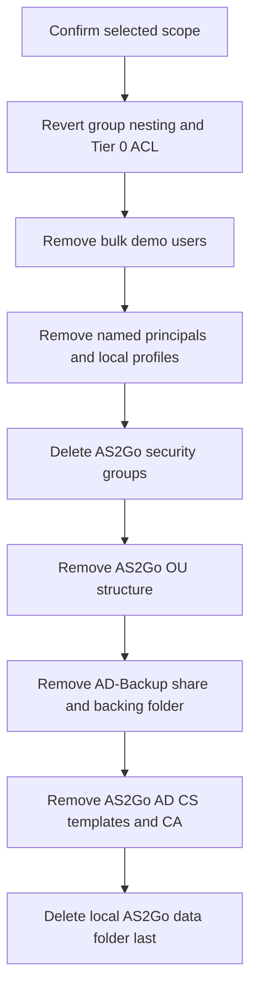

# ASP00 Remove AS2Go Lab

`Remove-AS2GoLab` is the public cleanup function for AS2Go lab objects. `Uninstall-AS2GoDemo` is an alias for the same function; both commands accept the same parameters. Run cleanup directly from an elevated PowerShell session, not through the `Initialize-AS2GoLab` setup menu.

The function removes selected categories of AS2Go lab data and asks for confirmation before the main removal run and before individual destructive actions. Use it only against the intended, explicitly authorized lab.

## Quick Start

Review the cleanup preview, then choose the categories to remove. To remove every category in the dependency-aware order, use:

```powershell
Remove-AS2GoLab -Preview
Remove-AS2GoLab -All
```

`Uninstall-AS2GoDemo -All` is equivalent. The live run displays the scenario, target server, and selected scope, then asks for confirmation. The default selection is **Quit**; choose **Yes** to proceed. Category-specific prompts may follow.

To remove selected categories only, pass one or more category switches, for example:

```powershell
Remove-AS2GoLab -DemoUser -DemoPrincipalSet
```

If no category switch or `-All` is supplied, the function displays a warning and performs no cleanup.

## Removal categories

| Switch | What it removes or reverts |
|---|---|
| `-DemoUser` | Removes tagged bulk demo users created by the Demo Users workflow for the selected scenario. |
| `-DemoPrincipalSet` | Removes the tagged named lab principals and compromised account, their SPN computer, and matching local user profiles on the computer running the command. Run it on the same machine used to create the principal set. |
| `-Groups` | Removes AS2Go group nesting from privileged AD groups and the configured local Administrators group, moves detected built-in privileged groups back to `CN=Users`, restores Tier 0 ACL inheritance, and deletes the configured AS2Go security groups. |
| `-AS2GoOU` | Recursively removes the configured AS2Go OU structure, including remaining objects under those OUs. A custom Demo Accounts search base is deleted only if it has the matching AS2Go creation tag. |
| `-Share` | Removes the `AD-Backup` SMB share and recursively deletes its backing `C:\temp\as2go` folder on the configured share server. |
| `-ADCS` | Removes scenario-tagged AS2Go certificate templates, decommissions `AS2GoRootCA`, and uninstalls the CA and Web Enrollment Windows features. `NTAuthCertificates` is not modified. |
| `-AS2GoFolder` | Deletes the entire local `%PUBLIC%\AS2Go` directory, including configuration, tools, logs, tickets, and other AS2Go data. |
| `-All` | Runs every category above, in the order described below. |

## Order used by `-All`

The full cleanup follows this dependency-aware sequence:



The local AS2Go folder is removed last because the earlier cleanup steps use the configuration it contains.

The function includes confirmation prompts within several categories. If an individual prompt is declined, that category can be left partly or entirely in place while later categories continue.

## Scenario matching and older lab setups

The default `-Scenario` value is `AS2Go`. The creation functions tag supported lab objects with a scenario marker; cleanup uses that marker and saved AS2Go settings to find the objects. Supply the same scenario value that was used during setup. A mismatched value can leave tagged objects behind.

The cleanup assumes objects use the current tag format `AS2Go|<Scenario>|ASP00|Create`. For environments created before that tagging scheme, first review and migrate the legacy markers with `Update-AS2GoLabAttribute`. Its `-WhatIf` switch reports candidate updates before writing tags. Use the same scenario value for migration and subsequent cleanup.

## Requirements and parameters

Run the function elevated with the Active Directory PowerShell module available and an account with Domain Admin-equivalent rights. `-Server` selects the domain controller used for directory operations; when omitted, AS2Go uses the current logon server. The Share, AD CS, and local-profile cleanup also need the corresponding remote or local administrative access.

| Parameter | Effect |
|---|---|
| `-Preview` | Displays the cleanup preview and returns without running removal actions. |
| `-DemoUser`, `-DemoPrincipalSet`, `-Groups`, `-AS2GoOU`, `-Share`, `-ADCS`, `-AS2GoFolder` | Selects one or more cleanup categories. |
| `-All` | Selects every cleanup category and uses the required removal order. |
| `-Scenario` | Matches objects created with that scenario label; defaults to `AS2Go`. |
| `-Server` | Specifies the domain controller for directory operations; defaults to the current logon server. |

## Changes not reverted automatically

`Remove-AS2GoLab -All` does not reverse every change an AS2Go setup or exercise may have made. Review and restore these separately where applicable:

- DNS zone transfers set to `TransferAnyServer` by **MDI Triggers**.
- Microsoft Defender real-time monitoring settings and folder exclusions changed by **Malicious Tools** or attack workflows.
- The MDI service-side honeytoken registration.
- The Certificate Services Client auto-enrollment GPO setting configured manually after AD CS installation.
- The AS2Go CA certificate in `NTAuthCertificates`, if it was published there.
- PowerShell Remoting enabled on an Admin PC by the SAW setup.
- Any files copied into the share folder or AS2Go data folder that should be retained.

The function prints progress and warnings for missing objects; it does not produce a dedicated result object. Review the completion output and verify the lab state after cleanup. Take a coordinated snapshot before cleanup if the environment may need to be restored.

## Related documentation

- [ASP00 Installation and Setup](ASP00-Setup.md)
- [ASP00 Demo Accounts](ASP00_DemoAccounts.md)
- [ASP00 Backup Share](ASP00_BackupShare.md)
- [ASP00 AD CS](ASP00_ADCS.md)
- [Public cleanup function: `Remove-AS2GoLab`](../Public/Remove-AS2GoLab.ps1)
- [Legacy tag migration: `Update-AS2GoLabAttribute`](../Public/Update-AS2GoLabAttribute.ps1)
