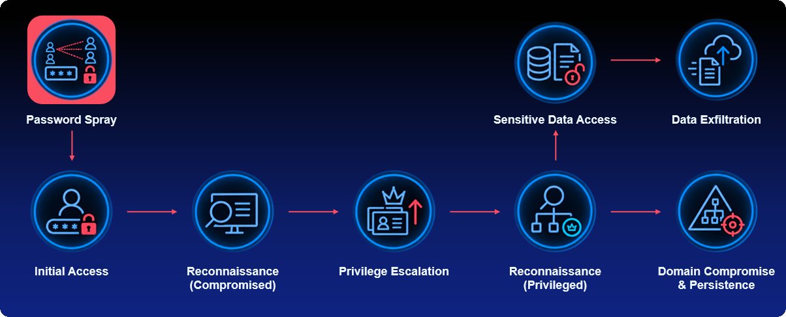

# ASP04 | Password Spray

ASP04 demonstrates how one chosen test password can be checked against enabled accounts in an authorized AS2Go lab. You start the phase through the AS2Go menu; the menu then guides you through scope and password choices.

Complete the shared preparation in [ASP00 Installation and Setup](ASP00__Setup.md) first. As with the other attack phases, run the scenario using the appropriate lab sign-in rather than the Enterprise Admin account used for installation.

## **Menu option**

Start `Start-AS2GoDemo` and select **Brute Force or Password Spray**. Choose the password-spray scenario when prompted. The phase can also be started directly through the public `Invoke-ASPhase04BruteForceAttack` function.

## What the phase does

Before starting, ASP04 displays password-policy information for the domains in the forest, including enabled-user counts, minimum password length, complexity, and account lockout settings. You then confirm the target scope, choose a test password, and decide whether each account's own `samAccountName` should also be tested as its password.

The phase checks enabled user accounts within the selected scope. It does not create, modify, or disable Active Directory objects. Authentication attempts can still trigger account lockouts and security monitoring.

## Choose the target scope

The scope menu lets you decide which part of Active Directory the demonstration will query:

| Menu choice | What it includes |
|---|---|
| **Current Domain** | Enabled users in the domain of the current session, including users in its child OUs. This is the default selection. |
| **Forest Level** | Enabled users across every domain in the forest. ASP04 processes the domains one at a time. |
| **OU Level** | Enabled users in the selected organizational unit and its child OUs. You can reuse the previously selected OU or choose another one. |
| **Domain Level** | Intended to let you select a specific domain through the AD Object Picker. The current implementation does not correctly handle the picker result, so this choice may not proceed as expected. Use **Current Domain** or **Forest Level** until this is corrected. |
| **Skip** | Leaves the phase without starting the password checks. |

After choosing a scope, review the displayed target and proceed, skip, or change the scope. Selecting **Forest Level** means all domains in the forest, not only the current domain. Selecting an OU limits the account search to that OU's subtree.

## Choose your test password

ASP04 offers the previously configured test password and lets you keep it or enter a different one. The password must be non-empty and at least as long as the greatest minimum password length reported for any domain in the forest.

Use a dedicated lab test password, not your personal or current sign-in password. The selected value is stored in the AS2Go configuration on this computer using machine-scoped DPAPI protection, so a later run can offer it again. The prompt displays the saved value, and successful results include the password that worked. Treat the console, transcripts, and recordings as sensitive.

The displayed lockout policy is information for your decision; ASP04 does not calculate a safe attempt count or enforce a limit based on that policy. Confirm that the scope and test password are appropriate for the lab before proceeding.

## Option: test each `samAccountName` as a password

ASP04 asks whether it should also try each enabled user's own `samAccountName` as that same user's password:

- **Yes:** ASP04 first tries the chosen test password. If that attempt fails, it tries that account's `samAccountName` as the password for that account. This can result in up to two attempts per account.
- **No:** ASP04 tries only the chosen test password once per account.
- **Cancel:** ASP04 cancels the password-spray run before authentication attempts begin.

This option does not try every user's name against every other account. The fallback is tested only against the matching account.

## What to expect

ASP04 shows progress in the console and reports successful accounts, including which password was accepted. It does not export a separate results file or return the result objects to the caller's pipeline. The process uses up to 15 parallel workers by default. You can press **Q** in the console to attempt to stop the running job.

## Requirements and operational impact

- The Active Directory PowerShell module must be available, and the host must be able to query the selected domain or forest.
- The implementation checks enabled accounts and validates credentials against the domain. It does not check for membership in a particular administrator group; the assessment identity needs the directory access required by the selected scope.
- Failed authentication attempts can increase bad-password counters, lock accounts, and generate domain-controller and monitoring events. Coordinate with the lab owner and monitor the run.
- ASP04 does not enforce an attempt rate or derive a safe number of attempts from the displayed lockout policy.

## Troubleshooting

| Symptom | Likely cause | What to check |
|---|---|---|
| The Active Directory module is reported missing. | RSAT Active Directory tools are unavailable on the host. | Install or enable the Active Directory PowerShell module, then start a new PowerShell session. |
| Forest or domain information cannot be retrieved. | The host cannot reach a domain controller, or the current identity lacks required directory read access. | Verify connectivity and access for the selected scope. |
| No accounts are processed. | No enabled users were found in the selected domain or OU subtree. | Review the confirmed scope and check that enabled user accounts exist there. |
| The new test password is rejected by the prompt. | It is blank or shorter than the greatest minimum password length displayed for the forest. | Enter a non-empty test value that meets the displayed length. |
| Accounts lock or the run stops unexpectedly. | Authentication attempts reached a lockout policy, the user cancelled, or an environment issue interrupted processing. | Stop further runs, coordinate with the AD owner, review domain-controller events, and reassess the scope and policy. |

## Related documentation

- [ASP00 Installation and Setup](ASP00__Setup.md)
- [Security Policy and authorized use](../SECURITY.md)
- [ASP04 phase walkthrough](../Phases/ASP04.html)
