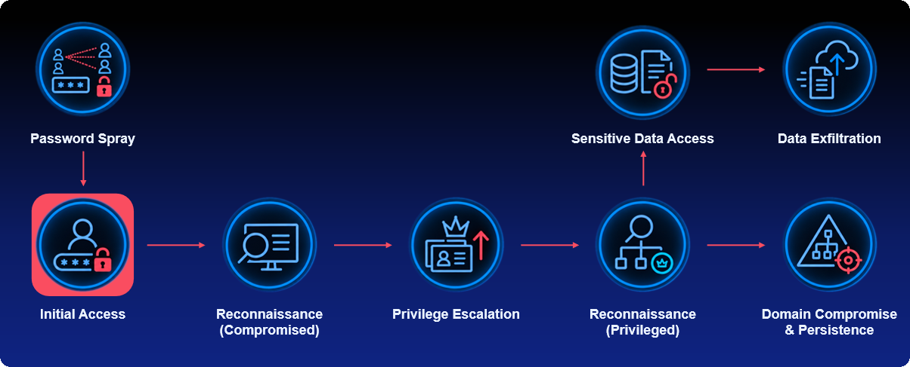

# ASP05 | Initial Access

ASP05 reviews the current account's Active Directory information and local security context. It displays the account, domain, password policy, group membership information available to the account, local administrator membership, and token elevation status. ASP05 does not perform a password spray or authenticate as another user.

Complete the shared preparation in [ASP00 Installation and Setup](ASP00-Setup.md) first. Run ASP05 in the Windows session signed in as the compromised or scenario account, not the Enterprise Admin session used for setup.

## **Menu option**

Start `Start-AS2GoDemo` and select **Initial Access**. The phase can also be started directly with `Invoke-ASPhase05InitialAccess` (alias: `ASP05`).

## Tier 0 group visibility

During AS2Go asset setup, privileged groups such as **Domain Admins (DA)** and **Enterprise Admins (EA)** can be moved into the `T0 Groups` OU beneath the AS2Go Tier 0 assets. Setup applies an inherited deny permission on that OU for the configured AS2Go scenario-user group (by default, `SG-AS2Go-Users`). This prevents the scenario user from enumerating the protected Tier 0 groups and reading their memberships.

Therefore, a newly created AS2Go scenario user may not see DA, EA, or their memberships in the ASP05 directory output. This is expected and demonstrates the Tier 0 visibility boundary configured by the lab. ASP05 reports the information available to the current account; missing group entries do not indicate that the groups or memberships are absent. The current Windows token group list is shown separately and reflects the signed-in session.

See [ASP00 Installation and Setup](ASP00-Setup.md) for the lab setup workflow and [ASP00 AS2Go Assets](ASP00_AS2GoAssets.md) for the tiered OU and group layout.

## Safe Mode

With `-SafeMode`, ASP05 skips the Active Directory account and group lookup. It still reports local administrator membership and token elevation status.

## Requirements

- A domain-connected Windows session using the account being assessed.
- The Active Directory PowerShell module for the directory information lookup.
- Directory permissions sufficient to read the requested account and group information. The AS2Go Tier 0 ACL intentionally limits visibility for scenario users.

## Related documentation

- [ASP00 Installation and Setup](ASP00-Setup.md)
- [ASP00 AS2Go Assets](ASP00_AS2GoAssets.md)
- [ASP05 phase walkthrough](../Phases/ASP05.html)
