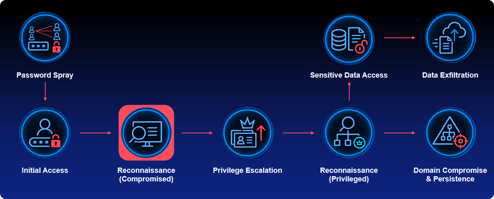

# ASP06 | Reconnaissance

ASP06 demonstrates what the current compromised domain account can discover and access during reconnaissance. The baseline reviews forest and domain information, privileged group memberships, computer accounts, and domain controllers. It also attempts to list the configured admin workstation's `C$` share and one domain controller's `C$` share in each forest domain.

Complete the shared preparation in [ASP00 Installation and Setup](ASP00__Setup.md) first. Run this phase in the Windows session signed in as the compromised or scenario account, not the Enterprise Admin session used for setup.

## **Menu option**

Start `Start-AS2GoDemo` and select **Recon**. The phase can also be started directly with `Invoke-ASPhase06Reconnaissance` (alias: `ASP06`).

## Baseline reconnaissance

In the interactive workflow, ASP06 asks whether to run the baseline checks. If you continue, it:

- Displays forest and domain details and identifies privileged groups.
- Attempts to enumerate Domain Admins membership.
- Lists up to ten enabled, non-domain-controller computer accounts with operating-system and last-logon information.
- Attempts to list the configured admin workstation's `C$` share if the host responds to ping.
- Enumerates domain controllers and attempts to list the `C$` share of one controller in each forest domain.

Results depend on the signed-in account's directory permissions, network reachability, firewall rules, and share permissions. A failed access attempt is reported; it does not change the target system. Share checks can generate network and authentication events.

## Optional extended reconnaissance

After the baseline, the interactive workflow asks whether to run additional tasks. These include:

- Enumerating members of **DNSAdmins** and **Enterprise Admins**.
- Opening `nslookup` and copying a DNS zone-transfer command to the clipboard. The command is not entered automatically; running it is a separate action.
- Using `NetSess.exe` to list NetBIOS sessions on the configured domain controller.
- If a honeytoken is configured, attempting an Active Directory query using that account with a random password. This failed authentication attempt can generate security events and monitoring alerts.

These actions may produce additional authentication, DNS, and endpoint telemetry. Confirm that the lab is authorized and monitoring is ready before choosing the extended tasks. See [ASP00 MDI Triggers](ASP00_MDITriggers.md) for optional honeytoken setup.

## Safe Mode and unattended execution

With `-SafeMode`, the phase offers only the option to skip the reconnaissance checks. In unattended mode, baseline reconnaissance runs automatically unless Safe Mode is enabled; extended reconnaissance is skipped because it requires a separate interactive choice.

## Requirements

- A domain-connected Windows session and the Active Directory PowerShell module.
- Working DNS and network connectivity to the configured domain controllers and, for share checks, the configured admin workstation.
- The configured lab values for the admin workstation and domain controller. Extended tasks also require their configured group and optional honeytoken settings; `NetSess.exe` is required for session enumeration.

## Related documentation

- [ASP00 Installation and Setup](ASP00__Setup.md)
- [ASP00 MDI Triggers](ASP00_MDITriggers.md)
- [ASP06 phase walkthrough](../Phases/ASP06.html)
