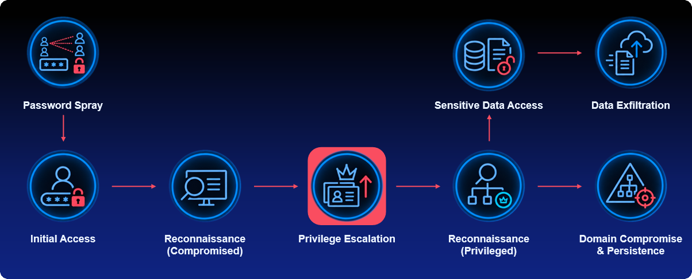

# ASP07 | Privilege Escalation



ASP07 is the entry point for the privilege escalation phase. It presents the available techniques and starts the selected workflow. Each technique is documented separately; this page is an overview only.

Complete the shared preparation in [ASP00 Installation and Setup](ASP00-Setup.md) first. Run the phase in the Windows session signed in as the compromised or scenario account, not the Enterprise Admin session used for setup.

## **Menu option**

Start `Start-AS2GoDemo` and select **Escalate**. You can also start ASP07 directly with `Invoke-ASPhase07PrivilegeEscalation` (alias: `ASP07`).

```powershell
# Start the phase and choose a technique interactively.
Invoke-ASPhase07PrivilegeEscalation

# Review the phase description without running its actions.
Invoke-ASPhase07PrivilegeEscalation -Preview
```

ASP07 displays a confirmation prompt in interactive mode, then opens the technique selection. Options whose requirements are not met may be hidden. Pass `-SkipImages` to suppress phase visuals, `-SkipClearHost` to retain existing console output, or `-EnableLogging` to enable phase logging.

## Phase flow

- Prepare the lab and sign in as the account selected for the scenario.
- Start ASP07 from the attack navigation or invoke the phase directly.
- Review the available options and choose one technique, or skip the phase.
- Follow the technique-specific guide for its prerequisites, actions, and impact.

The phase may also run as part of the larger `Start-AS2GoDemo` workflow, after Initial Access and Reconnaissance and before Privileged Reconnaissance. Starting ASP07 directly runs this phase only.

## Technique guides

The phase menu can start these workflows. Use the linked page for the individual walkthrough; this overview does not describe their execution steps.

| Menu option | Separate guide |
|---|---|
| Overpass-the-Hash | [ASP07 Overpass-the-Hash](ASP07_OverPassTheHash.md) |
| Pass-the-Ticket on a local machine | [ASP07 Pass-the-Ticket, local](ASP07_PassTheTicketLocalMachine.md) |
| Pass-the-Ticket on a remote machine | [ASP07 Pass-the-Ticket](ASP07_PassTheTicket.md) |
| Kerberoasting | [ASP07 Kerberoasting](ASP07_Kerberoasting.md) |
| AD CS certificate template abuse (ESC1) | [ASP07 ESC1](ASP07_ESC1.md) |
| PsExec as Local System | [ASP07 Run-as Different Privileges](ASP07_LocalSystem.md) |
| Credential theft via memory access | [ASP07 Memory Access](ASP07_MemoryDump.md) |
| Enable memory access for credential theft | [ASP07 Memory Access](ASP07_MemoryDump.md) |
| Replay a stored credential | [ASP07 Stored Credential](ASP07_StoredCredential.md) |

The [ASP07 attack compatibility reference](../Phases/ASP07_Attack-Compatibility-Reference.html) provides a cross-technique view of requirements and compatibility.

## Requirements and operational impact

Use the prepared, explicitly authorized lab described in [ASP00 Installation and Setup](ASP00-Setup.md). Run the phase from the scenario account's session. The exact directory permissions, tools, host configuration, network access, and side effects depend on the selected technique; check its guide before running it. ASP07 can launch actions that change security state or generate authentication, process, network, and monitoring events. It is not a read-only phase.

`-Preview` displays the preview workflow and returns before the phase's live actions. It does not validate lab readiness or permissions. Skipping images or clearing the console does not change the selected technique's behavior.

## Related documentation

- [ASP00 Installation and Setup](ASP00-Setup.md)
- [ASP05 Initial Access](ASP05_Initial-Access.md)
- [ASP06 Reconnaissance](ASP06_Reconnaissance.md)
- [ASP09 Privileged Reconnaissance](ASP09_Reconnaissance-Privileged.md)
- [ASP07 phase overview](../Phases/ASP07.html)
- [ASP07 attack compatibility reference](../Phases/ASP07_Attack-Compatibility-Reference.html)
