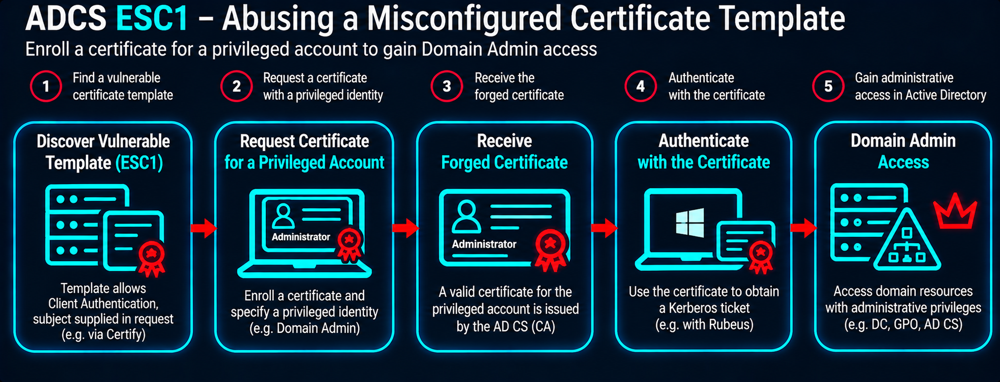

# ASP07 ADCS ESC1 Guide | Invoke-PrivilegeEscalationViaESC1

*Kill-chain Phase 07, privilege escalation — abuse a misconfigured AD CS certificate template to mint a certificate for any account, then convert it into Domain Admin access via Kerberos PKINIT. No credential theft, no hash — the CA issues the attacker an identity.*



> For explicitly authorized lab environments only. Run from an initialized AS2Go module session.

---

## 1. What this workflow does

[Invoke-PrivilegeEscalationViaESC1](../Private/ASP07/Invoke-PrivilegeEscalationViaESC1.ps1) walks the ESC1 chain in five steps:

| Step | Action | Details |
|---|---|---|
| 0 | Confirm the phase | Decision prompt; in `-SafeMode` only `Skip` is offered |
| 1 | Identify the vulnerable template | [Get-VulnerableCertificateTemplate](../Private/ASP07/Get-VulnerableCertificateTemplate.ps1) — LDAP filter on `pKICertificateTemplate` with `msPKI-Certificate-Name-Flag=1` (enrollee supplies the subject) and the Client-Authentication EKU; enroll-permission audit per template with a "Bingo" mark when **Domain Users (-513), Everyone (S-1-1-0) or Authenticated Users (S-1-5-11)** hold the enroll right |
| 2 | Select the impersonation target | `Set-AlternativeAccount` — the victim identity (UPN + SID) that the certificate will claim |
| 3 | Mint the certificate | [Request-PfxWithCertify](../Private/ASP07/Request-PfxWithCertify.ps1) — `certify.exe request --ca <CA> --template <name> --upn <victim-UPN> --sid <SID>`, CA-ping pre-check, PFX Base64 captured from the output |
| 4 | Convert to a TGT | [Request-TGTWithRubeus](../Private/ASP07/Request-TGTWithRubeus.ps1) — `Rubeus.exe asktgt /user:<victim> /domain:<FQDN> /certificate:<PFX> /ptt /enctype:aes256` performs **PKINIT** and injects the TGT of the *claimed* identity |
| 5 | Prove the access | Ticket cache before/after, last-ticket detail, and `Test-AccessToOneDCPerDomain` — Domain Admin access forest-wide, obtained without ever having a password |

Both main steps have their own repeat prompts (retry the certificate request or the TGT request independently).

Reach it from the Phase 07 menu option *AD CS – ESC1*.

---

## 2. Why ESC1 is the AD CS crown jewel

- **The CA becomes a credential-issuing oracle**: ESC1 combines two template mistakes — *enrollee supplies the subject* (`ENROLLEE_SUPPLIES_SUBJECT` flag set) and *Client-Authentication EKU* — with too-permissive enroll rights. The result: any user in the enroll group can request a certificate claiming *any* identity, including Domain Admin.
- **PKINIT turns a certificate into a TGT**: with `Smart Card Logon`-compatible EKUs, the certificate authenticates against Kerberos directly (`Rubeus asktgt /certificate`). No password is ever touched — password resets do **not** kill this access until the certificate is revoked or the template fixed.
- **`--sid` rides with the SAN**: Certify takes the victim's UPN and object SID into the request, so the issued certificate carries the identity attributes the KDC maps to the account. The demo shows both attributes explicitly in the command.
- **The security lesson in one line**: a certificate template is a privilege-issuance policy — audit it like a Tier-0 group. The three ESC1 ingredients (subject-supplied SAN, client-auth EKU, broad enroll permission) are individually innocent; together they are a one-click Domain Admin mint.

---

## 3. Safe Mode and unattended execution

In `-SafeMode` the phase offers only `Skip`. Unattended mode runs the full chain automatically — vulnerable-template resolution, alternative-account selection, Certify request, and the Rubeus TGT — using the persisted `BadCA` template setting and configured alternative account.

---

## 4. Working notes from the lab

### 4.1 The "Bingo" audit marks permissive enrollers

The enroll-permission check walks each risky template's DACL and flags enrollers by SID pattern: `-513` (Domain Users), `S-1-1-0` (Everyone), `S-1-5-11` (Authenticated Users) are red-flagged as *Bingo!*; `-515` (Domain Computers) is tracked separately because computer-context enrollment needs a different Certify invocation (`/machine`). This mirrors the real audit question: *who can enroll in a template that lets them be anyone?*

### 4.2 The template choice persists in `BadCA`

The selected vulnerable template is stored in the `BadCA` module setting (DPAPI-protected), so repeat runs and Verify-Config checks use the same template — consistent across the ESC1 demo and its troubleshooting page ([ASP07_ESC1-Troubleshooting.html](../Phases/ASP07_ESC1-Troubleshooting.html)).

### 4.3 The CA reachability check precedes the request

`certutil -config <CA> -ping` runs before Certify — a quick, tool-free check that distinguishes "template misconfigured" from "CA unreachable" failures. Good debugging pattern to point out in code review (and in the troubleshooting page).

### 4.4 Certify's PFX Output is regex-captured

The certificate request output's `[*] Certificate (PFX): <base64>` blob between the label and `Certify completed` is captured with a whitespace-tolerant regex and passed to Rubeus as `/certificate:` — no intermediate file, the PFX stays in memory.

### 4.5 The `enctype:aes256` choice matters for detection

The Rubeus call requests an AES-256 TGT (`/enctype:aes256`) — the *legitimate-looking* etype, unlike classic Kerberoasting's RC4 tells. The PKINIT AS-REQ (with the certificate) produces Event 4768 with pre-auth type **PKINIT (0x0F)** — the DC-side signal differs entirely from the hash-reuse paths in sections 5.

---

## 5. What defenders observe (Blue Team notes)

- **The issuance event is the golden trace**: a certificate minted for a privileged account from a host that never should enroll there is Event **4887/4886** (Certificate Services issued/requested) with the *requested SAN in the message*. Alert when the requested subject ≠ the enroller, or when the enroller is a user (not a system account) and the subject is Tier-0. MDI and AD CS-aware SIEM rules package this as ESC1 detection.
- **The PKINIT TGT is auditable**: Event **4768 with Pre-Auth Type 15 (PKINIT)** for a DA-class account from an unusual host — certificate-based logons are rarer than password logons and stand out in per-account baselines. The subsequent usage is normal Kerberos (clean etype), so the 4768 moment is the entry point for the whole session.
- **The template audit is the preventive control**: the workflow's LDAP filter *is* the audit query. Run it internally (or with a tool like Certify's `/enrollment` or PetéR) — `ENROLLEE_SUPPLIES_SUBJECT` + Client Authentication EKU + broad enroll groups = the exact combination; AS2Go provisions the deliberately-vulnerable template and the audit finds it. Remove any one ingredient to kill ESC1.
- **The hardening ladder**: fix template flags (manager-approves / no enrollee-supplies-subject for auth EKUs) → restrict enroll groups → Tier-0 accounts out of SAN-claimable entirely → monitor 4887 SAN mismatches + 4768 PKINIT anomalies → consider full certificate binding hardening (strong mapping, gMSA-style separation).
- **Why this beats stealing hashes**: password resets, KRBTGT rotations, and Credential Guard all defeat the hash/ticket theft paths. A valid certificate survives password changes until revoked — certificate *revocation management* becomes the control that matters.

---

## 6. Command quick reference

```powershell
# 1) The audit filter (as the workflow displays it — run against your forest):
$SearchFilter = "(&(objectClass=pKICertificateTemplate)(cn=<PublishedTemplate>)" +
                "(msPKI-Certificate-Name-Flag=1)(msPKI-Certificate-Application-Policy=" +
                "1.3.6.1.5.5.7.3.2))"
Get-ADObject -SearchBase "CN=Certificate Templates,CN=Public Key Services," +
    "CN=Services,CN=Configuration,<forestDN>" -LDAPFilter $SearchFilter -SearchScope OneLevel

# 2) CA reachability (pre-check the workflow makes):
certutil -config "<ENROLLMENT-CA>" -ping

# 3) Mint the certificate (as the workflow runs it):
.\Certify.exe request --ca <ENROLLMENT-CA> --template <BadTemplate> `
    --upn <victim-UPN> --sid <victim-SID>

# 4) Convert to a TGT (PKINIT) and inject:
.\Rubeus.exe asktgt /user:<victim> /domain:<FQDN> /certificate:<PFX> /ptt /enctype:aes256
klist
dir \\<DC-FQDN>\c$

# 5) Defender view — the PKINIT moment on the DC:
Get-WinEvent -FilterHashtable @{ LogName = 'Security'; Id = 4768, 4887 } `
    -MaxEvents 200 -ComputerName <DC-FQDN> |
    Where-Object { $_.Message -match 'PKINIT|0xF' -or $_.Id -eq 4887 } |
    Select-Object TimeCreated, Message | Format-List
```

The workflow itself requires no manual commands — run `Invoke-PrivilegeEscalationViaESC1` from the Phase 07 menu, confirm the template, pick the target account, and Certify + Rubeus run the mint-and-authenticate chain.

---

## 7. Related

- Phase diagram: [ASP07_ESC1.html](../Phases/ASP07_ESC1.html)
- Troubleshooting page for this workflow: [ASP07_ESC1-Troubleshooting.html](../Phases/ASP07_ESC1-Troubleshooting.html)
- Provisioning/decommissioning the ESC1 lab template: [New-ESCxCertficateTemplate.ps1](../Private/ASP00/New-ESCxCertficateTemplate.ps1) and Verify-Config's ESC1 check
- Attack matrix cross-reference: [ASP07_Attack-Compatibility-Reference.html](../Phases/ASP07_Attack-Compatibility-Reference.html)
- MITRE ATT&CK: Steal or Forge Authentication Certificates [T1649](https://attack.mitre.org/techniques/T1649/), Kerberos authentication sibling [T1558](https://attack.mitre.org/techniques/T1558/)
