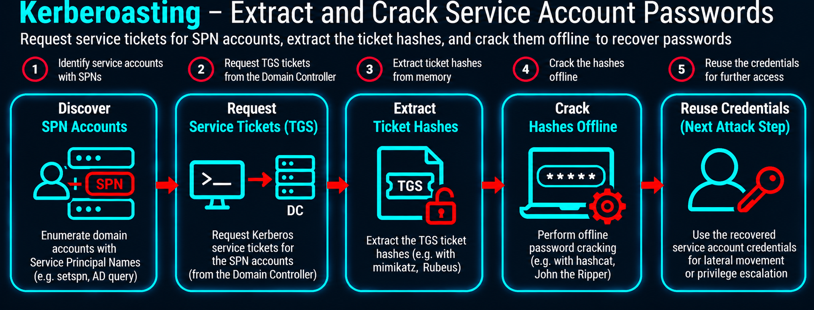

# ASP07 Kerberoasting Guide | Invoke-KerberoastingAttack

*Kill-chain Phase 07, privilege escalation — request service tickets for every privileged account with a registered SPN, export the ticket hashes, and hand them to offline cracking with Hashcat. No exploit, no privilege required beyond a normal domain account — only a weak service-account password between the attacker and Domain Admin.*



> For explicitly authorized lab environments only. Run from an initialized AS2Go module session.

---

## 1. What this workflow does

[Invoke-KerberoastingAttack](../Private/ASP07/Invoke-KerberoastingAttack.ps1) launches the Kerberoasting demonstration; the engine is [Start-Kerberoasting](../Private/ASP07/Start-Kerberoasting.ps1):

| Step | Action | Details |
|---|---|---|
| 0 | Confirm the phase | Decision prompt; in `-SafeMode` only `Skip` is offered |
| 1 | Show the command | The exact Rubeus call is displayed before running: `Rubeus.exe kerberoast /domain:<FQDN> /dc:<DC> /outfile:<hashes>` |
| 2 | Select the target domain | Current user domain (default) or a specific forest domain via the domain picker |
| 3 | Roast with Rubeus | `Rubeus.exe kerberoast /ldapfilter:'admincount=1' /domain:<FQDN> /dc:<DC> /outfile:KR-<domain>.hashes.txt` — all TGS-REP hashes for accounts with `adminCount = 1` land in the exfiltration folder |
| 4 | Open the result | The hash file is opened (`Invoke-Item`) and the crack guidance with the Hashcat mode is shown |

The workflow exports hashes only — cracking is demonstrated as the follow-up step with a ready-to-use Hashcat example (`-a 3 -m 13100`, mask `?u?l?l?l?l?l?d?d`) but is not run automatically.

Reach it from the Phase 07 menu option *Kerberoasting*, or run `Invoke-KerberoastingAttack` directly.

---

## 2. Why Kerberoasting is the quiet privilege escalator

- **It needs no exploit and no elevation**: a Kerberoasting request is a *legitimate* KDC operation — any authenticated domain user can request service tickets for any SPN account. The attack lives entirely in a design property: service ticket encryption is keyed with the service account's own password hash, so the ticket can be taken offline.
- **`adminCount = 1` filters for the jackpot**: rather than roasting every SPN in the directory, the workflow targets accounts that are or were members of protected groups (Domain Admins, Schema Admins, …). One cracked hash from this set usually means Tier-0 access.
- **The offline part defeats lockout**: password guessing via Kerberos pre-auth fails cleanly per attempt; password guessing against a *cracked TGS hash* leaves no KDC trail at all. Unlimited attempts, no 4625 events, no lockout — only the cracked result eventually shows up as a suspicious logon.
- **The security lesson in one line**: the strength of every Tier-0 service account password is the Kerberos domain's real lockout policy — long, random, or group-managed (gMSA) passwords make the roast pointless; `adminCount=1` accounts with human-style passwords make it inevitable.

---

## 3. Safe Mode and unattended execution

In `-SafeMode` the phase offers only `Skip`. Unattended runs proceed with the **current user's domain** and write `KR-<dnsdomain>.hashes.txt` into the exfiltration folder without prompts; the file-`Invoke-Item` and crack guidance still appear after the export.

---

## 4. Working notes from the lab

### 4.1 The LDAP filter is the scope decision

`/ldapfilter:'admincount=1'` restricts the roast to privileged accounts. Drop or change the filter to demonstrate the trade-off: roasting the whole directory produces bigger files and louder noise; the privileged-only filter stays small and quiet — exactly how a real attacker narrows the set to what is crackable in a session.

### 4.2 Each run rewrites its target file

`KR-<domain>.hashes.txt` is deleted before each run, so results never mix across domains or reruns; switching domains in the picker writes a new file next to the old ones. File naming (`KR-` prefix) matches the KRBTGT/ASP07KR naming family in the exfiltration folder.

### 4.3 The Hashcat example is policy-aware

The guidance text says *"the password policy is known, so a brute-force or mask attack can be used"* — mode 13100 (Kerberos 5 TGS-REP etype 23) with a mask like `?u?l?l?l?l?l?d?d` mirrors the lab's demo-password pattern (capital + lowercase + digits). For the detection discussion this matters: **the crack happens off-domain**, so the defender's chance is the *roast* in section 5, not the crack.

### 4.4 Empty results mean wrong domain context

If no file is produced, the domain had no `adminCount=1` SPN accounts (typical in fresh child domains) — the warning suggests choosing a different domain, which is exactly the picker's purpose in multi-domain labs.

---

## 5. What defenders observe (Blue Team notes)

- **Event 4769 bursts from one account**: Kerberoasting is a flood of TGS-REQs for SPN accounts *without* correspondingly many service connections. Baseline: normal users collect a handful of service tickets incidentally; a roaster requests dozens–hundreds within seconds. Detect 4769 frequency per source with **RC4-HMAC encryption types (0x17)** — the downgrade signature of classic Kerberoasting.
- **The hash cracking leaves no DC trace**: once exported, offline password guessing is invisible to the domain. Detection has to happen *before* the export: MDI flags suspicious Kerberoasting activity on the TGS-REQ burst pattern; RC4 as requested etype by a human-context account is the second strong flag.
- **The remediation ladder, in order of effect**: gMSA (password is auto-managed, roasting yields nothing crackable), long random passwords (256-bit class — mask attacks die), AES-only service accounts (`etype 18` raises crack cost dramatically and removes the 0x17 tell), and finally removing unnecessary SPNs from Tier-0 accounts so nothing is roastable in the first place.
- **Success looks like password spraying's quiet cousin**: the cracked credential then appears as a normal logon (4726/4624 on the service account, or WinRM/RPC from unexpected sources). Watch Tier-0 service accounts' logon *sources*, not just their failures.
- **The hardening lesson**: every account holding `adminCount=1` with an SPN is a standing privilege-escalation offer to any domain user. The demo's filter choice is the checklist — audit that exact LDAP filter internally to know your own exposure count.

---

## 6. Command quick reference

```powershell
# The roast itself (as the workflow runs it):
.\Rubeus.exe kerberoast /ldapfilter:'admincount=1' /domain:<FQDN> /dc:<DC-FQDN> `
    /outfile:$env:PUBLIC\AS2Go\Exfiltration\KR-<domain>.hashes.txt

# Your own exposure audit — how many roastable privileged accounts has the domain?
Get-ADUser -Filter { adminCount -eq 1 -and servicePrincipalName -like '*' } `
    -Properties servicePrincipalName, PasswordLastSet |
    Select-Object SamAccountName, PasswordLastSet, @{N='SPN';E={$_.servicePrincipalName.Count}} |
    Format-Table -AutoSize

# Offline cracking guidance shown by the workflow:
.\hashcat.exe -a 3 -m 13100 .\KR-<domain>.hashes.txt ?u?l?l?l?l?l?d?d

# Defender view — the roast burst on a DC (encryption type 0x17 = RC4 tell):
Get-WinEvent -FilterHashtable @{ LogName = 'Security'; Id = 4769 } `
    -MaxEvents 500 -ComputerName <DC-FQDN> |
    Where-Object { $_.Message -match '0x17' } |
    Select-Object TimeCreated, Message | Format-List
```

The workflow itself requires no manual commands — run `Invoke-KerberoastingAttack` (or the Phase 07 menu), pick the domain, and the hash file opens with the crack guidance on screen.

---

## 7. Related

- Phase diagram: [ASP07_Kerberosting.html](../Phases/ASP07_Kerberosting.html)
- Phase 07 menu caller: [Invoke-Phase07PrivilegeEscalation.ps1](../Public/Invoke-Phase07PrivilegeEscalation.ps1)
- The same exfiltration folder reused for exported hashes: [ASP11 Data Exfiltration guide](ASP11_Data-Exfiltration.md)
- MITRE ATT&CK: Kerberoasting [T1558.003](https://attack.mitre.org/techniques/T1558/003/), Steal or Forge Kerberos Tickets [T1558](https://attack.mitre.org/techniques/T1558/)
