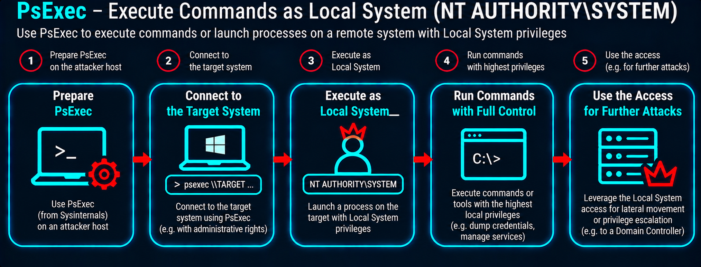

# ASP07 Run-as Different Privileges Guide | Invoke-PrivilegeEscalationViaLocalSystem

*Kill-chain Phase 07, privilege escalation — start an interactive session as Local System, the compromised Help Desk user, or the Domain Admin on the local machine, and understand how attacker tooling impersonates any context once credentials are available. This guide documents the **PowerShell-native replacements** for the previous PsExec-based workflow.*



> For explicitly authorized lab environments only. Run from an initialized AS2Go module session.

---

## 1. What this workflow does

[Invoke-PrivilegeEscalationViaLocalSystem](../Private/ASP07/Invoke-PrivilegeEscalationViaLocalSystem.ps1) offers three impersonation contexts in a repeat menu:

| Option | What it demonstrates | Native mechanism (replaces PsExec) |
|---|---|---|
| **Local System** | Session in the machine's SYSTEM context — full local control, domain-machine identity | Interactive pwsh session as SYSTEM via a scheduled task (`schtasks /ru SYSTEM /it ... /run`) — the same trick PsExec automates internally (create a service/task running as SYSTEM, launch interactive) |
| **HelpDeskUser** | Sessions as the compromised help-desk account (captured in the OpTH phase) | `runas /user:DOMAIN\user cmd.exe` (interactive password prompt) or `Start-Process -Credential $cred` when a PSCredential already exists |
| **Domain Admin** | Sessions as the Domain Admin (captured earlier in the kill chain) | Same as HelpDeskUser, with the DA credential |
| **Skip** | Leaves the menu | — |

Every option runs **locally** — this workflow does not start remote sessions (that is the ASP10 PsExec case, which stays on the tool). Start it from the Phase 07 menu option *PsExec*.

---

## 2. Why the three contexts matter

- **Local System closes the loop from endpoint compromise to machine context**: after local-admin access (Phase 04–07 chain), SYSTEM-level context means full token control, DPAPI master-key availability, and the machine account's domain context — the base for AD operations under the computer's own identity.
- **HelpDeskUser is the *captured* identity, not a guessed one**: the account was dumped in the Memory Dump/OpTH phase; running as it demonstrates that a harvested credential becomes a working session with its group memberships intact (the ticket/credential context follows the account, not the console).
- **Domain Admin is the same principle at Tier-0**: a DA session from a *workstation* is the tiering violation — the lesson the demo is built on.
- **The security lesson in one line**: once credentials are on a host, three native mechanisms (task-as-SYSTEM, runas, Start-Process -Credential) recreate any session without third-party tools — binary reputation cannot be the control; session origin monitoring can.

---

## 3. The PowerShell-native replacements (replacing PsExec)

### 3.1 Local System via scheduled task

```powershell
# One-shot task running interactive as SYSTEM, immediately fired:
$taskName = "AS2Go-SystemSession"
schtasks /create /tn $taskName /ru SYSTEM /sc ONCE /st 23:59 /it `
    /tr "pwsh.exe -NoExit" /f
schtasks /run /tn $taskName

# Cleanup afterwards:
schtasks /delete /tn $taskName /f
```

The `/it` flag makes the task interactive-only, so the window appears on the operator's desktop. This is functionally what `psexec -s -i` performs — minus the service-install artifacts and the PSEXESVC signature (which changes the detection story, section 5).

### 3.2 Run-as a captured account

```powershell
# Interactive password prompt (nativ, no stored plaintext needed):
runas /user:<DOMAIN>\<HelpDeskUser> cmd.exe

# With a PSCredential the module already holds (e.g. $global:BDCred from the backdoor phase):
Start-Process cmd.exe -Credential $global:BDCred
```

`runas` prompts for the password interactively; `Start-Process -Credential` accepts a PSCredential object, which the lab phases produce (`$global:BDCred`, `$global:BDCredUPN`). For the HelpDeskUser path the OpTH phase holds the account but not its plaintext password — use `runas` there, or convert a captured hash first via the OpTH ticket path.

### 3.3 What changes vs. the PsExec version

| Aspect | PsExec (`-s -i` / `-u -d -h -i`) | Native replacement |
|---|---|---|
| SYSTEM interactive | Service install (`PSEXESVC`) + process launch | Scheduled task (`schtasks`) — service-event story becomes task-history story |
| Run-as with password | PsExec prompts for the password | `runas` prompts natively; `Start-Process -Credential` uses a held PSCredential |
| EULA handling | `-accepteula` | not needed (first-party tooling) |
| Third-party dependency | PsExec.exe in tools folder | none — all three replacements ship with Windows |
| Console output | PsExec banner + pipe into session | direct — windows are plain `cmd`/`pwsh` |

The tool-check list (`Invoke-VerifyConfiguration`, `Initialize-AS2GoTools`, `Start-AS2GoDemo`'s FileVersion check, Tools/README, ASP00 MaliciousTools) can drop `PsExec.exe` once the local workflows no longer reference it — ASP10 still uses it for the *remote* console case.

---

## 4. Working notes from the lab

### 4.1 SYSTEM via task needs `/it` for interactivity

Without `schtasks /it`, a SYSTEM task runs headless — the pwsh window never appears. This flag is the detail worth pointing out; it is also why a pure `Start-ScheduledTask` cmdlet path is rarely used for interactive demos.

### 4.2 `runas` cannot take a password argument

`runas` always prompts interactively — by design. If the demo needs silent launches (unattended), the module's held PSCredentials (`Start-Process -Credential`) or a fresh `ConvertTo-SecureString` path is used instead. This is also why the workflow keeps the interactive `runas` for the attended path and does not attempt to automate password entry.

### 4.3 The domain prefix comes from the session, not the target

`$domain = $env:USERDOMAIN` builds `DOMAIN\user` at run time — matching the account as the session knows it. In multi-domain labs, verify the prefix matches the captured account's *own* domain (the OpTH phase stores `$Global:ASHelpDeskUser` without its FQDN; the display adds the prefix).

### 4.4 The repeat loop models attacker pivoting

Like the OpTH and Stored-Credential workflows, the menu repeats until `No` — an operator can try all three contexts in one sitting, which is exactly how real operators pick the working credential after capture.

---

## 5. What defenders observe (Blue Team notes)

- **The task path replaces a service install with task creation**: no more Event 7045 `PSEXESVC` — instead Event 4698 (scheduled task created) / 4699 (deleted) + Event 800/4703 task-scheduler logs, and a task registered under SYSTEM. Task-as-SYSTEM is legitimate for some software deployments; the signal is *interactivity* (`/it`) plus the image path (`pwsh`) on a workstation.
- **`runas` shows up cleanly**: Event 4624 Type 9 (NewCredentials) for `runas`/`Start-Process -Credential` with the logon-initiator process in the message. Baseline the *combination* — an interactive user session spawning another domain account's process is rare when it's not a designated break-glass or admin workflow.
- **Console-inheritance is the behavioral clue**: whichever mechanism, the spawned session inherits the caller's working directory and environment until the new logon is established — process-lineage analytics (Sysmon 1 parent-child chains: console → schtasks → pwsh on a workstation) catch all three variants with the same rule family.
- **The hardening ladder**: restrict local-admin membership (the pre-condition for the SYSTEM path), tiered sign-in locations (no DA logons on workstations — makes the DA option impossible to *capture* in the first place), Credential Guard (hashes/credentials unavailable to the capture phases feeding this one), and task/credential-process auditing as the detection backstop.
- **Why the replacement is also a security-positive demo point**: the attack no longer depends on an attacker-signed binary at all. Defenders who rely on EDR blocking `PSEXESVC` have no answer for `schtasks`+`pwsh` — the demo's message shifts from "block the tool" to "control the *identity contexts*".

---

## 6. Command quick reference

```powershell
# Local System (task-based, interactive):
schtasks /create /tn AS2Go-SystemSession /ru SYSTEM /sc ONCE /st 23:59 /it `
    /tr "pwsh.exe -NoExit" /f
schtasks /run  /tn AS2Go-SystemSession
# ... work in the spawned SYSTEM pwsh window ...
schtasks /delete /tn AS2Go-SystemSession /f

# HelpDeskUser / Domain Admin (interactive password):
runas /user:<DOMAIN>\<HelpDeskUser> cmd.exe
runas /user:<DOMAIN>\<DomainAdmin>  cmd.exe

# With a held PSCredential (silent, unattended-friendly):
Start-Process cmd.exe -Credential $global:BDCred
Start-Process pwsh.exe -Credential $cred -ArgumentList "-NoExit"

# Defender view — task creation + new-credential logon on the endpoint:
Get-WinEvent -FilterHashtable @{ LogName = 'Security'; Id = 4698, 4624 } `
    -MaxEvents 100 -ComputerName <LabPC-FQDN> |
    Select-Object TimeCreated, Id, Message | Format-List
```

The workflow itself requires no manual commands — run `Invoke-PrivilegeEscalationViaLocalSystem` (or the Phase 07 *PsExec* menu option), pick the context, and the replacement mechanism launches the session.

---

## 7. Related

- Phase diagram: [ASP07_PsExec.html](../Phases/ASP07_PsExec.html)
- Producers of the captured identities this menu runs as: [ASP07 Overpass-the-Hash guide](ASP07_OverPassTheHash.md), [ASP12 Backdoor User guide](../Docs/ASP12_BackDoorUser.md)
- The remote-console PsExec case (stays on the PsExec tool): [ASP10 Sensitive-Data-Access.md](ASP10_Sensitive-Data-Access.md)
- MITRE ATT&CK: Create or Modify System Process — Windows Scheduled Task [T1053.005](https://attack.mitre.org/techniques/T1053/005/), Create Process with Token [T1134](https://attack.mitre.org/techniques/T1134/)
