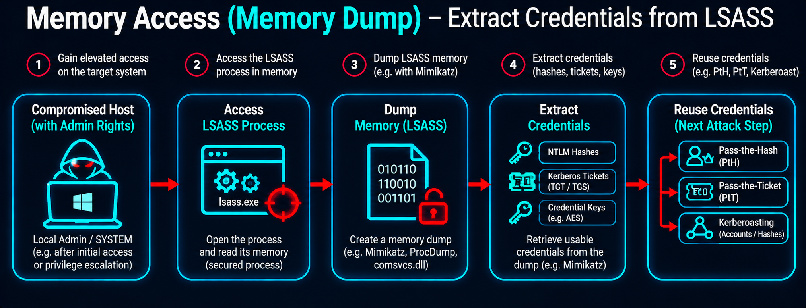

# ASP07 Memory Dump Guide | Invoke-PriviledgeEscalationViaMemoryAccess

*Kill-chain Phase 07, privilege escalation — read plaintext credentials from WDigest memory after enabling legacy credential storage, and understand why one registry value decides whether every later logon leaves its password in LSASS.*



> For explicitly authorized lab environments only. Run from an initialized AS2Go module session (elevated).

---

## 1. What this workflow does

[Invoke-PriviledgeEscalationViaMemoryAccess](../Private/ASP07/Invoke-PriviledgeEscalationViaMemoryAccess.ps1) runs on the **Lab PC** after WDigest plaintext storage was enabled:

| Step | Action | Details |
|---|---|---|
| 0 | Elevation check | `Test-LocalAdministrator` — the workflow aborts without an elevated session |
| 1 | Show the command | Mimikatz `sekurlsa::wdigest` displayed before running |
| 2 | Dump WDigest | Mimikatz `privilege::debug` + `sekurlsa::wdigest` with a session log into the exfiltration folder (`<timestamp>.mem`) |
| 3 | Parse the dump | [ConvertFrom-MemoryDump](../Private/ASP07/ConvertFrom-MemoryDump.ps1) extracts the unique WDigest principals (username, domain, **plaintext password**) |
| 4 | Enrich with AD | Every principal gets its domain FQDN (NetBIOS→FQDN resolution against `$Script:AllDomainsDetails`) and full AD group membership with RIDs resolved via `Get-ADPrincipalGroupMembership` |
| 5 | Display | The enriched sessions as a formatted list — account, plaintext password, domain, groups, logon server/time |

The paired setup step is [Set-UseLogonCredential](../Private/ASP07/Set-UseLogonCredential.ps1): it sets `HKLM:\SYSTEM\CurrentControlSet\Control\SecurityProviders\WDigest!UseLogonCredential = 1` and triggers `gpupdate /force` — after a logoff/logon (or cached cleartext refresh), subsequent interactive logons leave plaintext passwords readable in memory.

Reach it from the Phase 07 menu option *Memory Access (Memory Dump)*.

---

## 2. Why the WDigest dump matters

- **It is the one attack that yields plaintext, not hashes**: everything else in Phase 07 (PtH, OpTH, PtT, Kerberoasting) reuses *material*; a WDigest dump hands over the actual password — usable everywhere the account can type it, including MFA-protected portals where hashes and tickets are useless.
- **The registry enabler is the story**: by default, modern Windows never stores plaintext logon credentials. `UseLogonCredential = 1` restores the pre-2014-legacy behavior — and the demo shows how attackers (and old application compatibility advice) flip that switch, wait for logons, then harvest.
- **The kill chain connection**: this workflow's output is the direct feed for Phase 04 → 05 (sprayed/tested credentials) and the OpTH hash path — plaintext for the human workflows, hash for the protocol ones. The enriched group memberships tell the operator *which* captured password matters.
- **The security lesson in one line**: the `UseLogonCredential` registry value is a Tier-0 configuration on every workstation it appears on; monitor it, and treat any Mimikatz run on an endpoint regardless of what the AV said.

---

## 3. Safe Mode and unattended execution

The workflow has no SafeMode-specific branch: the confirmation prompt proceeds or skips. Unattended mode still requires elevation (hard check, aborts otherwise) and runs the dump without prompts; the enrichment always follows the parse.

---

## 4. Working notes from the lab

### 4.1 The setup step and the dump are paired by design

`Set-UseLogonCredential` (Phase 07 prerequisite menu) writes the registry value with a visible `Set-ItemProperty` command and forces the group-policy refresh. The registry write alone is often insufficient for already-running sessions — the header text notes that logoff/logon may be required before plaintext appears. The demo rhythm is: enable → let the demo account log on → dump → enrich → discuss.

### 4.2 The dump lands as a `.mem` session log

Mimikatz logs the `sekurlsa::wdigest` output into `<timestamp>.mem` in the exfiltration folder — same naming/pattern family as the OpTH `.pth` dump. [ConvertFrom-MemoryDump](../Private/ASP07/ConvertFrom-MemoryDump.ps1) parses the session blocks (one per logon session) and deduplicates principals.

### 4.3 NetBIOS→FQDN resolution feeds correct group lookups

Enrichment matches the captured `Domain` (NetBIOS form, e.g. `WS19-CH01`) against `$Script:AllDomainsDetails` to get the FQDN, then queries `Get-ADPrincipalGroupMembership -Server <FQDN>`. This keeps group resolution correct in multi-domain forests where the same SamAccountName exists in several domains — the same pattern the OpTH recommendation uses.

### 4.4 Empty dump is a legitimate outcome

If the WDigest storage is off (default) or no interactive logon happened since the toggle, the dump is empty and the workflow reports exactly that. In workshop flow, that's the *positive* demonstration: the default Windows behavior protects credentials; the toggle is the attack action.

### 4.5 Plaintext output is intentionally visible in the console

The enriched list shows account + password + groups in cleartext on the console — an honest demonstration of what a real attacker sees. For recordings/screenshots, treat the console as sensitive material (the same warning applies to the saved `.mem` file in the exfiltration folder).

---

## 5. What defenders observe (Blue Team notes)

- **The registry write is the earliest detection**: `UseLogonCredential` changes land as Event **4657** (registry value modified) or Sysmon Event 13 targeted at `HKLM\SYSTEM\CurrentControlSet\Control\SecurityProviders\WDigest`. No legitimate operation touches this key — alert on it with zero tolerance. PowerShell's own `Set-ItemProperty` path is visible in Event 4104/4688.
- **The dump is the classic LSASS handle**: `sekurlsa::wdigest` opens LSASS with debug privileges — Sysmon Event 10 with GrantedAccess `0x1010`/`0x1038`-class masks targeting `lsass.exe`, or the Mimikatz process-creation chain (4688/Sysmon 1). This is the same detection family as opth/pth harvesting; the binary changes, the handle access persists.
- **Plaintext in memory is a config drift signal**: monitor the WDigest key across the estate (config baseline, Defender for Identity — which flags `WDigest downgrade`-style activities). A domain where this value flips is post-preparation for credential harvesting — the demo shows why the alert is urgent, not informational.
- **The follow-up is normal-looking logons**: a cracked plaintext password means *interactive* logons (4723/4624 Type 2 from anywhere) — invisible to per-account failure analytics. The capture-to-reuse chain reinforces the zero-trust principle: endpoint compromise of one workstation with a privileged cached logon = domain incident.
- **The hardening ladder**: keep `UseLogonCredential = 0` (default, verify with policy monitoring), Credential Guard (plaintext never materializes even with the key set), LSA protection/PPL, restricted local-admin membership (the elevation pre-condition for every step), and EDR that alerts on registry-key + LSASS-handle combinations rather than on filenames.

---

## 6. Command quick reference

```powershell
# 0) The setup step (paired, as the workflow chain does):
Set-ItemProperty -Path HKLM:\SYSTEM\CurrentControlSet\Control\SecurityProviders\WDigest `
    -Name UseLogonCredential -Value 1
gpupdate /force /wait:0

# 1) The dump (as the workflow runs it):
.\mimikatz.exe "log $env:PUBLIC\AS2Go\Exfiltration\<timestamp>.mem" `
    "privilege::debug" "sekurlsa::wdigest" "exit"

# 2) The enrichment concept (what ConvertFrom-MemoryDump + the AD lookup do):
#    wdigest output blocks → unique principals → Get-ADPrincipalGroupMembership -Server <FQDN>

# 3) Defender view — the registry enabler on any endpoint:
Get-WinEvent -FilterHashtable @{ LogName = 'Security'; Id = 4657 } `
    -MaxEvents 100 -ComputerName <LabPC-FQDN> |
    Where-Object { $_.Message -match 'WDigest' } |
    Select-Object TimeCreated, Message | Format-List

# 4) Defender view — the LSASS handle (Sysmon):
Get-WinEvent -FilterHashtable @{ LogName = 'Microsoft-Windows-Sysmon/Operational'; Id = 10 } `
    -MaxEvents 200 | Where-Object { $_.Message -match 'lsass' } |
    Select-Object TimeCreated, Message | Format-List
```

The workflow itself requires no manual commands — run the Phase 07 menu option to enable WDigest storage, log on with the demo account, then run `Invoke-PriviledgeEscalationViaMemoryAccess`.

---

## 7. Related

- Phase diagram: [ASP07_MemDump.html](../Phases/ASP07_MemDump.html)
- The enabler step: [Set-UseLogonCredential.ps1](../Private/ASP07/Set-UseLogonCredential.ps1)
- Dump parser: [ConvertFrom-MemoryDump.ps1](../Private/ASP07/ConvertFrom-MemoryDump.ps1)
- What captured credentials/hashes feed downstream: [ASP07 Overpass-the-Hash guide](ASP07_OverPassTheHash.md)
- MITRE ATT&CK: Credentials in Registry [T1552.002](https://attack.mitre.org/techniques/T1552/002/), OS Credential Dumping — LSASS Memory [T1003.001](https://attack.mitre.org/techniques/T1003/001/)
