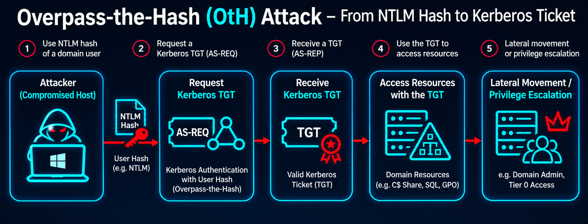

# ASP07 Overpass-the-Hash Guide | Invoke-OverPassTheHashAttack

*Kill-chain Phase 07, privilege escalation — turn a captured NTLM hash into a valid Kerberos TGT, using either the classic Mimikatz path (new command window) or the Rubeus path (in-session injection). The hash is the credential; the plaintext password is never needed.*



> For explicitly authorized lab environments only. Run from an initialized AS2Go module session.

---

## 1. What this workflow does

[Invoke-OverPassTheHashAttack](../Private/ASP07/Invoke-OverPassTheHashAttack.ps1) runs on the **Lab PC** where privileged users have recently logged on:

| Step | Action | Details |
|---|---|---|
| 0 | Ready-check | Lists the prerequisites (run as Administrator, no Credential Guard, no LSASS PPL, privileged test account logged on, DC reachable, RC4-HMAC accepted); aborts if the session is not elevated |
| 1 | Dump credentials | Mimikatz `sekurlsa::logonpasswords` with a session log into the exfiltration folder (`<timestamp>.pth`) |
| 2 | Analyze the dump | [ConvertFrom-CredentialDump](../Private/ASP07/ConvertFrom-CredentialDump.ps1) extracts unique principals; each gets its AD group membership resolved; the **best principal** is auto-recommended by privilege RID — Enterprise Admins (519), Domain Admins (512), Account Operators (548), in that order |
| 3 | Select the victim | Menu of found accounts with group memberships as Help content, recommended account preselected; domain, username, and NTLM hash are stored in `$Script:ASFQDN`/`$Global:ASHelpDeskUser`/`$Script:ASPtHntml` |
| 4 | Convert hash → TGT | Choose the tool: **Rubeus** (`asktgt /rc4:<hash> /ptt` — in-session injection) or **Mimikatz** (`sekurlsa::pth /run:pwsh.exe` — spawns a new elevated command window with the ticket) |
| 5 | Prove the access | After the Rubeus path: DC-per-domain access test, ticket table, last-ticket detail. After the Mimikatz path: guide to run `dir \\<logonserver>\c$` in the new window |
| 6 | Persist the loot | On confirmation, saves `FQDN\|user\|NTLM` into the DPAPI-protected `ASP07NT` setting for later reuse |

Reach it from the Phase 07 menu option *Overpass-the-Hash*.

---

## 2. Why overpass-the-hash matters

- **NTLM hashes authenticate in NTLM — and unlock Kerberos**: the classic PtH limitation was "works for NTLM auth only." OpTH removes that wall: the hash generates a valid Kerberos TGT via a real AS-REQ, and from that point everything Kerberos-authorized follows (SMB, WinRM, RPC, GPO, AD CS …). The attacker is now the account, in protocol terms.
- **The Lab PC is the harvesting point**: privileged admins (help desk, domain admins) log on to workstations; LSASS then holds their credential material. The demo's target — a Help-Desk/privileged account captured from a *workstation* — mirrors the real-world lesson that admin accounts must not browse/log on to user machines (tiering violation).
- **The two tool paths teach the same attack twice**: Mimikatz `sekurlsa::pth /run:pwsh.exe` injects the ticket into a *spawned* process (visible new window, clean session separation), Rubeus `asktgt /rc4 … /ptt` injects into the *current* session (faster, keeps the flow). Both produce the same artifact: a valid TGT for a stolen hash.
- **The security lesson in one line**: Credential Guard / LSASS PPL decide whether the dump step works at all — protect the harvest point, and NTLM-hash reuse dies with it. Where hashes remain capturable, disable RC4 so the AS-REQ fails (see section 5).

---

## 3. Safe Mode and unattended execution

In `-SafeMode`, the tool-selection menu is reduced to `Skip` only; the session elevated-admin check still runs first. Unattended execution skips the ready-check prompt but still dumps credentials, auto-selects the best principal, runs **Rubeus** (`asktgt … /ptt` runs without prompts), runs the per-domain access test, and saves the hash to `ASP07NT`.

---

## 4. Working notes from the lab

### 4.1 The best-principal ranking is RID-driven

`Get-ADPrincipalGroupMembership` resolves every found account's groups; the recommendation loop checks RIDs in priority order **519 (Enterprise Admins), 512 (Domain Admins), 548 (Account Operators)** and takes the most recently logged-on match for the first RID that appears. The preselected menu entry is the recommendation; operators can pick any other found account with Help showing its memberships.

### 4.2 The dump parser pairs username and hash from `msv`

`ConvertFrom-CredentialDump -Unique` reads the session log and merges duplicate principals. A previous fix (Version 2026.11.23.713) matters here: the NTLM hash is paired with the **`msv` block's** username rather than the `kerberos` block's — the two can name different accounts in the same session, which previously produced wrong hash/username pairs and broken PtH attempts downstream.

### 4.3 The two tool paths produce different validation flows

- **Rubeus path** runs in-session: `asktgt /user /domain /rc4 /ptt` immediately injects the TGT into the current logon session — the workflow then prints the ticket cache directly (`Get-KlistTicket`) and runs `Test-AccessToOneDCPerDomain` as the access proof.
- **Mimikatz path** spawns `pwsh.exe` via `sekurlsa::pth /run:pwsh.exe`: the ticket lives in the *new* window's session. The workflow cannot read it from the current process, so it prints the next command for the operator to run there: `dir \\<LogonServer>\c$`.

### 4.4 The saved setting feeds Invoke-StoredCredentialAttack

Storing to `ASP07NT` (DPAPI-protected, format `FQDN|user|NTLM`) makes the hash reusable from the Phase 07 *Stored Credential Attack* menu — the same pattern as `ASP07KR` for KRBTGT material. The three fields are exactly the args the PtH rerun needs.

---

## 5. What defenders observe (Blue Team notes)

- **The dump is the point of no return — and it is loud locally**: `sekurlsa::logonpasswords` opens LSASS with debug privileges. Sysmon Event 10 (process access to lsass.exe with GrantedAccess `0x1010`-class masks) and Event 8 (CreateRemoteThread into LSASS) are the highest-fidelity detections, available only with EDR/Sysmon on the target host. Credential Guard removes the harvested material; PPL raises the bar; neither produces DC-side events — endpoint telemetry is the *only* reliable place to catch step 1.
- **The OpTH conversion is a normal-looking AS-REQ**: `asktgt` with the hash produces a valid TGT and — with RC4 — **Event 4768 with encryption type 0x17 (RC4-HMAC) and pre-auth type 0** for an account that usually authenticates with AES and pre-auth. That etype/preauth deviation per *account baseline* is the key DC-side signal; MDI flags it as suspicious Kerberos behavior.
- **The account baseline is the detector**: help-desk/domain-admin accounts that normally log on with AES from known workstations suddenly issuing RC4 AS-REQs from a random machine is the story. Per-account encryption baselines (not per-domain thresholds) catch this.
- **The follow-on activity is normal tooling**: after the TGT, accesses are Kerberos-clean — C$ reads, WinRM, RPC from a new source. Network-side detection shifts to *source-context* (new host touching an admin share with the DA account), not tool signatures.
- **The hardening ladder**: Credential Guard on workstations → LSASS PPL → disable RC4 for accounts (`msDS-SupportedEncryptionTypes`, `ad-rc4` auditing) → tiered admin model so privileged accounts never touch user workstations. Each layer removes a step of this phase; the demo's ready-check list is the checklist in reverse.

---

## 6. Command quick reference

```powershell
# 1) The dump (as the workflow runs it):
.\mimikatz.exe "log $env:PUBLIC\AS2Go\Exfiltration\<timestamp>.pth" `
    "privilege::debug" "sekurlsa::logonpasswords" "exit"

# 2) The Rubeus conversion (in-session injection):
.\Rubeus.exe asktgt /user:<user> /domain:<FQDN> /rc4:<NTLM-HASH> /ptt /nowrap
klist                                     # the TGT is now in the cache
dir \\<DC-FQDN>\c$                        # access proof

# 3) The Mimikatz path (new window, ticket lives there):
.\mimikatz.exe "privilege::debug" `
    "sekurlsa::pth /user:<user> /ntlm:<NTLM-HASH> /domain:<FQDN> /run:pwsh.exe" "exit"
# then, in the spawned window:
dir \\<LogonServer>\c$

# 4) Defender view — the RC4 AS-REQ on the DC (etype 0x17 against an AES baseline):
Get-WinEvent -FilterHashtable @{ LogName = 'Security'; Id = 4768 } `
    -MaxEvents 200 -ComputerName <DC-FQDN> |
    Where-Object { $_.Message -match '0x17' } |
    Select-Object TimeCreated, Message | Format-List
```

The workflow itself requires no manual commands — run `Invoke-OverPassTheHashAttack` from the Phase 07 menu, confirm the ready-check, pick the account, and choose the Rubeus or Mimikatz path.

---

## 7. Related

- Phase diagram: [ASP07_OpTH.html](../Phases/ASP07_OpTH.html)
- Dump parser feeding the recommendation: [ConvertFrom-CredentialDump.ps1](../Private/ASP07/ConvertFrom-CredentialDump.ps1)
- Reuse of the saved hash: [ASP07 LoadHash → Invoke-StoredCredentialAttack](../Private/ASP07/Invoke-StoredCredentialAttack.ps1)
- The PtT sibling (injecting exported tickets instead of converting hashes): [Invoke-PassTheTicketAttackLocalMachine.ps1](../Private/ASP07/Invoke-PassTheTicketAttackLocalMachine.ps1)
- MITRE ATT&CK: Pass the Hash [T1550.002](https://attack.mitre.org/techniques/T1550/002/), Credentials from Password Stores [T1555](https://attack.mitre.org/techniques/T1555/), Kerberoasting sibling [T1558.003](https://attack.mitre.org/techniques/T1558/003/)
