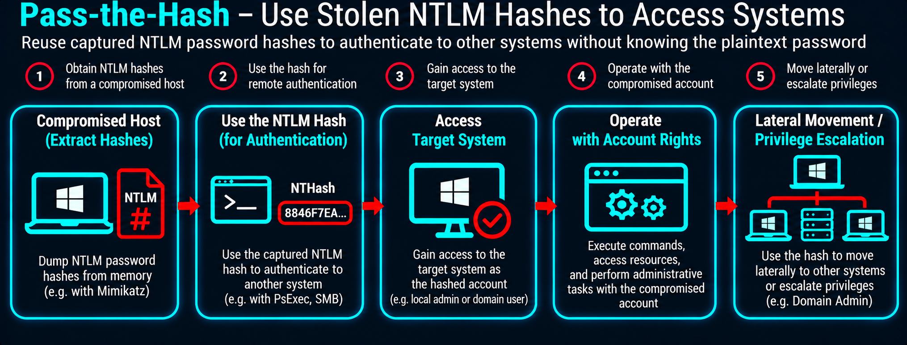

# ASP07 Pass-the-Hash Guide

*Kill-chain Phase 07, privilege escalation — authenticate to remote systems with a captured NTLM hash directly over NTLM, no Kerberos conversion needed. The hash *is* the password at the NTLM layer — whoever holds it works as the account everywhere NTLM is accepted.*



> For explicitly authorized lab environments only. Run from an initialized AS2Go module session.

---

## 1. What this scenario does

The **Pass-the-Hash (PtH)** diagram shows the direct NTLM replay of a captured hash — the technique that the OpTH workflow [Invoke-OverPassTheHashAttack](../Private/ASP07/Invoke-OverPassTheHashAttack.ps1) demonstrates locally in Phase 07. In the kill chain it appears at the start of the lateral-movement path:

| Stage | Action | Details |
|---|---|---|
| 1 | Capture | Dump NTLM hashes from LSASS on a compromised host (Mimikatz `sekurlsa::logonpasswords` / `sekurlsa::ekeys`) — exactly the harvest step the OpTH workflow runs (`<timestamp>.pth` sessions log) |
| 2 | Select | Rank the found principals by privilege (RID 519 → 512 → 548; the OpTH recommendation logic) |
| 3 | Replay directly | Use the hash for NTLM authentication against a *remote* target — e.g. `sekurlsa::pth` with a process, WMI/SMB with the hash in-tooling, or tools that accept hash-based sessions (Impacket-style) |
| 4 | Operate as the account | Access shares, services, remote consoles with the hashed account's rights — no plaintext, no Kerberos ticket exchange needed |
| 5 | Pivot | Use the same hash against further hosts; NTLM replay is host-independent until NTLM is disabled or the password changes |

In the AS2Go module the PtH *usage* flows through two concrete workflows: [Invoke-OverPassTheHashAttack](ASP07_OverPassTheHash.md) (which then converts the hash to Kerberos — the pass-the-hash *to overpass-the-hash* bridge) and the NTLM branch of [Invoke-StoredCredentialAttack](ASP07_StoredCredential.md) (the saved-hash rerun of that conversion).

---

## 2. PtH vs. OpTH vs. PtT — the three credential-reuse variants

| Variant | Material | Where the credential goes after capture | Typical use |
|---|---|---|---|
| **PtH** (this guide) | NTLM hash | Directly into NTLM authentication on remote hosts | Lateral movement in NTLM-heavy networks; non-Kerberos targets |
| **OpTH** ([guide](ASP07_OverPassTheHash.md)) | NTLM hash | Converted to a Kerberos TGT first (PKINIT-less `asktgt /rc4`), then Kerberos everywhere | Kerberos-first environments — the hash becomes every Kerberos-authenticated service |
| **PtT** ([guide](ASP07_PassTheTicket.md), [local variant](ASP07_PassTheTicketLocalMachine.md)) | Exported `.kirbi` tickets | Injected into the logon session (`ptt`) — no hash involved at all | When tickets (not hashes) were captured; survives password changes until expiry |

All three share the same harvest step (LSASS access). They differ in *what* they do with the material afterwards — and in what the DC-side telemetry shows (section 5).

---

## 3. Safe Mode and unattended execution

PtH itself is not a standalone workflow in the module — the OpTH workflow and StoredCredentialAttack's NTLM branch implement the usable paths. Both respect `-SafeMode` (Skip-only prompts) and run the full chain in unattended mode with stored values.

---

## 4. Working notes from the lab

### 4.1 The PtH→OpTH bridge is the demo's design point

After capturing the hash, the module guides toward the OpTH conversion (`Rubeus asktgt /rc4 /ptt` or Mimikatz `sekurlsa::pth`) rather than pure NTLM replay — because modern Windows Kerberos domains make the *conversion* the more powerful path (tickets open everything Kerberos does). The pure-PtH path remains relevant in the discussion for legacy NTLM targets and tooling contexts.

### 4.2 Where pure PtH still shows in the module

- **Mimikatz `sekurlsa::pth`**: internally performs hash-based process creation with new credentials — usable with or without the Kerberos follow-up.
- **The `dir \\<LogonServer>\c$` proof** after the OpTH ticket injection: from NTLM's perspective, that access is *indistinguishable* from PtH — Kerberos merely delivered the session.

### 4.3 Domain restrictions that kill PtH

Accounts in **Protected Users** (SID `-525`) reject NTLM by policy — the module's [New-PrivilegeEscalationRecommendation](../Private/ASP07/New-PrivilegeEscalationRecommendation.ps1) explicitly checks DA membership there (a BAD finding when present). SMB signing alone doesn't stop PtH; NTLM blocking does. The lab narrative: put Tier-0 accounts into Protected Users and PtH/OpTH both fail at the protocol, not the detection layer.

---

## 5. What defenders observe (Blue Team notes)

- **NTLM logon types betray hash reuse**: PtH shows up as Event **4624 Type 9** (NewCredentials) or **Type 3** (network) with the *NTLM* package but without the corresponding interactive session — the same host logging on as an account it has never seen interactively. NTLMv2 replay leaves **4776** (NTLM validated) entries with the account and workstation pair.
- **The NTLM usage baseline is the signal**: per-account NTLM frequency and source-mapping (which workstations use which accounts over NTLM) is the detector — hash replay comes from a new source with valid credentials, exactly like Pass-the-Ticket's usage pattern but over the NTLM protocol family.
- **Blocking beats detection**: NTLM's kill-chain role is shrinking but persistent; the controls stack as **disable NTLMv1 globally → audit NTLMv2 usage per account (4624/4776 source analytics) → Protected Users for Tier-0 → eventually remove NTLM where Kerberos covers the protocol**. Event 4625-NTLM failures plus the module's own PtH-ability checks (`New-PrivilegeEscalationRecommendation`) quantify the residual exposure.
- **The hardening ladder**: Credential Guard/L SASS PPL kills the harvest (no hash to pass) → NTLM restrictions kill the replay → Protected Users kills the logon → monitoring catches the remainder. The PtH→OpTH bridge in the module shows why *both* layers matter: if NTLM is blocked, the hash still works via the Kerberos conversion, so harvest defense and protocol defense are different battles.

---

## 6. Command quick reference

```powershell
# 1) The harvest (shared with OpTH) — Mimikatz with a session log:
.\mimikatz.exe "log $env:PUBLIC\AS2Go\Exfiltration\<timestamp>.pth" `
    "privilege::debug" "sekurlsa::logonpasswords" "exit"

# 2a) Pure PtH — hash-based process launch (Mimikatz path, NTLM context):
.\mimikatz.exe "privilege::debug" `
    "sekurlsa::pth /user:<user> /ntlm:<NTLM-HASH> /domain:<FQDN> /run:cmd.exe" "exit"

# 2b) The conversion the module prefers (OpTH bridge to Kerberos):
.\Rubeus.exe asktgt /user:<user> /domain:<FQDN> /rc4:<NTLM-HASH> /ptt /nowrap
dir \\<DC-FQDN>\c$

# 3) Defender view — NTLM logon pattern per account/source on a DC:
Get-WinEvent -FilterHashtable @{ LogName = 'Security'; Id = 4776 } `
    -MaxEvents 200 -ComputerName <DC-FQDN> |
    Select-Object TimeCreated, Message | Format-List
```

The phase itself requires no separate workflow — the harvest and hash-reuse paths run through [Invoke-OverPassTheHashAttack](../Private/ASP07/Invoke-OverPassTheHashAttack.ps1) and the NTLM branch of [Invoke-StoredCredentialAttack](../Private/ASP07/Invoke-StoredCredentialAttack.ps1).

---

## 7. Related

- Phase diagram: [ASP07_PtH.html](../Phases/ASP07_PtH.html)
- The workflow that captures and converts the hash: [ASP07 Overpass-the-Hash guide](ASP07_OverPassTheHash.md)
- The saved-hash rerun path: [ASP07 Stored Credential guide](ASP07_StoredCredential.md)
- Tier-0 NTLM hardening check the module performs: [New-PrivilegeEscalationRecommendation.ps1](../Private/ASP07/New-PrivilegeEscalationRecommendation.ps1)
- MITRE ATT&CK: Pass the Hash [T1550.002](https://attack.mitre.org/techniques/T1550/002/), OS Credential Dumping [T1003](https://attack.mitre.org/techniques/T1003/)
