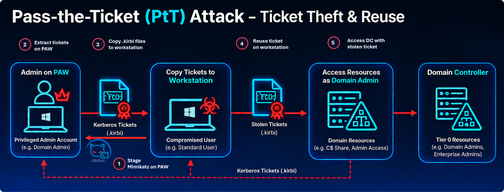

# ASP07 Pass-the-Ticket Guide | Invoke-PassTheTicketAttack

*Kill-chain Phase 07, privilege escalation — harvest exported Kerberos tickets from a privileged workstation, pick a TGT + service-ticket pair, inject it into the current session, and impersonate the account without its password or hash.*



> For explicitly authorized lab environments only. Run from an initialized AS2Go module session.

---

## 1. What this workflow does

[Invoke-PassTheTicketAttack](../Private/ASP07/Invoke-PassTheTicketAttack.ps1) runs against the **configured admin workstation** (`AS2GoSAW`) and its ticket share:

| Step | Action | Details |
|---|---|---|
| 0 | Ready-check | Endpoint-protection status read live from the admin PC (`Get-MpComputerStatus` via WinRM); confirm or skip. Old `.kirbi` files in the staging paths are cleared |
| 1 | Stage Mimikatz | `mimikatz.exe` copied to the ticket share on the admin PC |
| 2 | Harvest remotely | Via a `PSSession`: temporarily disable Defender real-time monitoring, run `sekurlsa::tickets /export` in `C:\Temp\tickets`, re-enable monitoring in a `finally` block |
| 3 | Analyze the harvest | [Get-KirbiTicketInfo](../Private/ASP07/Get-KirbiTicketInfo.ps1), [Get-KirbiUniqueInfo](../Private/ASP07/Get-KirbiUniqueInfo.ps1) and `Get-KirbiUniqueAccounts` summarize files, unique tickets, user vs. computer accounts, TGT/service-ticket counts per principal |
| 4 | Pick the victim | Best candidate = user with **both a TGT and at least one service ticket**, ranked by counts and recency; confirm or change in the candidate menu |
| 5 | Copy the tickets | All `.kirbi` files for the chosen principal come to the local temp dir; [Get-KirbiBestFiles](../Private/ASP07/Get-KirbiBestFiles.ps1) selects the **best ticket pair** (TGT + service ticket from the same LUID) |
| 6 | Inject | Mimikatz `kerberos::ptt <tickets-folder>` — both tickets of the pair are injected into the current session |
| 7 | Verify | Filtered ticket cache (`Get-KlistTicket -Client <candidate>`), then [Test-AccessToOneDCPerDomain](../Private/ASP07/Test-AccessToOneDCPerDomain.ps1) for forest-wide DC admin-share access |

Reach it from the Phase 07 menu option *Pass-the-Ticket*.

---

## 2. Why Pass-the-Ticket matters

- **Tickets are credentials that need no password, no hash, and no dump-time elevation on the target**: an exported `.kirbi` file contains everything the protocol requires — replay it from anywhere the ticket is still valid. Unlike OpTH, no LSASS access is needed at reuse time; the harvest is the only privileged moment.
- **The pair strategy is the demo's insight**: a TGT alone opens ticket requests; a service ticket alone opens exactly one service. A **TGT + service-ticket pair from the same logon session (LUID)** impersonates the account *immediately* without any further KDC round-trip the account wouldn't itself make. `Get-KirbiBestFiles` automates that pairing.
- **Ticket validity outlives password resets**: until expiry (or a KRBTGT rotation, or the account's ticket lifetime), a stolen ticket works even if the password changed meanwhile — a quieter persistence artifact than a backdoor account and invisible to `net user`-style reviews.
- **The security lesson in one line**: ticket lifetime and harvestability are the real exposure — protect the harvest point (endpoint protection on admin workstations), keep ticket lifetimes short for privileged accounts, and know that password rotation *does not* invalidate already-exported tickets.

---

## 3. Safe Mode and unattended execution

In `-SafeMode` the ready-check offers only `Skip`. Unattended runs proceed through the full chain automatically — staging, harvest with the Defender toggle, best-candidate selection, best-pair copy, Mimikatz injection, and the DC-access test — without prompts; only the ready-check confirmation would have needed input.

---

## 4. Working notes from the lab

### 4.1 The Defender toggle is explicit and symmetric

The `PSSession` block disables real-time monitoring *before* Mimikatz runs and re-enables it in a `finally` block — a visible, symmetric toggle rather than a hidden one. In workshops this is the honest moment to discuss why AV on the *admin workstation* is the harvest's main obstacle, and why the toggle itself (Event 5007 security-policy change) is a detection signal.

### 4.2 The candidate table is analytics, not decoration

`Get-KirbiUniqueAccounts` counts per principal: ticket files, unique SPNs, service tickets, TGTs. The recommendation requires a **user** account (computers are excluded) with `TGTCount > 0` and `ServiceTicketCount > 0`, then prefers more TGTs, more service tickets, more unique SPNs, most recent activity. That ordering encodes the *pairability* insight from section 2 into a ranking.

### 4.3 Same-LUID pairing is what makes injection work

`Get-KirbiBestFiles` pairs TGT and service ticket from the **same logon session** (LUID). Mixing tickets across sessions can produce caches where the TGT and service ticket disagree about client identity — and Windows validates AP-REQ context coherence. The printed "Best Ticket Pair" (Account, LUID, TGTSPN, ServiceSPN, files) is the demo's explain-the-mechanics moment.

### 4.4 The remote variant runs from a single box

The sibling function [Invoke-PassTheTicketAttackSingleBox](../Private/ASP07/Invoke-PassTheTicketAttackSingleBox.ps1) performs the same chain *on* the admin workstation itself (Rubeus triage/dump instead of Mimikatz-over-WinRM staging), and [Invoke-PassTheTicketAttackLocalMachine](../Private/ASP07/Invoke-PassTheTicketAttackLocalMachine.ps1) runs it entirely on the machine running AS2Go. Three variants, one technique — useful for demonstrating that the injection step is location-independent.

### 4.5 Old tickets are cleared, not appended

Staging paths are wiped before each run (local `TicketsToAbusePath\*.kirbi` and the remote share), so the candidate table reflects exactly the fresh harvest — no stale tickets leaking between demo runs.

---

## 5. What defenders observe (Blue Team notes)

- **The harvest is WinRM + Mimikatz in one session**: the toggle produces Event 5007 (Defender policy change), the Mimikatz run produces the process-creation chain (4688/Sysmon 1 with `sekurlsa::tickets /export` arguments), and the export writes dozens of `.kirbi` files into one directory — a file-burst signature that is detectable even without EDR. The staged `mimikatz.exe` copy to a ticket share (Sysmon Event 11 with EXE payload) is the earliest signal, before any privilege code runs.
- **The injection is silent server-side, noisy client-side**: `kerberos::ptt` (and Rubeus `ptt`) perform no network operation — no KDC events at injection time. The observables are on the endpoint: LSASS access from the injector process, and afterwards ticket *usage* from an unexpected context.
- **The replay surfaces at usage**: `Test-AccessToOneDCPerDomain` mirrors what real attackers do — admin-share reads across many DCs from one session. Server-side, each DC logs 5140/5145 (SMB access) from the *same impersonated account on an unusual source*. Correlate: one account, many servers, one new source = ticket replay, not logon roaming.
- **Windows' own tickets are the honest baseline tool**: `testlimit`-style session inflation aside, real environments can catch replayed tickets by comparing the ticket's Session key usage and source machine against the account's usual logon pattern — MDI's *Pass-the-Ticket* finding packages exactly that correlation.
- **The hardening ladder**: short ticket lifetimes and device-bound tickets (Windows 11/CBRS) shrink replay windows; endpoint protection on admin workstations removes the harvest; SMB auditing with per-account baselines catches usage. The demo exercises all three layers.

---

## 6. Command quick reference

```powershell
# 1) The remote harvest (as the workflow runs it on the admin PC):
Copy-Item .\mimikatz.exe "\\<SAW>\C$\Temp\tickets\" -Recurse
Invoke-Command -ComputerName <SAW-FQDN> -ScriptBlock {
    Set-Location C:\Temp\tickets
    .\mimikatz.exe "privilege::debug" "sekurlsa::tickets /export" "exit"
}

# 2) Analysis + best-pair selection (what the workflow automates):
#    .kirbi files named <LUID>-<User>@<SPN>-<...>.kirbi are grouped per principal,
#    the best TGT + service-ticket pair from one LUID is selected for injection.

# 3) The injection (both files of the pair):
.\mimikatz.exe "privilege::debug" "kerberos::ptt $env:PUBLIC\AS2Go\Tickets" "exit"
klist
dir \\<DC-FQDN>\c$

# Alternatively with Rubeus (as the sibling variants use):
.\Rubeus.exe ptt /ticket:<folder>\*.kirbi

# 4) Defender view — replay usage across servers (5140 from one new source):
Get-WinEvent -FilterHashtable @{ LogName = 'Security'; Id = 5140 } `
    -MaxEvents 300 -ComputerName <DC-FQDN> |
    Select-Object TimeCreated, Message | Format-List
```

The workflow itself requires no manual commands — run `Invoke-PassTheTicketAttack` from the Phase 07 menu and confirm the ready-check; candidate selection, pair copy, injection, and access test follow automatically.

---

## 7. Related

- Phase diagram: [ASP07_PtT.html](../Phases/ASP07_PtT.html)
- Ticket analytics feeding the selection: [Get-KirbiTicketInfo.ps1](../Private/ASP07/Get-KirbiTicketInfo.ps1), [Get-KirbiBestFiles.ps1](../Private/ASP07/Get-KirbiBestFiles.ps1)
- Local-machine and single-box variants: [Invoke-PassTheTicketAttackLocalMachine.ps1](../Private/ASP07/Invoke-PassTheTicketAttackLocalMachine.ps1), [Invoke-PassTheTicketAttackSingleBox.ps1](../Private/ASP07/Invoke-PassTheTicketAttackSingleBox.ps1)
- The hash-based sibling (converts a hash into a ticket first): [ASP07 Overpass-the-Hash guide](ASP07_OverPassTheHash.md)
- MITRE ATT&CK: Pass the Ticket [T1550.003](https://attack.mitre.org/techniques/T1550/003/), Steal or Forge Kerberos Tickets [T1558](https://attack.mitre.org/techniques/T1558/)
