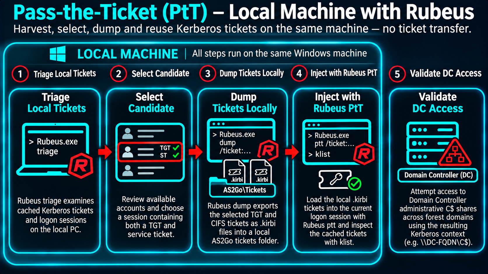

# ASP07 Pass-the-Ticket (Local Machine) Guide | Invoke-PassTheTicketAttackLocalMachine

*Kill-chain Phase 07, privilege escalation — run the complete Pass-the-Ticket chain on the machine running AS2Go: harvest exported tickets with Rubeus triage and dump, replay them into the own session, and make a change in AD with the stolen identity. No staging, no remote workstation, no password — everything happens locally.*



> For explicitly authorized lab environments only. Run from an initialized AS2Go module session.

---

## 1. What this workflow does

[Invoke-PassTheTicketAttackLocalMachine](../Private/ASP07/Invoke-PassTheTicketAttackLocalMachine.ps1) is the single-host variant of Pass-the-Ticket — every step runs locally with **Rubeus** instead of Mimikatz-over-WinRM:

| Step | Action | Details |
|---|---|---|
| 0 | Ready-check | Rubeus.exe present, endpoint protection configured for the tools folder; confirm or skip. Old `.kirbi` files in the tickets folder are cleared |
| 1 | Rubeus triage | `Rubeus.exe triage 2>&1` — lists every logon session (LUID) with its cached tickets |
| 2 | Analyze sessions | [Get-RubeusTriageSessions](../Private/ASP07/Get-RubeusTriageSessions.ps1) parses both triage formats, merges repeated sessions per user (best session wins: TGT + service ticket first, then longest-valid TGT), and resolves **AD group membership per candidate's own domain** |
| 3 | Pick the victim | Best candidate by privilege RID priority — **519 (Enterprise Admins), 512 (Domain Admins), 548 (Account Operators)** — requiring a TGT; fallback heuristics use service-ticket availability and TGT validity; confirm or change in the candidate menu (Help shows group RIDs) |
| 4 | Dump the tickets | `Rubeus.exe dump /luid:<LUID> /service:krbtgt /nowrap` and `/service:cifs` — Base64 blobs decoded into `.kirbi` files in the tickets folder |
| 5 | Inject | `Rubeus.exe ptt /ticket:<file>` per `.kirbi` file — TGT and service tickets re-enter the current session |
| 6 | Verify | Filtered ticket cache and [Test-AccessToOneDCPerDomain](../Private/Shared/Test-AccessToOneDCPerDomain.ps1) for forest-wide DC admin-share access |

Reach it from the Phase 07 menu option *Pass-the-Ticket (Local Machine)*.

---

## 2. Why the local-machine variant matters

- **The whole attack lives on one host**: no staging to a remote admin PC, no WinRM session, no Defender toggle dance — triage, dump, and injection are three local Rubeus calls. That mirrors the most common real-world shape of the technique, where an attacker who is *already on the box* replays cached tickets instead of moving files around.
- **Rubeus instead of Mimikatz**: the harvest uses modern tooling — `triage` for the session view, `dump` for Base64 extraction, `ptt` for injection. Fewer telemetry gaps, cleaner output, and no LSASS credential *dumping* (Rubeus reads ticket material directly). The demo shows the current state of the technique, not 2015-era tooling.
- **The analytics stay privileged-aware**: like the workstation variant, the selection ranks by RID 519/512/548 first — but on the local machine the interesting question is "who logged on *here*" (help desk, admin, service accounts), which is exactly the tiering-violation lesson.
- **The security lesson in one line**: any account with cached tickets on a machine can be impersonated from it until the tickets expire — limiting who logs on where (tiering) and shortening ticket lifetimes reduce the blast radius of every local compromise.

---

## 3. Safe Mode and unattended execution

In `-SafeMode` the ready-check offers only `Skip`. Unattended runs execute the full chain automatically — triage, best-candidate selection, dump, inject, and the DC-access test — with the 2-second pacing pauses between steps.

---

## 4. Working notes from the lab

### 4.1 Cross-realm tickets are tracked but not trusted

The triage parser keeps a non-matching realm entry (e.g. `krbtgt/<parent-or-other-tree>`) separate as `CrossRealmTGTSpn` instead of treating it as a usable TGT in the account's own domain. A privileged account whose only cached ticket is a cross-realm referral **still shows in the candidate table with its group memberships** — visible to the operator, but not selectable for the dump. This distinction was a correctness fix noted in the change log (Version 2026.11.23.599 range).

### 4.2 The dump regex anchors on the label

`Rubeus dump` prints `Base64(key)` (the session key) immediately before `Base64EncodedTicket` — both are 100+ Base64 characters. The extraction in this variant and the sibling PtT variants anchors the regex on the `Base64EncodedTicket` label (Version 2026.11.23.599 fix); an unanchored match silently writes a session-key blob into the `.kirbi` file and injection fails with no obvious cause. The valid ticket's first bytes (`doIG…`, the DER KRB-CRED sequence) are the sanity check.

### 4.3 Membership is resolved per candidate's own domain

`Get-ADPrincipalGroupMembership -Server <candidate's domain>` runs for every candidate with a known domain — not only for accounts with a usable same-realm TGT. This is why the table can show "this account is Tier-0 but currently has no injectable TGT" (cross-realm-only), which is exactly the honest picture of a privileged session.

### 4.4 Three fallback tiers pick the best local victim

When no 519/512/548 account is found: (1) any account with TGT *and* service ticket, sorted by longest-valid TGT; (2) any account with a TGT at all. The candidate menu's Help column still shows group RIDs for every entry, so a lower-ranked but privileged candidate can always be chosen manually.

### 4.5 The tickets folder is the exchange point

Dumped files land in `$Script:AS2GoTicketsDir` (cleared at start), the same location the Rubeus golden-ticket forge writes to in Phase 12 — so the folder accumulates demo artifacts across phases; the per-run clean keeps each demonstration's output fresh.

---

## 5. What defenders observe (Blue Team notes)

- **Triage is LSASS touch, dump is LSASS touch**: both `Rubeus triage` and `dump` enumerate ticket material from LSASS memory. Sysmon Event 10 (process access to lsass.exe) fires for the Rubeus process — same class as the Mimikatz dump, but from a different binary the reputation filters may trust. Behavioral detection (LSASS handle from a non-LSA process) beats binary allow-lists here.
- **`Rubeus.exe ptt` itself is nearly invisible**: injection performs no network operation; the ticket simply appears in the cache. Client-side, the process creation of Rubeus with `/ptt` arguments is the observable (Sysmon 1, 4688); the *usage* afterwards is what alerts server-side.
- **The usage pattern is forest-wide admin-share reads**: `Test-AccessToOneDCPerDomain` mirrors replay behavior — one account authenticating to DCs across multiple domains with SMB from a single new source. Event 5140/5145 correlation per source, grouped by account, catches the replay just as in the remote PtT variant.
- **Cross-realm-only sessions are the honest edge case**: a Tier-0 account visible in triage with no usable same-realm TGT still tells the defender *that account was on this machine* — session inventory per host is a tiering-compliance signal on its own.
- **The hardening ladder**: tiering (privileged accounts don't log on here), short ticket lifetimes, Credential Guard/PPL (Rubeus needs LSASS access for triage and dump), and SMB auditing with per-account baselines. The variant's value in workshops: it shows the attack working *entirely within* the compromised host's own context — no lateral tooling to attribute.

---

## 6. Command quick reference

```powershell
# 1) Triage (session view):
.\Rubeus.exe triage

# 2) Dump by LUID (krbtgt = TGT, cifs = service ticket):
.\Rubeus.exe dump /luid:<LUID> /service:krbtgt /nowrap
.\Rubeus.exe dump /luid:<LUID> /service:cifs /nowrap

# The workflow decodes the Base64 blobs itself:
$raw = .\Rubeus.exe dump /luid:<LUID> /service:krbtgt /nowrap | Out-String
$pattern = '(?s)Base64EncodedTicket\s*:\s*\r?\n\r?\n\s*([A-Za-z0-9+/=]{100,})'
$b64 = [regex]::Match($raw, $pattern).Groups[1].Value
[IO.File]::WriteAllBytes("<tickets>\tgt.kirbi", [Convert]::FromBase64String($b64))

# 3) Injection:
.\Rubeus.exe ptt /ticket:<tickets>\tgt.kirbi
klist
dir \\<DC-FQDN>\c$

# 4) Defender view — replay usage across DCs:
Get-WinEvent -FilterHashtable @{ LogName = 'Security'; Id = 5140 } `
    -MaxEvents 300 -ComputerName <DC-FQDN> |
    Select-Object TimeCreated, Message | Format-List
```

The workflow itself requires no manual commands — run `Invoke-PassTheTicketAttackLocalMachine` from the Phase 07 menu, confirm the ready-check, pick the candidate, and the dump/inject/verify chain runs automatically.

---

## 7. Related

- Phase diagram: [ASP07_PtTLocal.html](../Phases/ASP07_PtTLocal.html)
- Triage parser and session merging: [Get-RubeusTriageSessions.ps1](../Private/ASP07/Get-RubeusTriageSessions.ps1)
- The remote-workstation variant: [ASP07 Pass-the-Ticket guide](ASP07_PassTheTicket.md)
- Rubeus tooling notes (dump pitfalls, Base64(key) trap): [rubeus_kerberos_ticket_guide.md](rubeus_kerberos_ticket_guide.md)
- MITRE ATT&CK: Pass the Ticket [T1550.003](https://attack.mitre.org/techniques/T1550/003/), Kerberos Ticket Reuse [T1558](https://attack.mitre.org/techniques/T1558/)
