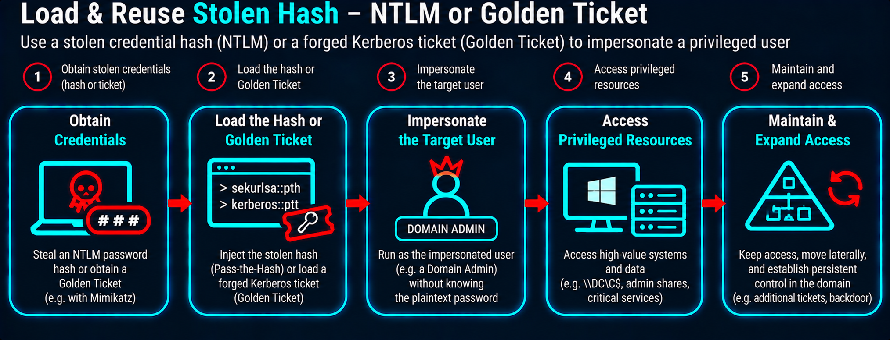

# ASP07 Stored Credential Attack Guide | Invoke-StoredCredentialAttack

*Kill-chain Phase 07 — reuse previously persisted credential material from the AS2Go configuration: re-forge and validate a Golden Ticket from the saved KRBTGT ticket file, or rerun Pass-the-Hash with the saved NTLM hash. The workflow demonstrates how an attacker's saved state turns a one-time compromise into a repeatable one.*



> For explicitly authorized lab environments only. Run from an initialized AS2Go module session.

---

## 1. What this workflow does

[Invoke-StoredCredentialAttack](../Private/ASP07/Invoke-StoredCredentialAttack.ps1) reads whatever the earlier phases persisted and re-runs the matching attack:

| Step | Action | Details |
|---|---|---|
| 0 | Load stored state | `ASP07KR` (Golden-Ticket data, DPAPI-protected) and `ASP07NT` (NTLM hash, DPAPI-protected) are read from the module configuration; validity is checked with [Test-ADFormat](../Private/ASP07/Test-ADFormat.ps1) (`GoldenTicket` checks FQDN + domain-SID fields, `Hash` the whole three-field format) |
| 1 | Show what is available | The most recent Golden-Ticket `.kirbi` file in the tickets folder (newest by write time) and/or the stored NTLM hash data are displayed |
| 2 | Choose the reuse path | `KRBTGT (Golden Ticket)` — re-forge from the saved ticket file, or `NTLM (Pass-the-Hash)` — rerun the OpTH flow with the saved hash; `Skip` exits |
| 3a | KRBTGT path | [Rubeus golden](../Private/ASP07/Invoke-GoldenTicketAttack.ps1) re-forges a PAC_REQUESTOR-compliant ticket to a `.kirbi` file, then [Import-KirbiFile](../Private/ASP07/Import-KirbiFile.ps1) validates it against the KDC (`asktgs`) before injecting (`ptt`) — on validation failure the cached-ticket inspection is skipped |
| 3b | NTLM path | Mimikatz `sekurlsa::pth /run:pwsh.exe` (choose Mimikatz) or `Rubeus asktgt /rc4:<hash> /ptt` (choose Rubeus) — the same two tool paths as the OpTH attack, now with the saved hash |
| 4 | Repeat loop | After each run, a `REPEAT | Stored Credential` prompt offers another pass until `No` |

Reach it from the Phase 07 menu option *Load Hash* (previously `Invoke-LoadHash`, renamed for a clearer name in version 2026.11.23.713).

---

## 2. Why stored-credential reuse matters

- **It closes the loop between compromise and persistence of attacker convenience**: every upstream phase saves its loot — `ASP07KR` (Golden Ticket material) and `ASP07NT` (NTLM hash) — under DPAPI. This workflow is the *replay* entry point: what took a whole demonstration in Phase 07/12 becomes a menu pick here.
- **It mirrors real attacker notebooks**: operators keep captured hashes and ticket material in their tooling for days. The demo makes that state visible and discussable — the *reuse* is the part defenders see weeks later, not the capture.
- **The re-forge path exercises the hardened-KDC lesson again**: because the KRBTGT branch now runs through Rubeus `golden` + [Import-KirbiFile](../Private/ASP07/Import-KirbiFile.ps1), a rerun shows the PAC_REQUESTOR validation gate a second time — useful right after demonstrating the rotation/`KDC_ERR_TGT_REVOKED` flow in Phase 12.
- **The security lesson in one line**: saved credential state extends a single compromise over time — and for defenders, the *second* run looks different from the first: no Mimikatz dump again, just a request from a stored blob. Session-history analytics matter more than per-event detection.

---

## 3. Safe Mode and unattended execution

In `-SafeMode` the selection menu is reduced to `Skip`. Unattended execution uses the first stored dataset (KRBTGT path preferred) and runs its reuse automatically, including validation, injection, and the DC-access test.

---

## 4. Working notes from the lab

### 4.1 Two storage formats, one menu

| Setting | Format | Producer |
|---|---|---|
| `ASP07KR` | `FQDN\|user\|NTLM-hash\|groups\|domain-SID` | [Invoke-GoldenTicketAttack](../Private/ASP07/Invoke-GoldenTicketAttack.ps1) after the DCSync step |
| `ASP07NT` | `FQDN\|user\|NTLM-hash` | [Invoke-OverPassTheHashAttack](../Private/ASP07/Invoke-OverPassTheHashAttack.ps1) on success |

Both are DPAPI-protected (machine-scoped), so the values leave no plaintext in the configuration file and only decode on the machine that stored them.

### 4.2 The KRBTGT branch now re-forges, not just re-injects

With the Rubeus rewrite (version 2026.11.23.980) the KBRTGT branch finds the newest `*.kirbi` in the tickets folder — the product of the last golden-ticket forge — and re-forges **from the saved file** rather than replaying it: it re-asks the KDC (`asktgs` validation first through `Import-KirbiFile`) before `ptt`. This is why an expired or rejected ticket (e.g. after a KRBTGT rotation demo) surfaces here as a clean failure message instead of a silent no-op.

### 4.3 The NTLM branch is the OpTH replay

Both tool paths from [Invoke-OverPassTheHashAttack](ASP07_OverPassTheHash.md) are offered again: **Mimikatz** (`sekurlsa::pth /run:pwsh.exe` → operator runs `dir \\<LogonServer>\c$` in the spawned window) and **Rubeus** (`asktgt /rc4 /ptt` → in-session injection followed by the DC-per-domain access test and ticket display). No re-dump is needed — the hash comes from the configuration.

### 4.4 The repeat loop demonstrates attacker workflow efficiency

The `REPEAT | Stored Credential` prompt at the bottom re-offers both stored datasets until the operator exits — deliberately modeling how a real operator pivots between credentials in one sitting. The menu Help line tells the user exactly what each option will run before confirming.

---

## 5. What defenders observe (Blue Team notes)

- **The re-run looks different from the original**: the first compromise showed a Mimikatz dump, a ticket forge with Event-37-style KDC interaction (old Mimikatz path) or a clean `asktgs` (Rubeus path). The *reuse* shows only the network-visible result — a TGT request or PtH logon without the corresponding harvesting activity. That gap (usage without capture) is the session-history signal.
- **DPAPI-protected attacker state is an endpoint-forensics artifact**: the module configuration (with DPAPI blobs) lives on the machine running AS2Go — in IR, recovering `ASP07KR`/`ASP07NT` from a compromised host reconstructs exactly which material the attacker had captured, and what they are likely to reuse. It is the lab-scale mirror of an attacker's saved credential vault.
- **The Golden Ticket re-forge still faces the KDC gate**: rotation demos (Phase 12 Revoke) invalidate the stored material — the re-run fails at `asktgs` with `KDC_ERR_TGT_REVOKED`, visible in [Import-KirbiFile](../Private/ASP07/Import-KirbiFile.ps1)'s validation output. This pair of demos makes the rotation lesson repeatable from the reuse angle.
- **The hardening lesson**: rotate what the reuse depends on. KRBTGT rotation kills the stored ticket path; account password resets kill the hash path (the stored NTLM stops working at the next AS-REQ); account disablement stops everything. All three recovery actions are exactly what the incident-response plan from the earlier phases should have triggered.

---

## 6. Command quick reference

```powershell
# What the workflow runs for the KRBTGT path (re-forge from the newest saved ticket):
.\Rubeus.exe golden /user:<user> /id:6666666 /sid:<DOMAIN-SID> /rc4:<NTLM-HASH> `
    /domain:<FQDN> /startoffset:-10 /outfile:<new-ticket>.kirbi

# validate → inject (Import-KirbiFile):
.\Rubeus.exe asktgs /ticket:<file> /service:cifs/<DC-FQDN> /dc:<DC-FQDN> /nowrap
.\Rubeus.exe ptt  /ticket:<file>
dir \\<DC-FQDN>\c$

# What the workflow runs for the NTLM path:
.\mimikatz.exe "privilege::debug" `
    "sekurlsa::pth /user:<user> /ntlm:<NTLM-HASH> /domain:<FQDN> /run:pwsh.exe" "exit"
# or:
.\Rubeus.exe asktgt /user:<user> /domain:<FQDN> /rc4:<NTLM-HASH> /ptt /nowrap
dir \\<LogonServer>\c$
```

The workflow itself requires no manual commands — run `Invoke-StoredCredentialAttack` (or the Phase 07 *Load Hash* menu option), pick the stored dataset, and the reuse path runs with validation.

---

## 7. Related

- Phase diagram: [ASP07_LoadHash.html](../Phases/ASP07_LoadHash.html)
- Producers of the stored state: [ASP07 Golden Ticket guide](../Private/ASP07/Invoke-GoldenTicketAttack.ps1), [ASP07 Overpass-the-Hash guide](ASP07_OverPassTheHash.md)
- Validation helper on the KRBTGT path: [Import-KirbiFile.ps1](../Private/ASP07/Import-KirbiFile.ps1)
- The rotation demo that invalidates the KRBTGT path: [ASP12 Revoke Tier 0 Access guide](ASP12_RemoveGroupMember.md)
- MITRE ATT&CK: Pass the Hash [T1550.002](https://attack.mitre.org/techniques/T1550/002/), Steal or Forge Kerberos Tickets [T1558](https://attack.mitre.org/techniques/T1558/)
