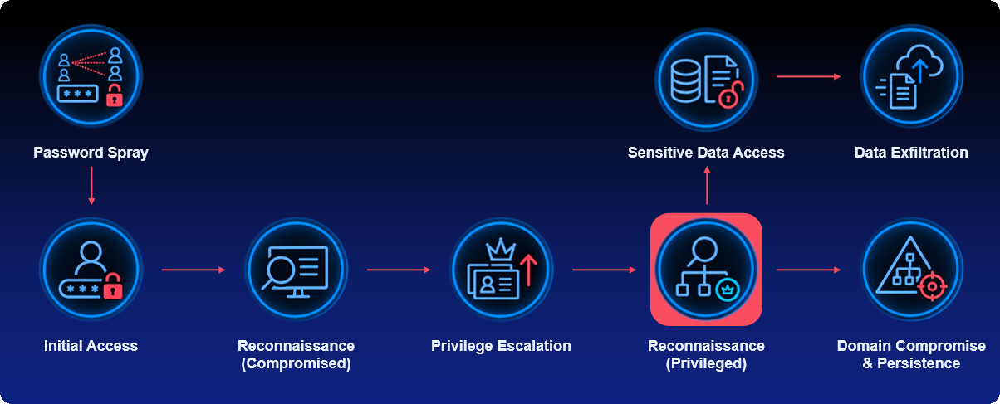

# ASP09 | Privileged Reconnaissance

ASP09 demonstrates what an elevated account can access during reconnaissance. It attempts to list the `C$` share of one domain controller in each forest domain. In an interactive run, it can also list services and processes on the current logon server and offer additional reconnaissance tasks.

Complete the shared preparation in [ASP00 Installation and Setup](ASP00-Setup.md) first. Run ASP09 in the Windows session signed in as the privileged account used for the scenario. This phase is available from the **Privileged** option in the `Start-AS2GoDemo` menu and can be started directly with `Invoke-ASPhase09ReconnaissancePrivileged` (alias: `ASP09`).

## Baseline checks

When you continue interactively, ASP09:

- Attempts to list the `C$` share of one selected domain controller in each forest domain.
- Displays the PowerShell commands for listing services and processes on the current logon server, then asks whether to run them remotely.
- If you choose to run them, uses PowerShell remoting to retrieve services and processes and displays the results in separate Out-GridView windows.

Share and remoting results depend on the account's permissions, network connectivity, firewall settings, and PowerShell remoting configuration. These checks can produce network, authentication, and remote-management events.

## Optional extended reconnaissance

After the service and process step, ASP09 asks whether to run the extended tasks. These include:

- Enumerating members of **DNSAdmins** and **Enterprise Admins**.
- Opening `nslookup` and copying a DNS zone-transfer command to the clipboard. The command is not entered automatically; running it is a separate action.
- Using `NetSess.exe` to list NetBIOS sessions on the configured domain controller.
- If a honeytoken is configured, attempting an Active Directory query with that account and a random password. This failed authentication attempt can generate security events and monitoring alerts.

Review the planned actions and confirm that monitoring is ready before continuing. See [ASP00 MDI Triggers](ASP00_MDITriggers.md) for optional honeytoken setup.

## Safe Mode and unattended execution

With `-SafeMode`, ASP09 offers only the option to skip its reconnaissance actions. In unattended mode, it runs the domain-controller share checks and extended reconnaissance automatically, while skipping the service and process listings on the logon server. The extended workflow can open `nslookup`, invoke `NetSess.exe`, and attempt the honeytoken authentication when configured.

## Requirements

- A domain-connected Windows session using an account with the intended elevated permissions.
- The Active Directory PowerShell module and working DNS/network access to the forest's domain controllers.
- Permissions and connectivity for the relevant `C$` shares.
- For interactive service and process collection, PowerShell remoting access to the current logon server.
- For extended reconnaissance, configured privileged-group and domain-controller information; `NetSess.exe` for session enumeration; and an optional configured honeytoken.

## Related documentation

- [ASP00 Installation and Setup](ASP00-Setup.md)
- [ASP00 MDI Triggers](ASP00_MDITriggers.md)
- [ASP09 phase walkthrough](../Phases/ASP09.html)
