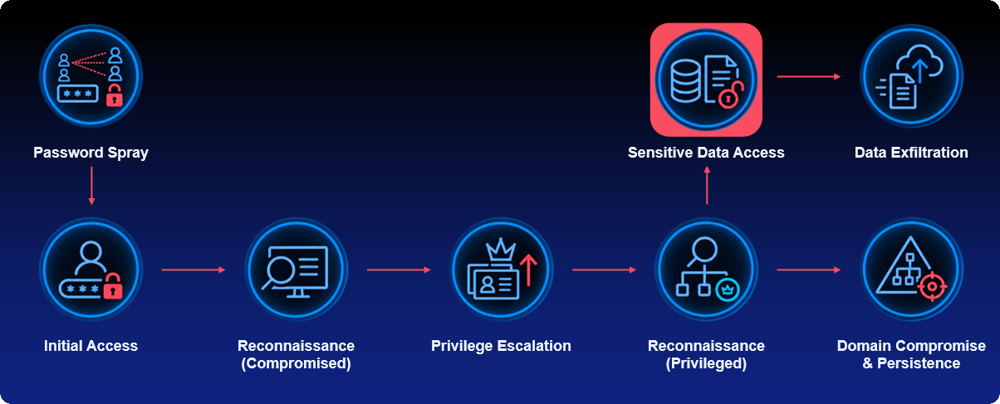

# ASP10 | Sensitive Data Access

ASP10 demonstrates how accessible shares and an application-server console can expose sensitive information. The lab uses simulated backup data and a sample plaintext file; it does not use real credentials or a real `ntds.dit` database.

Complete the shared preparation in [ASP00 Installation and Setup](ASP00__Setup.md) first. Run the phase with the account appropriate to the scenario, not the Enterprise Admin session used for setup.

## **Menu option**

Start `Start-AS2GoDemo` and select **Sensitive**. The phase can also be started directly with `Invoke-ASPhase10AccessSensitiveData` (alias: `ASP10`).

## What the phase does

When you continue, ASP10:

- Lists network shares on the server hosting the configured backup share.
- Writes a recursive listing of the AS2Go module files to the share as a simulated `ntds.dit` file, then displays the backup-share contents. This file is directory-listing text, not an Active Directory database.
- Prepares a sample file on the configured application server, if it is not already present. The default sample path is `C:\temp\as2go\daily-work.txt`; it contains instructional placeholder text, not passwords.
- Starts PsExec to open a command prompt on the application server. ASP10 copies a `more` command for the sample file to the clipboard and displays it for manual use; it does not type the command into the remote console automatically.

The phase may write simulated files to the backup share and the application's administrative share. The remote console requires PsExec and sufficient administrative access to the target. Review the selected hosts and permissions before proceeding.

## Safe Mode and unattended execution

With `-SafeMode`, ASP10 displays its overview and skips the actions. In unattended mode, it runs the phase automatically unless Safe Mode is enabled. The PsExec command prompt may still open and require operator interaction.

## Requirements

- A configured, reachable backup share with the required read and write access.
- A configured application server reachable through its administrative share and available for remote PsExec access.
- `PsExec.exe` in the configured AS2Go tools folder.
- A lab environment where creating simulated files and opening a remote command prompt are authorized.

See [ASP00 Backup Share](ASP00_BackupShare.md) for share setup and [ASP00 Malicious Tools](ASP00_MaliciousTools.md) for preparing PsExec.

## Related documentation

- [ASP00 Installation and Setup](ASP00__Setup.md)
- [ASP00 Backup Share](ASP00_BackupShare.md)
- [ASP00 Malicious Tools](ASP00_MaliciousTools.md)
- [ASP10 phase walkthrough](../Phases/ASP10.html)
