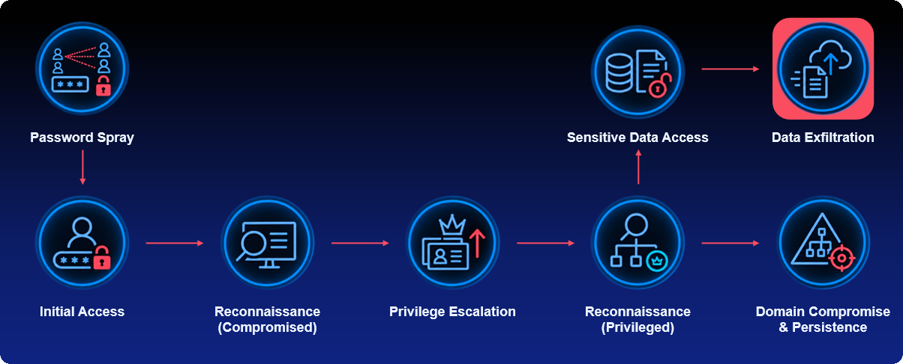

# ASP11 Data Exfiltration Guide | Invoke-ASPhase11ExfiltrateSensitiveData

*Kill-chain Phase 11, data exfiltration — copy staged backup files from the network share to a local folder over SMB, and understand why unmonitored share reads are the quiet moment where the stolen data actually moves.*



> For explicitly authorized lab environments only. Run from an initialized AS2Go module session.

---

## 1. What this workflow does

[Invoke-ASPhase11ExfiltrateSensitiveData](../Public/Invoke-Phase11ExfiltrateSensitiveData.ps1) (alias `ASP11`) walks through the exfiltration demonstration:

| Step | Action | Details |
|---|---|---|
| 0 | Confirm the phase | Decision prompt; in `-SafeMode` the phase ends here after the overview |
| 1 | Ensure the destination | Creates `$env:PUBLIC\AS2Go\Exfiltration` locally when missing |
| 2 | Copy over SMB | `Copy-Item -Path "$Script:ASBackupShare\*.*" -Destination $Script:DefautExfiltrationFolder` — files only, no subdirectories |
| 3 | Identify the loot | `Get-Item "$Script:DefautExfiltrationFolder\*.dit"` lists the copied fake database file(s) |

The phase copies files to the local host only. It does not send them outside the lab, parse the simulated `.dit` file, or extract credentials. The operation requires read access to the backup share and enough local access to create and write the destination folder.

Start `Start-AS2GoDemo` and select **Exfil**, or run `Invoke-ASPhase11ExfiltrateSensitiveData` directly.

---

## 2. Why this phase matters

- **Exfiltration starts as a file copy**: the demo shows the mundane core of the problem — a readable share and a destination disk are all it takes. Before an attacker compresses, encrypts, or uploads anything, the data first has to land *somewhere local*, and that move is the first observable step.
- **The staged `ntds.dit` completes the story**: ASP10 planted a simulated AD database on the backup share; ASP11 moves it into the exfiltration folder. Together they demonstrate the chain *find → read → stage → move* that real incidents follow when backup shares are readable by too many accounts.
- **"Copy to local" is a detection opportunity, not just a step**: file-landing moments are where defenders can still catch data before it leaves the perimeter. The discussion point: what telemetry exists for a server-side share read followed by a local write on a workstation?
- **The security lesson in one line**: backup shares need read auditing and least privilege, because the simplest exfiltration channel is a legitimate protocol used with legitimate-looking access.

---

## 3. Safe Mode and unattended execution

With `-SafeMode`, ASP11 displays its overview and skips the copy operation. In unattended mode, it copies the files automatically unless Safe Mode is enabled.

---

## 4. Working notes from the lab

### 4.1 The copy is deliberately shallow

`Copy-Item -Path "<share>\*.*"` copies files at the share root only — no recursion, no subdirectories. The demonstration stays focused on the staged `.dit` file from ASP10; nested folder structures in the backup share are intentional clutter that the phase ignores.

### 4.2 The `.dit` listing is the narrative anchor

`Get-Item "$Script:DefautExfiltrationFolder\*.dit"` displays the copied fake database file. The visual moment — "the AD database now sits in a workstation's Public folder" — is the demo's exfiltration anchor point for the wrap-up discussion.

### 4.3 No external circuit

The phase makes no outbound connection: no uploads, no web hooks, no DNS tunneling. That keeps the lab self-contained (and the authorization surface small). The *detection* discussion in section 5 therefore focuses on SMB reads and local file writes — the channel this phase actually uses.

---

## 5. What defenders observe (Blue Team notes)

- **Server side — the read event**: the copy triggers Event **5140/5145** (network share access) for every file read from the backup share, attributed to the caller's identity. A workstation account reading many files from a backup share in seconds is the exfiltration signature *before any data leaves the network*. Correlate with the Phase 10 enumeration from the same source.
- **Client side — the landing pattern**: files appearing in user-writable folders (`$env:PUBLIC`, temp) after burst SMB reads — Sysmon Event 11 (FileCreate) catches the write, Event 3 catches the SMB source. A `.dit`-shaped file on a workstation is anomalous on its own: AD databases belong on domain controllers, nowhere else.
- **Volume over content**: don't wait for the upload event that never fires. Watch *data movement* — bytes read from shares, files created in staging folders, and time-of-day patterns outside backup windows.
- **The hardening lesson**: restrict backup-share reads to actual backup identities, alert on SMB reads by non-service accounts, and treat any AD-database-like file off a domain controller as an incident. When every legitimate copy path is allow-listed, this phase fails at step 2 — the copy simply has nothing readable.

---

## 6. Command quick reference

```powershell
# 1) The copy itself (as the workflow does):
Copy-Item -Path "\\<BackupServer>\<BackupShare>\*.*" -Destination "$env:PUBLIC\AS2Go\Exfiltration"

# 2) Identify the staged database file:
Get-Item "$env:PUBLIC\AS2Go\Exfiltration\*.dit" | Out-Host

# 3) Defender view — share reads on the backup server + file landing on the client:
Get-WinEvent -FilterHashtable @{ LogName = 'Security'; Id = 5140, 5145 } `
    -MaxEvents 100 -ComputerName <BackupServer-FQDN> |
    Select-Object TimeCreated, Message | Format-List
```

The workflow itself requires no manual commands — run `Invoke-ASPhase11ExfiltrateSensitiveData` (or `Start-AS2GoDemo` menu option *Exfil*) and confirm the phase.

---

## 7. Related

- Phase diagram: [ASP11.html](../Phases/ASP11.html)
- The preceding staging step: [ASP10 Sensitive-Data-Access.md](ASP10_Sensitive-Data-Access.md)
- Share setup: [ASP00_BackupShare.md](ASP00_BackupShare.md)
- MITRE ATT&CK: Exfiltration Over SMB [T1039](https://attack.mitre.org/techniques/T1039/), Data Staged [T1074](https://attack.mitre.org/techniques/T1074/)
