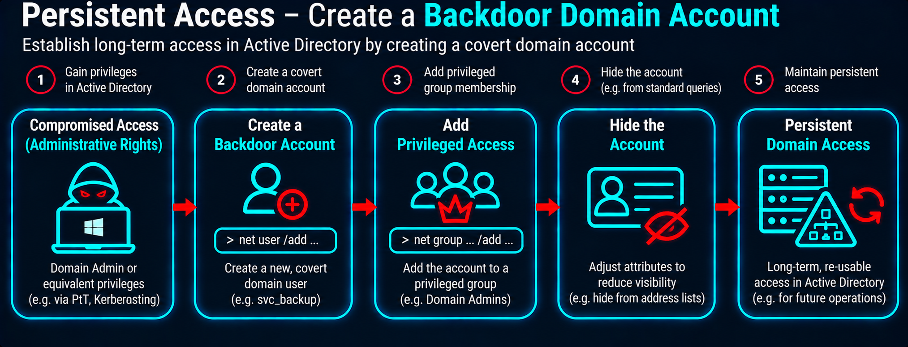

# ASP12 Backdoor User Guide | Invoke-BackdoorUserCreation

*Domain Persistence (Phase 12) — create a persistent backdoor account with elevated group memberships across the entire forest, and understand the attribute tricks that make it hard to spot.*



> For explicitly authorized lab environments only. Run from an initialized AS2Go module session.

---

## 1. What this workflow does

[Invoke-BackdoorUserCreation](../Private/ASP12/Invoke-BackdoorUserCreation.ps1) walks through the complete backdoor-account demonstration:

| Step | Action | Details |
|---|---|---|
| 0 | Generate a time-stamped identity | `BD-<YYYYMMDD>.<HHMMSS>` — random password from `Get-RandomPassword`, never expires |
| 1 | Resolve the target OU | Reads `BDUsersOU` from the module configuration; falls back to the built-in `CN=Users` container automatically when the setting is empty or the OU no longer exists |
| 2 | Create the user | Full user object (UPN against the forest root domain, description, title, display name, `employeeType = AS2GoBackDoorUser`, thumbnailPhoto) |
| 3 | Elevate in the local domain | Domain Admins, DNS Admins; `primaryGroupID` switched to 512 |
| 4 | Elevate forest-wide | Enterprise Admins (on a root-domain DC) and `Builtin\Administrators` (S-1-5-32-544) in **every** domain of the forest |
| 5 | Verify | Opens a `pwsh` session as the new account, runs a logon test against the DC, and lists the resolved group memberships |

The user DN is persisted in the `LastBDUser` configuration setting, and the credentials live in `$global:BDUser`, `$global:BDSecurePass`, `$global:BDCred` (`NETBIOS\user`), and `$global:BDCredUPN` — later phases and the credential-dump workflows consume them directly.

---

## 2. Why this account is a strong persistence primitive

### Membership beyond the obvious

The account is placed into **four different privilege layers**, each with its own reach:

| Group | Layer | Reach |
|---|---|---|
| Domain Admins (512) | Domain | Full control of the compromised domain |
| DNS Admins | Service plane | DNS service context on DCs is SYSTEM — path to DC compromise beyond AD rights |
| Enterprise Admins (519) | Forest | Configuration/schema partitions, forest trusts, added via the **root-domain DC** |
| `Builtin\Administrators` (S-1-5-32-544) | Every domain | Local admin context on DCs in **all** forest domains |

### The `primaryGroupID` trick

The workflow sets `primaryGroupID = 512` — a detail most attackers and even many administrators ignore:

- The **primary group** does not appear in `memberOf`; enumeration via `Get-ADPrincipalGroupMembership` or the token `Groups` list does not simply show it the way normal memberships do.
- In a Kerberos PAC, the primary group ID is part of the identity regardless — the account still authenticates with Domain Admins rights.
- Defenders rarely audit `primaryGroupID`, so an account whose *visible* memberships were cleaned can keep Domain Admin privileges. This is exactly the discussion point the demo is built around.

### Masquerading attributes

- **`thumbnailPhoto`** from `LabSetup\thumbnailPhotos\AS2Go_BD-User.jpg` — the account shows a corporate-style photo in Outlook/People views, so it blends in with real employees.
- Timestamped `BD-…` naming looks tool-generated on purpose for the demo, but the *pattern* discussion (names that mimic helpdesk contractors, service accounts, or internal conventions) is part of the workshop lesson.
- `PasswordNeverExpires` gives the account an effectively unlimited lifetime; `AccountExpirationDate` is cleared.

---

## 3. Where AS2Go tracks the account

| Store | Content | Consumed by |
|---|---|---|
| `LastBDUser` (module config) | DN of the created user | [Add-GPOMemberToBuiltinGroups](../Private/ASP12/Add-GPOMemberToBuiltinGroups.ps1) and [Invoke-GroupManipulation](../Private/ASP12/Invoke-GroupManipulation.ps1) re-target the account; cleanup helpers resolve it |
| `$global:BDUser` / `$global:BDCred` / `$global:BDCredUPN` | Account + PSCredentials | Credential-dump and Phase 07 workflows; **excluded from disruption** |
| `employeeType = AS2GoBackDoorUser` | AD attribute marker on the user | Distinguishes the demo account from real users when reviewing |
| [Start-UserAccountDisruption](../Private/ASP12/Start-UserAccountDisruption.ps1) protection | Excludes `$global:BDUser` from Disable/PwReset | The Phase 12 disruption demo never locks the attacker out mid-workshop |

---

## 4. Working notes from the lab

### 4.1 Forest-wide elevation targets the root DC

The Enterprise Admins membership is written with `Set-ADGroup -Add` against the **root-domain DC** — `Add-ADGroupMember` against the child domain would fail because EA is a forest-root object. The workflow pauses (10 s) before the write to let the newly created user replicate into a queryable state.

### 4.2 Group enumeration needs a moment

`Get-ADPrincipalGroupMembership` runs in a retry loop (up to 50 attempts, break on >3 groups). If the fast path still fails, the workflow falls back to reading raw `MemberOf`, so the verification table shows something meaningful either way. `primaryGroupID` is expected to be absent from this list — that is the trick from section 2, not a failure.

### 4.3 Builtin\Administrators is written per domain

The loop iterates `$Script:AllDomainsDetails` (populated by `Get-ForestInfo`) and adds the account to each domain's local `Builtin\Administrators` with a 2-second pause per domain. Failures per domain are logged as warnings and do not abort the workflow — a useful resilience pattern to point out in code review.

### 4.4 The logon test is the real proof

Two verifications run at the end:

1. `Start-Process pwsh -Credential $global:BDCred` — an interactive shell **as the new account** ("whoami").
2. `Test-ADLogon` against the DC — a direct logon check even when the interactive spawn is not possible on a headless host.

---

## 5. What defenders observe (Blue Team notes)

- **Account creation + elevation chain**: Event **4720** (user created) followed by **4724** (password set), **4728** (added to Domain Admins), **4756** (added to Enterprise Admins), **4732** (added to a local group — `Builtin\Administrators`). Four elevated-group events for a brand-new account is the loudest possible signal.
- **Attribute anomalies**: `primaryGroupID` changes produce no group event — audit **Event 5136** (directory attribute changed) on `primaryGroupID`. The same event catches `thumbnailPhoto` writes on accounts that should not get one.
- **Masquerade controls**: compare `employeeType`/description/display patterns against change tickets; a photo attribute on a machine-patterned account name (`BD-YYYYMMDD.HHMMSS`) is a strong masquerade indicator.
- **Behavioral view**: an account that immediately holds Domain Admins, DNS Admins, Enterprise Admins, and Builtin\Administrators across every domain never occurs naturally. Correlate *one* creation event with *multiple* elevation targets across domains (MDI: suspicious additions to sensitive groups + abnormal membership enumeration).
- **The hardening lesson**: membership in many groups does not create redundancy for defenders, only attack-surface. Periodic Tier-0 membership review with a tool like the AS2Go export (`Export-ADPrivilegedGroupDirectMember`) surfaces accounts whose only claim is the invisible primary group.

---

## 6. Command quick reference

```powershell
# Reproduce the core steps manually against <DC-FQDN>:

# 1) Create the account (attributes as the workflow sets them)
New-ADUser -SamAccountName BD-20261125.130000 `
    -UserPrincipalName "BD-20261125.130000@<ROOT-FQDN>" `
    -DisplayName "20261125, 130000 (Backdoor)" -Description "Backdoor Account (AS2Go Demo)" -Title "Backdoor" `
    -OtherAttributes @{ employeeType = 'AS2GoBackDoorUser' } `
    -AccountPassword (Read-Host -AsSecureString) -PasswordNeverExpires $true `
    -Path "<TARGET-OU-DN>" -Server <DC-FQDN> -PassThru | Enable-ADAccount

# 2) Elevate — domain, service, forest, and local layers
Add-ADGroupMember -Identity <DomainAdminsSid> -Members BD-20261125.130000 -Server <DC-FQDN>
Add-ADGroupMember -Identity <DnsAdminsSid>    -Members BD-20261125.130000 -Server <DC-FQDN>
Set-ADGroup "<EnterpriseAdminsDN>" -Add @{ member = "<newUserDN>" } -Server <ROOT-DC-FQDN>
Set-ADGroup "<BuiltinAdministratorsDN>" -Add @{ member = "<newUserDN>" } -Server <otherDomainFQDN>

# 3) The invisible persistence trick + masquerading photo
Set-ADUser BD-20261125.130000 -Replace @{ primaryGroupID = 512 } -Server <DC-FQDN>
Set-ADUser BD-20261125.130000 -Replace @{ thumbnailPhoto = ([byte[]](Get-Content <photo.jpg> -AsByteStream)) }

# 4) Verify
Start-Process pwsh -Credential <cred> -ArgumentList "-NoExit","-Command","whoami"
Get-ADUser BD-20261125.130000 -Properties primaryGroupID, memberOf, PasswordNeverExpires

# 5) Defender view — correlate the event chain on the DC
Get-WinEvent -FilterHashtable @{ LogName = 'Security'; Id = 4720, 4724, 4728, 4756, 4732, 5136 } `
    -MaxEvents 50 -ComputerName <DC-FQDN> | Select-Object TimeCreated, Id, Message | Format-List
```

---

## 7. Related

- Phase diagram: [ASP12_BD.html](../Phases/ASP12_BD.html)
- Disruption demo (protects the backdoor account while degrading everyone else): [Invoke-UserAccountDisruption.ps1](../Private/ASP12/Invoke-UserAccountDisruption.ps1)
- GPO persistence that re-uses the account: [Add-GPOMemberToBuiltinGroups.ps1](../Private/ASP12/Add-GPOMemberToBuiltinGroups.ps1)
- Group cleanup demo (removes direct Tier-0 memberships): [Invoke-GroupManipulation.ps1](../Private/ASP12/Invoke-GroupManipulation.ps1)
- MITRE ATT&CK: Create Account — Domain Account [T1136.002](https://attack.mitre.org/techniques/T1136/002/), Account Manipulation [T1098](https://attack.mitre.org/techniques/T1098/)
