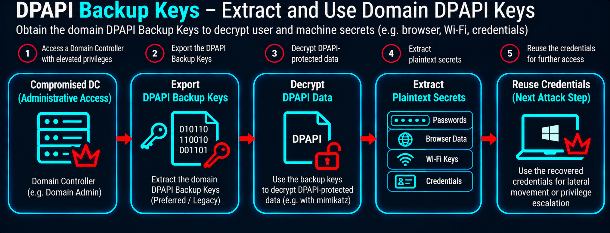

# ASP12 DPAPI Backup Keys Guide | Invoke-DPAPIBackupKeyExport

*Domain Persistence (Phase 12) — export the domain's DPAPI backup keys from a domain controller and understand why a single key export can unlock protected data on every domain-joined endpoint.*



> For explicitly authorized lab environments only. Run from an initialized AS2Go module session.

---

## 1. What this workflow does

[Invoke-DPAPIBackupKeyExport](../Private/ASP12/Invoke-DPAPIBackupKeyExport.ps1) walks through the DPAPI backup-key demonstration:

| Step | Action | Details |
|---|---|---|
| 0 | Confirm the phase | Decision prompt; shows the Mimikatz command first |
| 1 | Prepare the output folder | `$Script:DefautExfiltrationFolder` created when missing |
| 2 | Select the domain | Domain-only object picker, then `Get-BestDomainController` resolves the target DC |
| 3 | Export the keys | Mimikatz `lsadump::backupkeys /system:<DC-FQDN> /export` writes the preferred and legacy backup keys to files in the exfiltration folder |
| 4 | Show the loot | `Get-Item <folder>\ntds_*` lists the exported key files (prefixed `ntds_` by Mimikatz), newest first |

The exporting helper is [Export-DPAPIBackupKey](../Private/ASP12/Export-DPAPIBackupKey.ps1); the interactive wrapper only displays the exact command and confirms before running. Domain Administrator privileges on the selected DC are required.

Start `Start-AS2GoDemo` and select **Backup Key**, or run the phase through the Domain Persistence menu.

---

## 2. Why the domain backup key matters

- **DPAPI is the password manager of Windows**: Chrome/Edge saved passwords, Wi-Fi profiles, credential-manager entries, Outlook stored credentials, and Task Scheduler secrets are all protected with DPAPI. Each user's *master key* guards these blobs — and the domain's *backup key* can recover any user's master key.
- **One export, domain-wide reach**: the domain backup key is stored on the DC and used for domain-scientific master-key recovery (e.g. after password resets). An attacker who exports it can, offline and per user, unprotect data on **every domain-joined endpoint that ever stored a secret** — no need to revisit each machine.
- **The persistence angle**: backup keys change almost never. An exported key stays valid across password rotations, endpoint rebuilds, and (in most labs) even KRBTGT rotations — a quieter persistence artifact than a Golden Ticket, and the direct complement to the [Revoke Tier 0 Access guide](ASP12_RemoveGroupMember.md): remove the attackers' group memberships, and the exported key still opens their files.
- **The security lesson in one line**: treat DC access as the boundary of every user secret in the domain; who can run code on a DC can unlock every DPAPI blob the domain has ever protected.

---

## 3. Safe Mode and unattended execution

The phase has no dedicated SafeMode branch: the decision prompt only starts or skips the export. In unattended mode (`-UnAttended`) the export runs automatically. The DC selection picker still appears in both modes.

---

## 4. Working notes from the lab

### 4.1 The `ntds_*` file prefix is Mimikatz convention

`lsadump::backupkeys /export` writes the preferred key and the two legacy keys as `.pkey`/`.pvk` files prefixed with `ntds_` — the same prefix Mimikatz uses for other DC-dump output. The workflow's loot listing (`Get-Item ntds_*`) matches that convention; rename awareness matters when you correlate the folder contents with other ASP12 outputs.

### 4.2 The command display shows the target DC before the picker runs

The wrapper prints `lsadump::backupkeys /system:$Script:ASDC.$Script:ASFQDN` as the *command preview* before the domain picker resolves the actual target; [Export-DPAPIBackupKey](../Private/ASP12/Export-DPAPIBackupKey.ps1) then uses `Get-BestDomainController -domain $dn` for the real export. In a child-domain lab, picking the child domain exports that domain's backup key (each domain has its own).

### 4.3 Export location mirrors the exfiltration workflow

The keys land in the same folder ASP11 uses to stage copied files — so after Phase 11, the exfiltration folder demonstrates both staged backups and exported key material. Useful for the wrap-up discussion of "what one file copy plus one privileged export can carry away."

---

## 5. What defenders observe (Blue Team notes)

- **The export is loud on the DC**: Mimikatz reads `LSA` backup-key material via RPC (`lsarpc`, `LsarRetrievePrivateData` on the `DPAPI_SYSTEM` secret) with `SeBackupPrivilege`. This shows up as a privileged RPC call from an admin-originated credential dump — MDI flags it as *Backup key extraction*; Sysmon EID 3 connections to the `lsarpc` pipe from a non-DC host with an interactive session are high-signal.
- **Files with `ntds_` and `.pkey` suffixes appearing on non-DC hosts**: backup-key blobs should exist only in the domain backup chain; a `.pkey` file in a user-writable folder (like the exfiltration folder here) is an incident marker on its own — the same lesson as `.dit`-shaped files off a DC.
- **Who ran what**: correlate with the interactive logon that started Mimikatz (4624/4625 + 4688 process creation with the Mimikatz image name) — the export requires interactive admin context, so the source account chain tells you how far the compromise had progressed.
- **The hardening lesson**: limit interactive admin sessions on DCs (PAW model, no persistent logons), monitor `LsarRetrievePrivateData` calls on `DPAPI_SYSTEM`, and protect the DC backup-key chain as Tier-0 material. Rotating the DPAPI backup key is possible (`kbkdcapi`/`dpapi-rollback` tooling) but heavy — detection is the practical control.

---

## 6. Command quick reference

```powershell
# The export command (as the workflow displays and runs it):
.\mimikatz.exe "cd $env:PUBLIC\AS2Go\Exfiltration" "privilege::debug" `
    "lsadump::backupkeys /system:<DC-FQDN> /export" "exit"

# The loot listing (preferred + legacy keys):
Get-Item "$env:PUBLIC\AS2Go\Exfiltration\ntds_*" | Sort-Object LastWriteTime -Descending | Out-Host

# Defender view — privileged RPC service access on the DC around the export window:
Get-WinEvent -FilterHashtable @{ LogName = 'Security'; Id = 4624, 4688 } `
    -MaxEvents 200 -ComputerName <DC-FQDN> |
    Where-Object { $_.Message -match 'mimikatz' } |
    Select-Object TimeCreated, Message | Format-List

# File-side detection — key blobs off the DC (Sysmon):
Get-WinEvent -FilterHashtable @{ LogName = 'Microsoft-Windows-Sysmon/Operational'; Id = 11 } `
    -MaxEvents 200 | Where-Object { $_.Message -match 'ntds_.*\.pkey|\.pvk' } |
    Select-Object TimeCreated, Message | Format-List
```

The workflow itself requires no manual commands — run `Invoke-DPAPIBackupKeyExport` through the Domain Persistence menu, pick the domain, and confirm the export.

---

## 7. Related

- Phase diagram: [ASP12_BackupKey.html](../Phases/ASP12_BackupKey.html)
- Exfiltration folder staging: [ASP11 Data Exfiltration guide](ASP11_Data-Exfiltration.md)
- Persistence that survives group cleanup: [ASP12 Backdoor User guide](ASP12_BackDoorUser.md)
- MITRE ATT&CK: Private Keys [T1552.004](https://attack.mitre.org/techniques/T1552/004/), Credentials from Password Stores [T1555](https://attack.mitre.org/techniques/T1555/)
