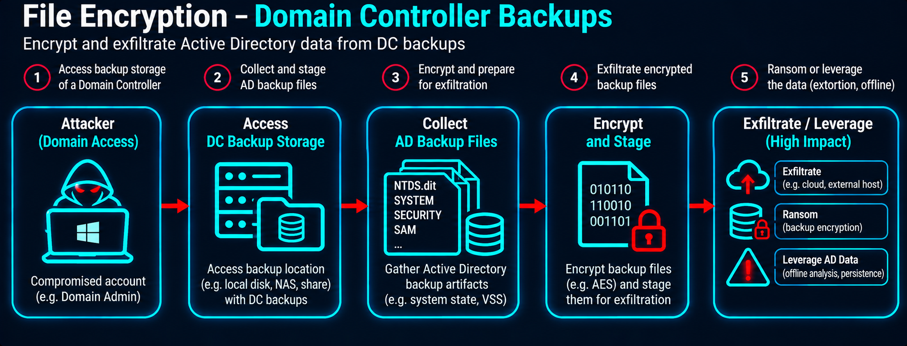

# ASP12 File Encryption Guide | Invoke-Encryption

*Domain Persistence (Phase 12) — ransomware-style encryption of staged files with ransom-note impact popups on every domain controller, and the full restore path that makes the lab reversible.*



> For explicitly authorized lab environments only. Run from an initialized AS2Go module session.

---

## 1. What this workflow does

[Invoke-Encryption](../Private/ASP12/Invoke-Encryption.ps1) walks through the ransomware-impact demonstration — on a **staged copy** in the backup share, not on live system files:

| Step | Action | Details |
|---|---|---|
| 0 | Build the staging folder | New timestamped subfolder `<BackupShare>\<yyyyMMdd_HHmmss>` on the backup share |
| 1 | Copy the staged data | Copies `$env:PUBLIC\AS2Go\Exfiltration\*.*` (ASP11's exfiltration folder) into it, excluding executables and scripts |
| 2 | Leave a ransom note | `RW-<timestamp>.txt` addressed to the current user (*"next time I will encrypt the complete Domain Controller"*) with a file listing, copied into the staging folder as well |
| 3 | Encrypt on confirmation | The note is opened once pre-encryption (readable), then [Start-Encryption](../Private/ASP12/Start-Encryption.ps1) recursively encrypts every file in the staging folder with a machine certificate; the note is opened again post-encryption (now unreadable) |
| 4 | Impact popups | For **every domain controller** in `$Script:AllDCs`, [Start-AS2GoDemoPopup](../Private/ASP12/Start-AS2GoDemoPopup.ps1) copies the ransom-note-style [preview.html](../LabSetup/Encryption/preview.html) locally and opens it on the DC — the visual "your domain is encrypted" moment |

The lab uses a ransomware-like encryption chain on copies; the actual DC system files are never touched. Requires a suitable machine certificate (see section 4.1).

---

## 2. Why ransomware belongs in the Domain Persistence story

- **Ransomware is the monetization step of domain compromise**: every earlier phase (DA access, backup-share reads, exfiltration staging) exists in modern attack chains to prepare exactly this — encrypt what the victim cannot afford to lose, while having exfiltrated a copy first for double-extortion.
- **This demo shows the pre-condition chain**: reach the backup share (write access), stage a copy of exfiltrated data, plant the note, encrypt in place, and broadcast impact to the DCs. The message: ransomware capabilities don't arrive by themselves — they are the tail end of the same compromise chain the other ASP12 phases demonstrate.
- **Encryption-as-leverage needs keys**: the files are encrypted with the machine's RSA/AES pair, and the private key is the only recovery path — exactly the leverage real ransomware creates by holding its key hostage. The lab inverts that deliberately (section 4.2), so the demo is reversible.
- **The security lesson in one line**: protect the backup share's write path and monitor for bulk-encrypt patterns; a ransomware run that starts inside a writable backup share succeeds even against otherwise well-protected domain controllers.

---

## 3. Safe Mode and unattended execution

The workflow has no dedicated SafeMode branch: the confirm prompts are the confirmation to proceed with encryption and DC popups (default: **No** for the popup step). In unattended mode the prompts auto-confirm and the encryption runs; the DC popups still require network access to each DC.

---

## 4. Working notes from the lab

### 4.1 The certificate is a hard prerequisite, not a setup step

`Start-Encryption` searches `Cert:\LocalMachine` for the first certificate with a private key whose subject matches `CN=<COMPUTERNAME>.…`; no match = abort before any file is touched. The certificate must be provisioned in the lab beforehand (setup guide). This inversion is the demo's safety property: no certificate, no encryption, no accidental damage.

### 4.2 The restore path is built in

Before overwriting any file, `Start-FileEncryption` saves a **plain-text copy to the AS2Go temp folder** (`$Script:AS2GoTempDir`, source filename). Every encrypted file has a recoverable twin — the lab is reversible by design, and the AES/RSA file layout (`[keyLen][ivLen][RSA-encrypted session key][IV][AES-256-CBC ciphertext]`) makes that recovery a teaching moment about hybrid encryption: with the certificate's private key, the session key unwraps and the file restores.

Safety boundary worth quoting in review: temp copies use the **source filename only**, so two files with identical names in different subfolders of the staging share overwrite each other's backup.

### 4.3 The ransom note is the before/after proof

The same `RW-…txt` file is opened twice: before encryption (readable text + file listing) and after (binary ciphertext). That single artifact shows the impact arc without any viewer tooling — plaintext-to-ciphertext in the operator's own eyes.

### 4.4 The DC popups are remote, not local

`Start-AS2GoDemoPopup` copies `preview.html` to each DC over the admin share and opens it in an `Invoke-Command` session per DC — the impact is *broadcast* to every domain controller, making the scope of compromise visible across the whole forest rather than only on the running host.

---

## 5. What defenders observe (Blue Team notes)

- **The staging writes precede the encryption**: new timestamped folder on the backup share + bulk copy from the exfiltration folder + a `RW-*.txt` note = the pre-encryption footprint. Sysmon Event 11/12 (file/folder create) with bursts against a share, plus the `NT Authority`-attributed SMB writes from the attacker's session, are the earliest signals — hours before any encryption fires.
- **Bulk-encrypt pattern**: many files rewritten in place in a short window (Sysmon 11 + Event 4663 on the share with WriteData on many paths), *and* each written file is a new hybrid-encrypted blob — size changes by the key/IV header, extension unchanged. Ransomware detection at this fidelity is generic (no malware signature needed): rapid in-place rewrites with header-shaped output is the pattern.
- **The remote popups are a canary**: `Invoke-Command` against every DC within seconds, copying and then opening the same HTML file — Event 4103/4104 (PowerShell remoting + script block) across all DCs from one source is an impact broadcast that no legitimate operation performs. This is the loudest event in the whole phase.
- **The recovery-plan lesson**: real ransomware holds the only key. The lab's plain-text temp copies are the honest mirror of what a *defensible* organization has instead — offline, immutable backups plus tested restore. Discuss backup share isolation (the write path this demo uses), backup immutability, and restore drills alongside the encryption detection.
- **The hardening lesson**: the chain requires (a) write access to the backup share, (b) a usable local certificate, (c) WinRM reachability to all DCs. Remove any one — share write ACLs, certificate hygiene, hardened WinRM — and this phase breaks at a different step each time. Defense-in-depth is the demo outcome.

---

## 6. Command quick reference

```powershell
# 1) Staging + note (as the workflow does):
$stamp = Get-Date -Format 'yyyyMMdd_HHmmss'
$folder = "\\<BackupServer>\<BackupShare>\$stamp"
New-Item $folder -ItemType Directory
Copy-Item "$env:PUBLIC\AS2Go\Exfiltration\*.*" -Destination $folder -Exclude *.exe, *.ps1, .vs*
"$(Get-Date) | Hi user '$env:USERNAME', next time I will encrypt the complete Domain Controller." |
    Out-File "$env:PUBLIC\AS2Go\Exfiltration\RW-$stamp.txt"

# 2) The encryption core (Start-FileEncryption per file):
$plain = [IO.File]::ReadAllBytes($file)                      # read into memory
aes.KeySize = 256; aes.Mode = CBC                            # AES-256-CBC + RSA-wrapped session key
# layout written over the original:
# [4B keyLen][4B ivLen][RSA-encrypted key][IV][AES ciphertext]
# plain-text safety copy saved to $Script:AS2GoTempDir\<name> before the overwrite

# 3) Impact broadcast to every DC:
Start-AS2GoDemoPopup -ComputerName <DC-FQDN> -SourceFile <preview.html>

# 4) Defender view — bulk in-place rewrites on the share:
Get-WinEvent -FilterHashtable @{ LogName = 'Security'; Id = 4663 } `
    -MaxEvents 500 -ComputerName <BackupServer-FQDN> |
    Group-Object { $_.Properties[8].Value } |                 # object name
    Sort-Object Count -Descending | Select-Object -First 10 Count, Name | Format-Table
```

The workflow itself requires no manual commands — run it through the Domain Persistence menu option *Encrypt*, confirm the prompts, and log on to a DC watch-endpoint to see the popup.

---

## 7. Related

- Phase diagram: [ASP12_Encryption.html](../Phases/ASP12_Encryption.html)
- The data this phase encrypts (staged by Phase 11): [ASP11 Data Exfiltration guide](ASP11_Data-Exfiltration.md)
- Ransom-note popup mechanics: [Start-AS2GoDemoPopup.ps1](../Private/ASP12/Start-AS2GoDemoPopup.ps1)
- Encryption core and restore-by-private-key: [Start-Encryption.ps1](../Private/ASP12/Start-Encryption.ps1)
- MITRE ATT&CK: Data Encrypted for Impact [T1486](https://attack.mitre.org/techniques/T1486/), Data Destruction [T1485](https://attack.mitre.org/techniques/T1485/)
