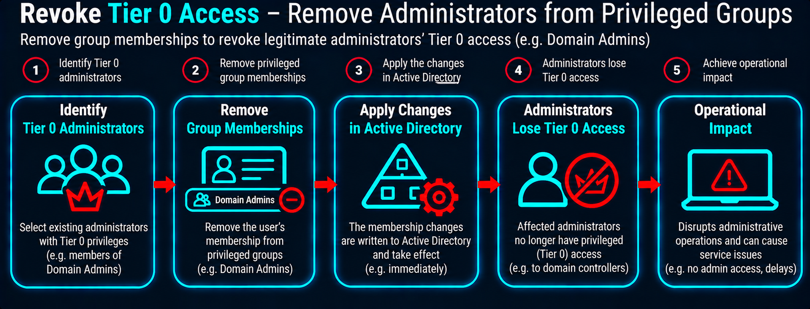

# ASP12 Revoke Tier 0 Access Guide | Invoke-GroupManipulation

*Domain Persistence (Phase 12) — remove every direct member from all privileged groups in a selected scope while protecting only the break-glass and backdoor accounts, and understand why administrative lockout is an attack and a hardening measure at once.*



> For explicitly authorized lab environments only. Run from an initialized AS2Go module session.

---

## 1. What this workflow does

[Invoke-GroupManipulation](../Private/ASP12/Invoke-GroupManipulation.ps1) walks through the administrative-lockout demonstration:

| Step | Action | Details |
|---|---|---|
| 0 | Select the scope | `New-TargetBase` — a single DN or multiple search bases |
| 1 | Resolve the protected accounts | `BreakGlassAccount` and `LastBDUser` from the module configuration are resolved to their SIDs; if no break-glass account is configured, `Set-BreakGlassAccount` asks for one first |
| 2 | Identify privileged groups | All groups under the selected scope whose **RID matches the configured `PriviledgeGroupRIDs` list** (512/517/518/519/520/525/526/527/548/549/550/551/2122 by default) |
| 3 | Show the impact | Groups listed with CanonicalName, SID, domain — plus which accounts are protected before removal |
| 4 | Remove direct memberships | [Remove-AS2GoGroupMembers](../Private/ASP12/Remove-AS2GoGroupMembers.ps1) iterates all identified groups and removes **direct** members except the two protected SIDs |

The caller [Invoke-PrivilegeGroupPurge](../Private/ASP12/Invoke-PrivilegeGroupPurge.ps1) wraps this workflow with a **backup gate**: it offers *Run with current backup*, *Run (but refresh backup first)* via [Export-ADPrivilegedGroupDirectMember](../Public/Export-ADPrivilegedGroupDirectMember.ps1), or *Skip* — and refuses to purge when no usable backup exists. That gate is the defensive counterpart to the purge and turns the same workflow into a Tier-0 hygiene exercise.

---

## 2. What "direct members only" means

`Remove-ADGroupMember -Recursive:$false` is deliberately non-recursive:

| Membership type | Removed? | Why it matters |
|---|---|---|
| Direct member of DA/EA/etc. | **yes** | The obvious attack path is cut |
| Member of a nested group that itself belongs to a privileged group | **no** | Nested privilege survives → the classic audit gap: hygiene runs that only clean the top group leave nested paths intact |
| `primaryGroupID` (512/519/521/522/...) | **no** | Not a membership object at all — invisible to `memberOf` and group-member enumerations (see the [ASP12 Backdoor User guide](ASP12_BackDoorUser.md#2-why-this-account-is-a-strong-persistence-primitive)) |
| Protected SIDs (break-glass, backdoor) | kept | The two accounts the workflow excludes |

This combination is the workshop lesson: a lockout that *looks* complete may leave nested and primary-group paths wide open. Reviewers should always re-check with recursive enumeration and an `adminCount` review before calling a Tier-0 group clean.

---

## 3. The two protected accounts

| Account | Config source | Purpose in the demo |
|---|---|---|
| Break-glass account | `BreakGlassAccount` (set via `Set-BreakGlassAccount`) | The organization's emergency admin — kept so the lab retains one legitimate login path |
| Backdoor account | `LastBDUser` (set by `Invoke-BackdoorUserCreation`) | The attacker's persistence — kept on purpose so the workshop can discuss *why* attackers leave such accounts |

When neither account is configured, the helper retains fallback SID values rather than inventing accounts; missing backdoor data is only logged. Both SIDs are compared **as strings against the member SIDs**, so removal and protection work for users, groups, and computer accounts alike.

---

## 4. Working notes from the lab

### 4.1 The removal loop is per-group, per-member

Removing a member from **one** group at a time (instead of `Remove-ADGroupMember -Members <all>` against all groups in one call) keeps failure isolation: a single failing removal logs an error and continues; the rest of the group is still cleaned. Each removal runs with `-Confirm:$false`, so the workflow does not stall per removal.

### 4.2 The server comes from the group, not from a fixed DC

The loop re-resolves the target server from each group's `Domain` (`$grp.domain`), so groups in **child domains** are written to their own domain controllers even though the caller might have started in another domain. This mirrors what [Add-GPOMemberToBuiltinGroups](../Private/ASP12/Add-GPOMemberToBuiltinGroups.ps1) does on the writing side.

### 4.3 The groups list is RID-driven

The group list comes from `PriviledgeGroupRIDs` in the module configuration — RIDs ending `-512, -518, -519, -520, -548, -549, -550, -551, ...` by default. Groups without a well-known privileged RID (`Builtin\Administrators` S-1-5-32-544, custom Tier-0 OUs' groups) are **not** touched unless their RID is added to that setting.

### 4.4 Scope can be multiple search bases

`New-TargetBase` may return an array. The multi-value path iterates search bases and aggregates the group list before displaying it — so one run can clean several domains' groups in a single pass.

---

## 5. What defenders observe (Blue Team notes)

- **Group change events, in bulk**: every removal produces **Event 4729** (member removed from a security-enabled *domain* group) or **4757** (privileged/EA groups). A burst of these events within seconds across multiple privileged groups is the signature of a lockout — no legitimate administration removes dozens of members simultaneously.
- **Correlate the direction of change**: [Add-GPOMemberToBuiltinGroups](../Private/ASP12/Add-GPOMemberToBuiltinGroups.ps1) (adding, ASP12) and this purge (removing) produce opposite event flows on the same object — an attacker using both keeps the group visually consistent while rotating who holds privilege.
- **The backup gate detects intent change**: the purged-state is only recoverable from the JSON timestamped file `Export-ADPrivilegedGroupDirectMember` wrote *just before*. A defender reviewing events around that timestamp can spot who triggered the purge and from which host.
- **Primary-group and nested paths hide**: a Tier-0 hygiene run is incomplete if the reviewer trusts this workflow's output; re-verify with recursive enumeration (`Get-ADGroupMember -Recursive`) and check `primaryGroupID ≠ 513` for every domain account — both the backdoor demo and this purge depend on that distinction.
- **Break-glass discipline**: organizations *should* protect exactly one emergency account like this — but only with an offline-known password, not an interactive one set live. The demo's break-glass account is the defensive mirror of the attacker's backdoor account (see the [backdoor guide, section 3](ASP12_BackDoorUser.md)).

---

## 6. Command quick reference

```powershell
# Identify privileged groups under a scope by RID list (as the workflow does)
$rids  = (Get-ASConfig -Setting 'PriviledgeGroupRIDs') -split ',' | ForEach-Object { $_.Trim(" '") }
$groups = Get-ADGroup -Filter * -Properties CanonicalName, SID -Server <DC-FQDN> -SearchBase <SCOPE-DN> |
    Where-Object { ($_.SID.Value -split '-')[-1] -in $rids }

# Snapshot direct memberships BEFORE purging (the backup gate does this)
Export-ADPrivilegedGroupDirectMember

# Purge direct members, keeping only the two protected SIDs
Remove-AS2GoGroupMembers -Server <DC-FQDN> `
    -Groups $groups `
    -BreakGlassAccount "<BG-SID>" `
    -BackDoorAccount  "<BD-SID>"

# Verify: recursive view will still show nested paths — that is the lesson
Get-ADGroupMember "<GROUP>" -Recursive | Select-Object Name, objectClass
Get-ADUser <user> -Properties primaryGroupID | Select-Object SamAccountName, primaryGroupID

# Defender view — the removal burst on the DC
Get-WinEvent -FilterHashtable @{ LogName = 'Security'; Id = 4729, 4757 } `
    -MaxEvents 100 -ComputerName <DC-FQDN> |
    Select-Object TimeCreated, Message | Format-List
```

---

## 7. Related

- Phase diagram: [ASP12_Revoke.html](../Phases/ASP12_Revoke.html)
- Backup gate and membership export: [Export-ADPrivilegedGroupDirectMember.ps1](../Public/Export-ADPrivilegedGroupDirectMember.ps1)
- The inverse operation (adding members via GPO): [Add-GPOMemberToBuiltinGroups.ps1](../Private/ASP12/Add-GPOMemberToBuiltinGroups.ps1)
- The account that survives the purge: [ASP12 Backdoor User guide](ASP12_BackDoorUser.md)
- MITRE ATT&CK: Account Manipulation [T1098](https://attack.mitre.org/techniques/T1098/), Access Token Manipulation [T1134](https://attack.mitre.org/techniques/T1134/)
