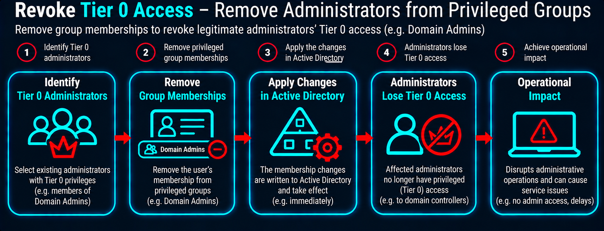

# ASP12 Restore Group Memberships Guide | Import-ADPrivilegedGroupDirectMember

*Domain Persistence (Phase 12) — restore the direct members of privileged groups from the JSON backup created before a purge. The recovery counterpart to the Tier-0 lockout: the demo that removes everyone can also put everyone back.*



> For explicitly authorized lab environments only. Run from an initialized AS2Go module session.

---

## 1. What this workflow does

[Import-ADPrivilegedGroupDirectMember](../Public/Import-ADPrivilegedGroupDirectMember.ps1) restores what the ASP12 purge removed:

| Step | Action | Details |
|---|---|---|
| 0 | Resolve the backup | Uses the saved `ADPrivilegedGroupDirectMember` config path (confirm prompt), falls back to an **OpenFileDialog** if it's unavailable or declined; an explicit `-Path` bypasses both |
| 1 | Validate the backup | Schema check (`SchemaVersion 1`, `MembershipType: DirectMemberAttribute`), forest lookup, **every domain and group record validated before any change**: domain membership in forest, Domain-SID match, writable DC resolved, RID parse, group-SID recomputation (domain-SID vs. `S-1-5-32-...` for Builtin RIDs 548–551), member-DN array checks |
| 2 | Restore memberships | Per group: reads `member` attribute, adds **only missing DNs** via `Set-ADGroup -Add` against the resolved writable DC — `AlreadyMember`, `Skipped` (outside `ShouldProcess`), `Added`, or `Failed` per member, with one result object per member |
| 3 | Report | Result objects (Domain, Group, GroupSid, MemberDn, Status, Error); a terminating error closes the run when any addition failed |

The backup producer is [Export-ADPrivilegedGroupDirectMember](../Public/Export-ADPrivilegedGroupDirectMember.ps1) — written *before* the purge by the backup gate in [Invoke-PrivilegeGroupPurge](../Private/ASP12/Invoke-PrivilegeGroupPurge.ps1), and also by the ASP12 purge workflow itself. Together with [Invoke-GroupManipulation](../Private/ASP12/Invoke-GroupManipulation.ps1) this pair forms ASP12's reversible Tier-0 demo.

---

## 2. Why the restore is the demo's safety and the IR lesson

- **Every destructive demo needs its rewind**: Phase 12's purge removes members from privileged groups — without this import, the lab state would be a one-way door. The backup gate (purge refuses without a usable backup) plus this restore form the same pattern defenders should have in production: *snapshot before bulk change, restore path tested*.
- **The real-world lesson is the recovery playbook**: in an incident, "who was in Domain Admins before the attacker purged" is exactly the question this pair answers. The JSON is a point-in-time snapshot of Tier-0 membership — its timestamp and diff vs. current state are incident evidence and recovery work-list at once.
- **Idempotent by design**: re-running the import on an already-restored state does nothing (`AlreadyMember`), so it is safe to run repeatedly while diagnosing a partially-failed import — the same pattern that makes real IR tooling trustworthy.
- **The security lesson in one line**: protect the backup *worse than the groups themselves* — an attacker who also corrupts the restore path (config pointer, backup file) makes the lockout stick. The demo's config-stored pointer is a convenient lab convenience and a real-world anti-pattern to discuss.

---

## 3. Parameters and modes

| Parameter | Effect |
|---|---|
| `-Path <file>` | Explicit JSON backup; bypasses saved-path prompt and file picker |
| `-Silent` | Suppresses routine output and the per-member result objects — for pipeline/automation use; errors and `ShouldProcess` prompts remain |
| `-Preview` | Shows the planned steps without touching files or AD |
| `-WhatIf` / `-Confirm` | `SupportsShouldProcess, ConfirmImpact = 'High'` — every add goes through `ShouldProcess`; `-WhatIf` validates the backup against AD and shows planned additions with no changes |

High `ConfirmImpact` means interactive sessions prompt per group — deliberate for a Tier-0 write function.

---

## 4. Working notes from the lab

### 4.1 The validation phase makes the import tamper-evident

Before any write, the import re-derives the **expected group SID from the forest's Domain-SID + recorded RID** (or the well-known `S-1-5-32-*` form for Builtin RIDs) and compares it with the recorded SID; domain-SID mismatches, unknown domains, RID 0, and unexpected statuses throw. A backup edited by hand (or by an attacker) fails loudly rather than writing a poisoned membership.

### 4.2 Restore writes DNs, not identity objects

The `member` attribute receives the recorded **distinguished name strings directly** (typed `[string[]]`, because AD-attribut hashtables do not unwrap JSON-PSObjects) — `Set-ADGroup -Add` resolves the reference. Nested groups come back as nested (no expansion, matching the export), foreign security principals keep their original form. Membership is **preserved**, never replaced: the import is additive-only by design.

### 4.3 Each group is resolved by SID against a fresh writable DC

`Get-ADDomainController -Discover -Writable` per domain — so multi-domain restores write to each domain's own writable controller, mirroring the purge loop. The resolved `DomainSid` comparison catches the notepad-rename case where someone re-pointed the backup at another forest: same names, different SIDs, clean rejection.

### 4.4 The failure policy is report-then-throw

Per-member failures are collected and surfaced as result objects/`Warning`s while the loop continues; after processing, a terminating error summarizes `N failed membership additions`. Partial success is visible, and the exit signal distinguishes clean imports from partially failed restores — the pattern an IR orchestrator can rely on.

### 4.5 Missing groups flow through as skips

Groups recorded as `Missing` in the backup (e.g. the backup ran before the lab reset) are skipped at validation — so a backup taken before a lab rebuild still imports cleanly, restoring only the groups that exist.

---

## 5. What defenders observe (Blue Team notes)

- **The restore writes the same audit trail as the attack**: every `Set-ADGroup -Add` on a privileged group is Event **4728/4756** (member added to security group) — the *inverse* of the purge burst (4729/4757). A real incident's IR would show the attacker's removal burst followed closely by the response team's addition burst; in the demo, the two bursts are the before/after of the same exercise and the correlation window (minutes apart, same privileged operator) is the story.
- **Backup hygiene is Tier-0 material**: the JSON contains the full Tier-0 membership snapshot with DNs and SIDs of privileged accounts. Treat its storage path as Tier-0 (permissions, DPAPI-protected config pointer, retention) — an attacker who can read the backup learns the full privileged group chain; an attacker who can *write* it can poison the next restore with an accomplice DN. The demo's `Validate` phase (section 4.1) is the model: expect the restore to re-check what the attack could have tampered with.
- **Idempotent restore = safe re-run in incident playbooks**: `AlreadyMember` results make re-execution lossless — the playbook pattern for recovery tooling. The same property the module's `Test-Access-*` helpers show: recovery functions must be re-runnable without knowledge of prior partial states.
- **The hardening lesson**: for every bulk-change demo there is a bulk-restore counterpart — keep backups *outside* the attacking user's write reach, validate on read (schema + SIDs), make writes additive/idempotent, and audit the restore burst separately from the attack burst. The demo pair (Export → Purge → Import) is the miniature of that playbook.

---

## 6. Command quick reference

```powershell
# 0) Snapshot before the purge (the restore partner):
Export-ADPrivilegedGroupDirectMember
#    → timestamped JSON under the config dir; path recorded in ADPrivilegedGroupDirectMember

# 1) Validate without changes (planned additions only):
Import-ADPrivilegedGroupDirectMember -Path '<backup>.json' -WhatIf

# 2) Restore from the saved backup (config pointer used, confirm per group):
Import-ADPrivilegedGroupDirectMember

# 3) Restore from an explicit file silently, then filter the results:
Import-ADPrivilegedGroupDirectMember -Path '<backup>.json' -Silent
Import-ADPrivilegedGroupDirectMember -Path '<backup>.json' |
    Where-Object { $_.Status -ne 'AlreadyMember' } |
    Select-Object Status, Domain, Group, MemberDn | Format-Table -AutoSize

# 4) Defender view — the restore burst (member added to privileged groups):
Get-WinEvent -FilterHashtable @{ LogName = 'Security'; Id = 4728, 4756 } `
    -MaxEvents 100 -ComputerName <DC-FQDN> |
    Select-Object TimeCreated, Message | Format-List
```

The workflow itself requires no manual commands — the backup gate in the ASP12 purge run offers the Export/Refresh options, and a later `Import-ADPrivilegedGroupDirectMember` restores the snapshot with prompts.

---

## 7. Related

- Phase diagram: [ASP12_Revoke.html](../Phases/ASP12_Revoke.html)
- The purge counterpart: [ASP12 Revoke Tier 0 Access guide](ASP12_RemoveGroupMember.md)
- The backup producer: [Export-ADPrivilegedGroupDirectMember.ps1](../Public/Export-ADPrivilegedGroupDirectMember.ps1)
- The backup gate wrapping the purge: [Invoke-PrivilegeGroupPurge.ps1](../Private/ASP12/Invoke-PrivilegeGroupPurge.ps1)
- MITRE ATT&CK: Account Manipulation [T1098](https://attack.mitre.org/techniques/T1098/) — the restore path is the mitigations' inverse of the same technique
