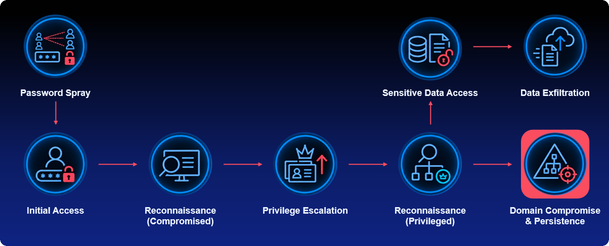

# ASP12 Coordinated Reboot Guide | Invoke-Shutdown

*Domain Persistence (Phase 12) — schedule a coordinated reboot or shutdown across all reachable domain controllers simultaneously, and understand why availability is the third pillar an attacker can take away after confidentiality and integrity.*



> For explicitly authorized lab environments only. Run from an initialized AS2Go module session.

---

## 1. What this workflow does

[Invoke-Shutdown](../Private/ASP12/Invoke-Shutdown.ps1) walks through the coordinated power-action demonstration:

| Step | Action | Details |
|---|---|---|
| 0 | Choose the action | `Reboot` (default), `Shutdown`, or `Skip`; unattended runs default to `Reboot` |
| 1 | Show the target set | `$Script:AllDCs` table (Online, Root domain, FQDN, RODC, OS) — the inventory the phase will act on |
| 2 | Schedule per DC | For every **reachable** DC (ping check, 1×32-byte buffer), `shutdown /r /f` or `/s /f` with the configured delay and a taunting message; the local computer and unreachable DCs are skipped and reported |

Three configuration values drive the run: the `UseCase` label and `time2reboot` delay (both from the module settings shown by `Get-AS2GoSettings`), and the DC inventory built by `Set-BestDomainController`. The comment text is deliberately provocative (*"Your network was hacked. All Domain Controllers will be rebooted in N seconds!!"*) — it is the message a real attacker wants helpdesk and users to read while the outage begins.

Start `Start-AS2GoDemo` and select **Reboot**, or run it through the Domain Persistence menu.

---

## 2. Why coordinated reboot is an attack action

- **Availability is a confidentiality story**: taking every DC down at once breaks authentication, GPO processing, DNS/AD-integrated services, and file access forest-wide. With the exfiltrated data from ASP11 (or the KRBTGT key from the Golden Ticket phase), the attacker does not need the domain online anymore — the outage is punishment or misdirection, not the goal.
- **The delay is the defender's window — and the attack's feature**: `/t <seconds>` gives helpdesk a countdown to cancel (`shutdown /a` on each DC). The demo makes both sides visible: as an attacker, the delay avoids the run crashing mid-deployment; as a defender, knowing *abort exists and must be typed on every DC individually* is the recovery story.
- **Legit tooling, illegitimate intent**: `shutdown.exe /m` is a first-party remote-administration tool. No malware, no exploit — domain admin rights alone decide between an approved maintenance reboot and coordinated sabotage. That is the classic T1529 story (System Shutdown/Reboot), and it is why 4672-privileged sessions on DCs matter more than binary reputation.
- **The security lesson in one line**: who can authenticate as Domain Admin to every DC can also switch them all off; constrain interactive DA logons (PAW model) and alert on remote power actions — not on "malicious binaries."

---

## 3. Safe Mode and unattended execution

There is no dedicated Safe Mode branch. Unattended runs default to **Reboot** with the configured delay; interactive runs ask explicitly. The phase has the highest real-world impact of ASP12 — in production-shaped labs, coordinate the run window with the lab owner before confirming.

---

## 4. Working notes from the lab

### 4.1 The target loop skips two things deliberately

The per-DC loop excludes (a) the **local computer** (`$env:COMPUTERNAME -ne $computer.name`) — so the attacking session does not pull its own rug, and (b) **unreachable DCs** (ping check per target, reported as warnings rather than failures). OS-specific branches for Windows 7/10 clients exist in the structure, but only the Windows Server branch fires against the DC inventory.

### 4.2 The comment text is the visible impact

`shutdown /c "<comment>"` puts the taunt on every DC's shutdown screen — users and admins *see* the message during the countdown. This is the demo's impact moment: the domain's own admin tooling broadcasting the compromise message on the domain's most trusted machines.

### 4.3 The inventory comes from Set-BestDomainController

`$Script:AllDCs` (built by `Set-BestDomainController`) includes RODC and OS columns — so the run acts on every domain regardless of write-status (RODCs reboot like any other DC). Combined with the per-domain `Online` flag, the table makes the blast radius reviewable before confirmation.

### 4.4 Caller context in the phase menu

In the Domain Persistence menu, the Reboot option triggers this workflow and then proceeds to `Stop-AS2GoDemo` — rebooting the domain is treated as the demonstration's endpoint, not a mid-run action. Plan the demo schedule around it (do this last; authentication interruptions follow).

---

## 5. What defenders observe (Blue Team notes)

- **Remote power actions are individually auditable**: each `shutdown /m` produces an interactive/remote logon on the target DC with the caller's privileges — Event 4624 (Type 3 or 2 via `shutdown` RPC) plus Event 1074 (system initiation: *shutdown/reboot requested by user on behalf of user*). A 1074 with the attacker's message text is self-documenting evidence.
- **The pattern is the signal**: 1074 events for **many DCs within the same seconds window**, same source, same comment string — no legitimate maintenance reboots every domain controller simultaneously. Correlate 1074 bursts per source with 4624 logons from that source across the DC set.
- **Cancellation is manual and per-DC**: `shutdown /a` aborts a pending shutdown only on the machine it runs on — recovery under time pressure is per-target work. This is the business-continuity lesson for the demo: DC power actions need change-freeze alerting, and the `/a` drill belongs in the recovery playbook.
- **The hardening lesson**: restrict interactive Domain Admin logons to PAWs, alert on any remote `shutdown.exe` execution against server assets (4688 process creation with `shutdown /r /m` or `/s /m`), and treat multi-DC 1074 bursts as an incident trigger — not as scheduled maintenance noise.

---

## 6. Command quick reference

```powershell
# The core action (as the workflow runs it per DC):
shutdown /r /f /c "<UseCase> | Your network was hacked..." /t <seconds> /m \\<DC-FQDN>
shutdown /s /f /c "<..>" /t <seconds> /m \\<DC-FQDN>          # shutdown variant

# Review the inventory the workflow uses:
$Script:AllDCs | Select-Object Online, Root_Domain, FQDN, RODC, OperatingSystem | Format-Table

# Cancel a pending shutdown (per DC!):
shutdown /a /m \\<DC-FQDN>

# Defender view — shutdown initiations across the DC set:
Get-WinEvent -FilterHashtable @{ LogName = 'System'; Id = 1074 } `
    -MaxEvents 50 -ComputerName <DC-FQDN> |
    Select-Object TimeCreated, Message | Format-List

# Process-side detection on the initiating host (Sysmon):
Get-WinEvent -FilterHashtable @{ LogName = 'Microsoft-Windows-Sysmon/Operational'; Id = 1 } `
    -MaxEvents 200 | Where-Object { $_.Message -match 'shutdown\.exe.*(\\/r|\\/s).*\\/m' } |
    Select-Object TimeCreated, Message | Format-List
```

The workflow itself requires no manual commands — run it through the Domain Persistence menu option *Reboot*, choose the action, and watch the DC inventory table before the countdown starts.

---

## 7. Related

- Phase diagram: [ASP12.html](../Phases/ASP12.html)
- DC inventory source: [Set-BestDomainController.ps1](../Private/Shared/Set-BestDomainController.ps1)
- Demo endpoint sequencing (Reboot ends the demonstration): [Invoke-Phase12DomainCompromisePersistence.ps1](../Public/Invoke-Phase12DomainCompromisePersistence.ps1)
- MITRE ATT&CK: System Shutdown/Reboot [T1529](https://attack.mitre.org/techniques/T1529/), Service Stop [T1489](https://attack.mitre.org/techniques/T1489/)
