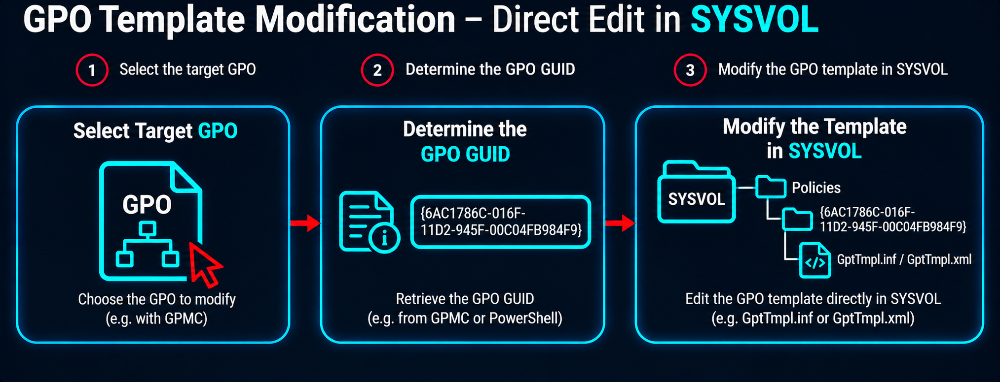

# ASP12 GPO Template Modification Guide | Invoke-GPTManipulation

*Domain Persistence (Phase 12) — edit Group Policy Template files directly in SYSVOL so every computer applying the GPO receives the malicious configuration, and understand why SYSVOL must be treated as part of the control plane.*



> For explicitly authorized lab environments only. Run from an initialized AS2Go module session.

---

## 1. What this workflow does

[Invoke-GPTManipulation](../Private/ASP12/Invoke-GPTManipulation.ps1) walks through the GPO-weaponization demonstration:

| Step | Action | Details |
|---|---|---|
| 0 | Select a GPO | `Get-TargetGPO` resolves DomainDNS, GUID, display name, and the SYSVOL server; the workflow shows the GPO's *before* state via `Get-GPOSettings` |
| 1 | Choose a technique | Local group membership (M), scheduled task (S), or user-rights assignment (U) — the menu repeats in a loop (M → S → U → M …) so several techniques can be layered on the same GPO |
| 2 | Edit the GPT file in SYSVOL | Each technique writes its well-known template file (`Groups.xml`, `ScheduledTasks.xml`, `GptTmpl.inf`) directly under `\\<DC>\SYSVOL\<domain>\Policies\{GUID}\...` |
| 3 | Register the CSE extension | `Set-GPCMachineExtensionNames` writes `gPCMachineExtensionNames` in AD so client-side processing actually applies the file |
| 4 | Show the *after* state | `Get-GPOSettings -postfix after` displays the changed GPO |

The three technique helpers are [Add-GPOMemberToBuiltinGroups](../Private/ASP12/Add-GPOMemberToBuiltinGroups.ps1), [Add-GPOScheduleTask](../Private/ASP12/Add-GPOScheduleTask.ps1), and [Add-GPOUserRightAssignments](../Private/ASP12/Add-GPOUserRightAssignments.ps1). Each registers its own CSE GUID — the group-preference extension, the scheduled-task extension, or the security-template extension — so a single GPO can carry all three payloads.

---

## 2. The three techniques

### 2.1 Local group membership (Groups.xml)

`Add-GPOMemberToBuiltinGroups` adds a trustee to **Administrators (built-in)** and **Remote Desktop Users (built-in)** on every computer applying the GPO:

- Trustee choices: `Authenticated Users` (S-1-5-11), `Domain Users` (RID 513 of the GPO's domain), the configured **backdoor account** (`LastBDUser`), or any user/group picked in the AD tree.
- The file `Machine\Preferences\Groups\Groups.xml` is created with the correct `clsid` if absent; existing `<Group>` elements are reused, missing ones appended.
- Trustees are appended as `<Member>` entries with name + SID; the local-group CSE then applies the members at the next policy refresh.
- Because Domain Users → local Administrators applies to **every domain user on every targeted computer**, this single XML edit is effectively "everyone is admin" — the strongest lateral-movement lever in the demo.

### 2.2 Scheduled task (ScheduledTasks.xml)

`Add-GPOScheduleTask` appends a `<Task>` element named `ST-<date>.<time>` (description: *"A bad actor was here"*):

- `appName: cmd.exe`, `args: /c powershell.exe -nop -w hidden \\<SYSVOL-HOST>\...\scripts\surprise.ps1` — a hidden PowerShell execution of a script served from SYSVOL itself.
- Daily trigger at 06:00 starting tomorrow, `systemRequired="1"`, no battery constraints — a task that fires on real workstations reliably.
- Payload lives on SYSVOL: the task and the script share the same replication channel, so no external infrastructure is visible.

### 2.3 User-rights assignment (GptTmpl.inf)

`Add-GPOUserRightAssignments` edits `Machine\Microsoft\Windows NT\SecEdit\GptTmpl.inf` under `[Privilege Rights]`:

| Right | Trustee written | Effect on targeted machines |
|---|---|---|
| `SeTcbPrivilege` (Act as part of the operating system) | `*S-1-1-0` (Everyone) or `*S-1-5-11` (Authenticated Users) | Path toward token manipulation/SYSTEM-level contexts |
| `SeDebugPrivilege` (Debug programs) | same | Attach to any process — LSASS read, token theft, AV/EDR process manipulation |
| `SeRemoteInteractiveLogonRight` | same | RDP possible for everyone — lateral movement door into workstations/servers |

The helper is idempotent: it detects existing lines and appends the second trustee (`,*S-1-5-11`) instead of duplicating, and only creates the `[Privilege Rights]` section plus the `[Unicode]`/`[Version]` headers when the INF is fresh.

---

## 3. SYSVOL write mechanics worth knowing

### 3.1 GPC/GPT split

Group Policy is split: the **GPC** (container object in AD) holds metadata (`gPCMachineExtensionNames` naming the client-side-extension GUIDs), the **GPT** (files in SYSVOL) holds the settings themselves. An attacker with write access to SYSVOL can put arbitrary content into the GPT — but clients only process it when the GPC names the matching CSE GUID. **Both files and AD attribute are needed**, which is why each helper finishes with `Set-GPCMachineExtensionNames`.

### 3.2 Write order matters when security controls watch SYSVOL

The helpers write the SYSVOL file(s) **first** and update the AD-side extension list **afterwards**. An early AD write can trigger DC-side policy processing while the file is still being written — in the lab this previously coincided with `Groups.xml` disappearing mid-flow (Defender quarantine on the DC). All three helpers therefore re-check the file between writes and report the disappearance as a warning with a rerun hint instead of crashing.

### 3.3 The loop is cumulative

The repeat menu keeps the same GPO selected across techniques (M → S → U), so one demo run can build a single GPO that makes everyone local admin, drops a daily hidden task, and hands out SeDebugPrivilege — a complete workstation-compromise chain with zero exploit code, only file writes.

---

## 4. Working notes from the lab

### 4.1 The payload script must exist in `NETLOGON/SYSVOL\scripts`

The scheduled task invokes `\\<domain>\SYSVOL\<domain>\scripts\surprise.ps1`. That file is part of the lab share content; if it is missing, the task fires into nothing. For customization, replace the args while keeping the `-w hidden` discussion point — then the lesson becomes detection of hidden-window PowerShell from SYSVOL.

### 4.2 GPO selection honors linked scope

`Get-TargetGPO` picks from GPOs in scope; a deliberately chosen OU-linked GPO (e.g. workstations) makes the blast radius visible in the demo — the same edit scoped to Domain Controllers would target a different tier. Discuss scoping both as attacker lever and defender control (who can write which GPO, and where is SYSVOL write access delegated).

### 4.3 `before` and `after` snapshots

`Get-GPOSettings` renders HTML snapshots (`GP-<GUID>-before.html` / `-after.html` in the temp dir) so the workshop can compare states on screen — a clean, self-contained evidence story without touching the GPC logging.

---

## 5. What defenders observe (Blue Team notes)

- **File-integrity is the primary detection**: everything here is plain file writes to SYSVOL. Monitor `\\<domain>\SYSVOL\...` for changes to `Groups.xml`, `ScheduledTasks.xml`, and `GptTmpl.inf` (Sysmon FileCreate events, Azure/Defender-for-Identity abnormal sensitive-group modification, SYSVOL-focused file auditing). Any unexpected `Groups.xml` is anomalous by definition — most environments do not use local-group preferences legitimately in Tier-0-adjacent OUs.
- **GPC/GPT correlation**: Event 5136 (`gPCMachineExtensionNames` attribute change) or an AD replication change of the GPC paired with a SYSVOL file change is exactly the CSE-registration signature. Alert when the extension list gains *new* GUIDs on an existing GPO.
- **Scheduled task content**: the payload pattern `cmd.exe /c powershell… -w hidden` from a SYSVOL UNC path is a high-signal detection; correlate the file change with client-side Event 4698 (task created by policy) and 400/111 task-scheduler operational logs at trigger time.
- **Privilege rights in INF**: `SeDebugPrivilege`/`SeTcbPrivilege` granted to Everyone or Authenticated Users deviates so strongly from baselines that a simple diff policy (compare `GptTmpl.inf` against approved baseline) catches it. RSAT's security-template diffing does this out of the box.
- **The hardening lesson**: constrain **who can edit SYSVOL** (Domain Admins and delegated GPO edit owners only), alert on GPO edits outside change windows, and use Tiered administration so workstation GPOs cannot be edited by accounts with only workstation-local rights. Every technique in this phase fails the moment SYSVOL write access is protected and monitored.

---

## 6. Command quick reference

```powershell
# Where each technique lands inside a GPO (SYSVOL paths):
#   \\DC\SYSVOL\<domain>\Policies\{GUID}\Machine\Preferences\Groups\Groups.xml
#   \\DC\SYSVOL\<domain>\Policies\{GUID}\Machine\Preferences\ScheduledTasks\ScheduledTasks.xml
#   \\DC\SYSVOL\<domain>\Policies\{GUID}\Machine\Microsoft\Windows NT\SecEdit\GptTmpl.inf

# Inspect what a GPO currently contains (before/after comparison)
Get-GPOSettings -ID <GUID> -Name <GPO> -postfix before

# The core manual writes (as the helpers do):

# 1) Local group membership — append a <Member> to the built-in Administrators group entry
[xml]$xml = Get-Content "\\<DC>\SYSVOL\<domain>\Policies\{<GUID>}\Machine\Preferences\Groups\Groups.xml"
$xml.Save("\\<DC>\SYSVOL\<domain>\Policies\{<GUID>}\Machine\Preferences\Groups\Groups.xml")

# 2) Register the CSE extension (group-preference example)
Set-GPCMachineExtensionNames -GPOGUID <GUID> -CSEGUID $Script:CSEGUIDLocalUaG -TOOLGUID $ToolGUIDLocalUaG -Server <domain>

# 3) User rights — the written line pattern in GptTmpl.inf [Privilege Rights]:
#    SeDebugPrivilege = *S-1-1-0            (Everyone gets debug)
#    SeTcbPrivilege   = *S-1-1-0            (Everyone acts as part of OS)
#    SeRemoteInteractiveLogonRight = *S-1-5-11

# 4) Defender view — SYSVOL/GPO change correlation on DCs
Get-WinEvent -FilterHashtable @{ LogName = 'Security'; Id = 5136 } -MaxEvents 50 -ComputerName <DC-FQDN> |
    Where-Object { $_.Message -match 'gPCMachineExtensionNames|Groups.xml|GptTmpl' } |
    Select-Object TimeCreated, Message | Format-List
```

The workflow itself requires no manual commands — run `Invoke-GPTManipulation` (or Phase 12 menu option *Tamper GPT*) and choose techniques in the repeat menu.

---

## 7. Related

- Phase diagram: [ASP12_GPT.html](../Phases/ASP12_GPT.html)
- The inverse path (group membership removal, no SYSVOL writes): [ASP12 Revoke Tier 0 Access guide](ASP12_RemoveGroupMember.md)
- Persistence account that can be granted via `Groups.xml`: [ASP12 Backdoor User guide](ASP12_BackDoorUser.md)
- MITRE ATT&CK: Group Policy Modification [T1484.001](https://attack.mitre.org/techniques/T1484/001/), Account Manipulation [T1098](https://attack.mitre.org/techniques/T1098/), MS-GPPREF protocol specification ([Microsoft Learn](https://learn.microsoft.com/en-us/openspecs/windows_protocols/ms-gppref/))
