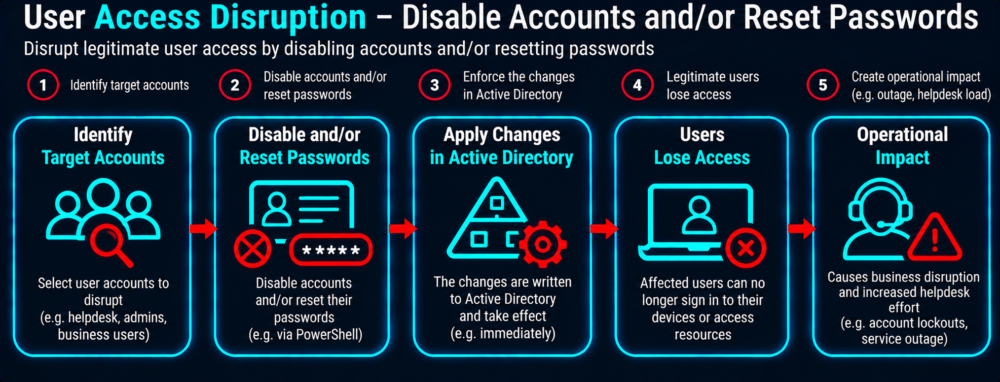

# ASP12 User Access Disruption Guide | Invoke-UserAccountDisruption

*Domain Persistence (Phase 12) — disable user accounts and reset their passwords at scale to create operational business impact, and understand why bulk account manipulation is a sabotage attack that defenders must catch in minutes, not hours.*



> For explicitly authorized lab environments only. Run from an initialized AS2Go module session.

---

## 1. What this workflow does

[Invoke-UserAccountDisruption](../Private/ASP12/Invoke-UserAccountDisruption.ps1) walks through the account-disruption demonstration:

| Step | Action | Details |
|---|---|---|
| 0 | Show the blast surface | Password-policy overview for every forest domain (domain type, enabled users, min. length, complexity) — the same data an attacker uses to pick a profitable target scope |
| 1 | Choose the action | `Disable Users`, `PW Reset`, `Both`, or `Skip` |
| 2 | Select the scope | `Set-AttackScope` — a single OU/domain or **all domains in the forest** |
| 3 | Fix the replacement password | `Get-RandomPassword` (modifiable in interactive mode; stored DPAPI-protected in `LastPW` when changed) |
| 4 | Execute in bulk | [Start-UserAccountDisruption](../Private/ASP12/Start-UserAccountDisruption.ps1) runs LDAP writes in parallel (throttle 5), with live progress, DC CPU and LDAP-latency metrics, and a `Q` abort |

Every successfully changed account is stamped with a timestamp in `adminDescription` (the **TickValue**), so a matching [Undo-UserManipulation](../Private/ASP12/Undo-UserManipulation.ps1) can reverse exactly the accounts this run touched — the lab's built-in recovery path.

---

## 2. Disruption and why attackers do it

Password reset + disable is not persistence — it is **sabotage with a message**:

- **Business impact**: every disabled account is a support ticket; every reset invalidates Kerberos TGTs, cached credentials, and often stored mobile-device tokens simultaneously. A forest wide run creates helpdesk load that can occupy IT for days — the outage is the attacker's leverage.
- **Ransomware-adjacent playbooks** disable accounts to *slow the response*: blue-team triage cannot log in, service accounts get locked, and the incident bridge loses visibility while the payload runs.
- **Password reset as lockout**: setting a shared random password on hundreds of accounts means the attacker holds one credential that later unlocks any of them — disruption first, selective re-use for follow-up access afterwards.
- **The demo's asymmetry**: the attacker's own accounts (backdoor, break-glass) are **excluded** — the disruption only burns accounts the victim needs. That asymmetry *is* the lesson: disruption hurts defenders, not the intruder.

---

## 3. What the parallel executor actually does

[Start-UserAccountDisruption](../Private/ASP12/Start-UserAccountDisruption.ps1) replaces pure AD-module calls with **raw LDAP over `System.DirectoryServices.DirectoryEntry`** per user:

| Per-user write | Implementation |
|---|---|
| Password reset | `DirectoryEntry.Invoke("SetPassword", <pw>)` |
| Disable | `userAccountControl -bor 2` (flag OR) |
| Tick marker | `adminDescription = <TickValue>` |
| Commit | single `CommitChanges()` round-trip per action group |

The design notes in the code are worth quoting in review: raw LDAP **"completely avoids ADWS and its connection pool limit — the root cause of the 'transient condition' error under parallel load"**. For a workshop, this is a real-world scale lesson: bulk changes against 25,000-user labs hit ADWS throttling before they hit LDAP.

Protection in the same helper:

- **Backdoor account** (`$global:BDUser`) and **break-glass account** (`BreakGlassAccount`) are excluded by SamAccountName before the parallel pool starts.
- An unresolvable break-glass DN **aborts the run** deliberately — a safety lock against wiping out the lab's only recovery path.

---

## 4. Working notes from the lab

### 4.1 The TickValue is a reversible marker

Each run generates `TickValue = Get-Date -Format 'yyyy-MM-dd HH:mm:ss'` and writes it verbatim into `adminDescription`. [Undo-UserManipulation](../Private/ASP12/Undo-UserManipulation.ps1) re-selects users by exactly that attribute value and re-enables them — the demo can crash a domain and restore it in two commands. In code review, this marker doubles as a *forensic pattern*: attribute-value stamping of bulk changes is exactly what IR later looks for.

### 4.2 Q-abort with live metrics

The monitor loop polls the parallel job every 250 ms, checks `Console.KeyAvailable` for a `Q` abort, and refreshes DC CPU (% Processor Time) and LDAP latency (RootDSE ping) as background jobs — non-blocking, so progress stays smooth over thousands of users. The abort via `Stop-Job` leaves already-committed writes in place; the TickValue marker still identifies every completed one.

### 4.3 Scope options differ in domain handling

- **Single OU/domain**: `Get-BestDomainController` resolves the target DC once; one parallel run.
- **All domains in forest**: the loop iterates `Get-ADForest().Domains`, resolves each domain's DN, and runs a fresh `Start-UserAccountDisruption` per domain — password resets land on each domain's own DC, disabled accounts propagate through replication like normal writes.

### 4.4 Unattended mode always regenerates the password

In `-UnAttended` runs, a fresh `Get-RandomPassword` overrides everything — the automated demo never writes a user-supplied password across the forest, avoiding accidental reuse of a real-world credential.

---

## 5. What defenders observe (Blue Team notes)

- **Event burst is the detection**: each disable → **4722** (re-enable)/**4725** (disable), each reset → **4724** (password set — by another account) + **4723** (self-service variant) in rapid succession for the same initiator. Baseline: password resets per hour are low single digits; an incident produces **hundreds in under a minute**. Threshold + burst correlation beats per-event alerting.
- **The initiator is the story**: all changes carry the same caller SID/host (MDI: suspicious account manipulation). Correlate with the privileged session that started it — this phase runs *after* Domain Admin access, so the alert should tie to an earlier privilege-escalation event from the same session chain.
- **adminDescription stamping is unusual**: mass attribute writes to `adminDescription` with an identical timestamp string are not a legitimate admin pattern. Event 5136 filtering on that attribute is a precise detector for this tooling pattern — and a general lesson for any bulk-script marker.
- **ADWS vs LDAP visibility**: AD-module changes produce ADWS audit paths; raw LDAP writes surface differently (4724/4725 still fire, but the *volume pattern* differs). Detection must not assume one management channel — bulk-parallel writes often intentionally use raw LDAP/LDAPS.
- **The recovery plan lesson**: the TickValue-based undo only works because a marker exists. Organizations should keep **restore plans that do not depend on the attacker's tools**: break-glass account offline (typed password, never stored), verified backups of `userAccountControl`/`pwdLastSet` state, and a tested emergency-access path (see [ASP12 RemoveGroupMember.md](ASP12_RemoveGroupMember.md) — the same account is protected from group purge and disruption).

---

## 6. Command quick reference

```powershell
# What the workflow does — reproduce the core manually:

# 1) Disable (flag OR 2) on a set of users, no AD-module overhead:
$users = Get-ADUser -Filter "Enabled -eq 'True'" -SearchBase <SCOPE-DN> -Server <DC-FQDN> -Properties SamAccountName, SID |
    Where-Object { $_.SamAccountName -notin @('<BD-User>', '<BreakGlass-User>') }
foreach ($u in $users) {
    $e = New-Object System.DirectoryServices.DirectoryEntry "LDAP://<DC-FQDN>/$($u.DistinguishedName)"
    $uac = [int]$e.Properties["userAccountControl"].Value
    $e.Properties["userAccountControl"].Value = $uac -bor 2
    $e.Properties["adminDescription"].Value = "2026-11-25 13:30:00"
    $e.CommitChanges()
    $e.Dispose()
}

# 2) Password reset via LDAP:
$e.Invoke("SetPassword", "<NewRandomPassword>")

# 3) Recovery — re-enable exactly the accounts this run touched:
Undo-UserManipulation -SearchBase <SCOPE-DN> -Server <DC-FQDN> -TickValue "2026-11-25 13:30:00"

# 4) Defender view — the disruption burst on the DC:
Get-WinEvent -FilterHashtable @{ LogName = 'Security'; Id = 4725, 4724, 4723 } `
    -MaxEvents 200 -ComputerName <DC-FQDN> |
    Select-Object TimeCreated, @{N='Initiator';E={$_.Properties[1].Value}}, Message |
    Format-List
```

---

## 7. Related

- Phase diagram: [ASP12_Disruption.html](../Phases/ASP12_Disruption.html)
- Parallel executor and TickValue mechanics: [Start-UserAccountDisruption.ps1](../Private/ASP12/Start-UserAccountDisruption.ps1)
- Reversal workflow: [Undo-UserManipulation.ps1](../Private/ASP12/Undo-UserManipulation.ps1)
- The account that survives the disruption (and why): [ASP12 Backdoor User guide](ASP12_BackDoorUser.md)
- MITRE ATT&CK: Account Access Removal [T1531](https://attack.mitre.org/techniques/T1531/), Account Manipulation [T1098](https://attack.mitre.org/techniques/T1098/)
