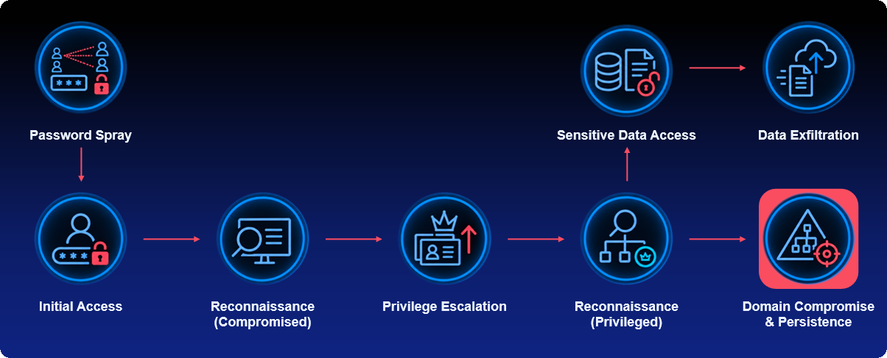

# ASP12 | Domain Compromise & Persistence



ASP12 is the entry point for the final phase of the AS2Go demonstration. It presents actions that demonstrate persistence and impact after privileged access has been obtained. This page is an overview only; each action has its own guide where available.

Complete the shared preparation in [ASP00 Installation and Setup](ASP00__Setup.md) first. Run ASP12 only in the authorized lab and in a Windows session with the privileges required by the selected action. Requirements differ between actions.

## **Menu option**

Start `Start-AS2GoDemo` and select **Domain Compromise & Persistence**. You can also start ASP12 directly with `Invoke-ASPhase12DomainCompromisePersistence` (aliases: `ASP12`, `Compromise`).

```powershell
# Start ASP12 interactively.
Invoke-ASPhase12DomainCompromisePersistence

# Review the phase description without running its actions.
Invoke-ASPhase12DomainCompromisePersistence -Preview
```

In interactive mode, ASP12 asks whether to start the phase and then presents the available actions. Actions whose prerequisites are not met may be hidden. `-SafeMode` adds a skip choice at the start prompt. Pass `-SkipImages` to suppress phase visuals, `-SkipClearHost` to retain existing console output, or `-EnableLogging` to enable phase logging.

## Phase flow

- Prepare the lab using [ASP00 Installation and Setup](ASP00__Setup.md), then sign in with an account authorized for the action you intend to demonstrate.
- Start ASP12 from the attack navigation or invoke the phase directly.
- Review the actions shown and select one, or skip the remaining actions.
- Follow the linked action guide for its prerequisites, steps, and effects.

ASP12 is the final stage in the `Start-AS2GoDemo` workflow. Starting it directly runs this phase only. The phase can change domain accounts, privileged group memberships, Group Policy, and authentication material; it can also encrypt configured backup files or restart reachable Domain Controllers. Review each action's guide before proceeding.

## Action guides

| Menu option | Purpose | Guide |
|---|---|---|
| Change BGA | Select or change the protected break-glass account | [ASP00 Break-Glass Account](ASP00_BreakGlassAccount.md) |
| Backdoor | Create a persistent domain account | [ASP12 Backdoor Account](../Phases/ASP12_BD.html) |
| Tamper GPT | Change Group Policy Template files to distribute policy settings | [ASP12 Group Policy Template](../Phases/ASP12_GPT.html) |
| Wipe Access | Remove privileged group memberships | [ASP12 Revoke Privileged Access](../Phases/ASP12_Revoke.html) |
| Lock Out | Disable accounts or reset passwords | [ASP12 User Account Disruption](../Phases/ASP12_Disruption.html) |
| Dump DPAPI Keys | Export domain DPAPI backup keys | [ASP12 DPAPI Backup Keys](../Phases/ASP12_BackupKey.html) |
| Golden Ticket | Create, validate, and inject a Golden Ticket | [ASP12 Golden Ticket guide](ASP12InvokeGoldenTicket.md) |
| Encrypt | Encrypt configured backup files | [ASP12 File Encryption](../Phases/ASP12_Encryption.html) |
| Reboot | Restart reachable Domain Controllers | Check the lab and restart prerequisites in [ASP00 Installation and Setup](ASP00__Setup.md) before selecting this action. |

## Requirements and operational impact

Use the prepared, explicitly authorized lab described in [ASP00 Installation and Setup](ASP00__Setup.md). The required rights, tools, target objects, and side effects depend on the selected action. ASP12 is not a read-only phase: actions can alter accounts and group membership, modify Group Policy files, export sensitive DPAPI backup material, encrypt files, forge and inject Kerberos tickets, or restart Domain Controllers. Review the corresponding guide and ensure you have a recovery plan for the lab before running an action.

`-Preview` displays the preview workflow and returns before the phase's live actions. It does not validate lab readiness or permissions. Skipping images or clearing the console does not change the selected action's behavior.

## Related documentation

- [ASP00 Installation and Setup](ASP00__Setup.md)
- [ASP00 Break-Glass Account](ASP00_BreakGlassAccount.md)
- [ASP12 phase overview](../Phases/ASP12.html)
- [ASP12 Golden Ticket guide](ASP12InvokeGoldenTicket.md)
