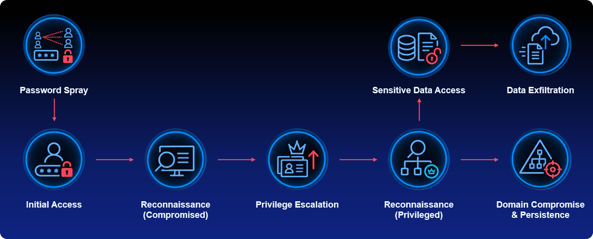

# AS2Go (Attack Scenario to Go)


[](https://deepwiki.com/HerrHozi/AS2Go)
[](https://herrhozi.com)

```Text
Author:          Holger Zimmermann | as2go@mrhozi.com
Current Version: 2026.11.13.1258
Last Update:     2026-11-13
```

AS2Go (**Attack Scenario to Go**) is a PowerShell-based Active Directory attack simulation and training framework designed for demos, workshops, security awareness sessions, and purple team exercises.

The project provides a controlled lab environment that demonstrates how attackers can move through an Active Directory infrastructure by following a realistic cyber kill chain from initial access to full domain compromise.

AS2Go helps security professionals, consultants, and defenders better understand how common weaknesses in Active Directory can be abused in practice, while providing a safe and repeatable environment for learning and demonstrations.

It is designed for:

- Security awareness and blue team training
- Detection engineering and incident response exercises
- Demonstrating Semperis Directory Services Protector (DSP) or Lightning, Microsoft Defender and Sentinel alert behavior
- Repeatable SOC tabletop and hands-on lab sessions

## Project Information

- Author: Holger Zimmermann
- Project: <https://github.com/HerrHozi/AS2Go>
- Blog: <https://herrhozi.com>
- License: MIT

## Important Notice

AS2Go is intended for educational use in isolated, authorized lab environments only.

Do not run this module in production or in any environment you do not own or explicitly control.
You are responsible for legal, policy, and compliance requirements in your organization.

## What AS2Go Demonstrates



AS2Go follows a realistic multi-phase attack chain to generate observable behavior for defenders.
Depending on your setup and enabled phases, the simulation can include:

- Initial account abuse and access attempts
- Reconnaissance activities
- Privilege escalation paths
- Sensitive data access and exfiltration simulation
- Domain compromise and persistence scenarios

The goal is not stealth, but visibility and learning.

## Module Structure

- Public/: Entry points and phase orchestrators
- Core-Functions/: Internal helper and attack action functions
- Tools/: External binaries or dependencies used in lab workflows
- LabSetup/: Optional lab preparation scripts
- CleanUp/: Runtime output and exported artifacts

## Requirements

### Platform

- Windows lab environment
- PowerShell 7.4 or higher
- Active Directory test domain (recommended for full scenario)

### PowerShell Modules

- ActiveDirectory
- GroupPolicy

### External Tools (depending on phase)

- Certify.exe
- Mimikatz.exe
- Rubeus.exe
- NetSess.exe
- PsExec.exe

Note: Tool availability and security controls in your lab influence which actions are executed successfully.

## Installation

### Requirements for the initial AS2Go lab configuration

- Single-domain Active Directory environment
- At least one Domain Controller (DC)
- At least one domain-joined victim machine, such as a server or workstation
- Initial configuration should preferably be executed on the victim machine
- Administrative privileges are required
- Enterprise Admin privileges are recommended for full configuration

### Option 1: Import from local folder

```powershell
Import-Module <PathToModule>\AS2Go.psd1 -Force
```

### Option 2: Install from PSGallery

```powershell
Install-Module -Name AS2Go -Scope AllUsers -Force
Import-Module AS2Go -Force
```

## Quick Start

### Start the demo workflow

```powershell
Start-AS2GoDemo
```

### Useful startup switches

```powershell
# Setup the lab
Initialize-AS2GoLabConfiguration

# Run a Password Spray
Invoke-ASPhase04BruteForceAttack

# Phase Privilege Escalation
Invoke-ASPhase07PrivilegeEscalation

# Last phase Domain Compromise and Persistence
Invoke-ASPhase12DomainCompromisePersistence

# Troubleshooting friendly output
ASP12 -EnableLogging -SkipImages -SkipClearHost
```

## Typical Training Flow

1. Prepare a fresh lab snapshot.
2. Start AS2Go and run one phase at a time.
3. Observe telemetry in Defender/Sentinel/SIEM.
4. Validate detections and enrich incident playbooks.
5. Reset lab and repeat with different switches.

## Public Commands (Examples)

- Start-AS2GoDemo
- Invoke-ASPhase04BruteForceAttack
- Invoke-ASPhase06Reconnaissance
- Invoke-ASPhase07PrivilegeEscalation
- Invoke-ASPhase09ReconnaissancePrivileged
- Invoke-ASPhase10AccessSensitiveData
- Invoke-ASPhase11ExfiltrateSensitiveData
- Invoke-ASPhase12DomainCompromisePersistence

Use Get-Help for command documentation:

```powershell
Get-Help Start-AS2GoDemo -Full
Get-Help Invoke-ASPhase12DomainCompromisePersistence -Full
```

## Logging and Artifacts

AS2Go can produce logs and temporary output files for review and cleanup.

- Use -EnableLogging for verbose execution logging.
- Review generated files in your configured cleanup/output folders.
- Archive artifacts for training evidence and detection tuning history.

## Recommended Safety Practices

- Use isolated virtual networks only.
- Use non-production accounts and data only.
- Snapshot systems before each run.
- Restrict internet egress in the lab if possible.
- Document each run (phase, time, expected alerts, observed alerts).

## Roadmap Ideas

- Additional simulation profiles for different defender maturity levels
- Built-in reporting templates for SOC training outcomes
- Extended cloud/hybrid identity telemetry mappings

## Contributing

Issues and pull requests are welcome.
If you share improvements, include:

- Lab assumptions
- Reproduction steps
- Expected vs. observed behavior
- Sample logs/screenshots (sanitized)

## Acknowledgments

Thanks to the security community and tool authors whose research and utilities support realistic defensive training labs.

## Offline preview

```powershell
Start-AS2GoDemo -Preview
Invoke-ASPhase07PrivilegeEscalation -Preview
Initialize-AS2GoLabConfiguration -Preview
```

Every public function accepts `-Preview`. Preview returns before live initialization,
configuration writes, AD queries or external tools. It does not require domain membership.
The existing module-import initialization is unchanged.

Preview uses a separate numbered navigation menu built from workflow calls and help in
the source files. Choose a step to view its description and child steps; Enter returns
or exits, and `?` displays menu help. Leaf steps show literal planned source commands.
Expressions remain literal and are never executed. Kerberoasting includes an offline
domain-choice prompt and placeholder values for the domain, DC and output location.

`-Preview -UnAttended` prints the reachable workflow without prompting. The live
workflow's technique, continuation and skip parameters are not evaluated in preview:
this is a source browser, not a simulation of runtime conditions or AD results.
The existing `-Simulation` switch retains its original meaning.

Run offline checks with `./Tests/Preview.Tests.ps1`.
